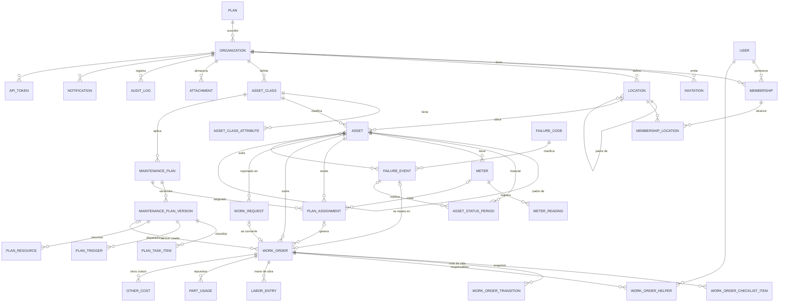

# 03 — Modelo de datos

**Estado:** borrador v0.1 (2026-09-24)

Los nombres de tablas y campos están en inglés (convención de código, ver
`CLAUDE.md`); las descripciones en español. Motor: PostgreSQL 16+.

## 1. Convenciones generales

| Regla | Detalle |
|---|---|
| **Clave primaria** | `id UUID` versión 7 (ordenable por tiempo), generado en la aplicación. Permite que el cliente offline genere IDs (ADR-011) y evita IDs adivinables. |
| **Tenant** | Toda tabla de negocio hereda de `TenantModel` y tiene `organization_id UUID NOT NULL` con FK a `organization`, **también las tablas hijas** (ej. `work_order_checklist_item`). Esto permite RLS sin joins y filtrado uniforme. |
| **Integridad entre tenants** | Las FK entre tablas de negocio se validan en el servicio (mismo `organization_id`). En tablas críticas se agrega FK compuesta `(organization_id, id)` para que la base lo garantice. |
| **Tiempos** | `timestamptz` en UTC. Campos `created_at`, `updated_at` en todas las tablas; `created_by_id` donde aplique. |
| **Borrado** | Sin borrado físico de datos de negocio con historial: `is_active` / estado *de baja* / `cancelled`. Borrado físico solo al eliminar una organización (X-04). |
| **Índices** | Todo índice compuesto de tabla de negocio empieza por `organization_id`. Unicidades de negocio siempre `UNIQUE (organization_id, code)`. |
| **Datos flexibles** | `JSONB` solo para atributos definidos por el cliente y snapshots; nunca para datos sobre los que se calculan KPI. |
| **Idempotencia** | Tablas que reciben escrituras desde móvil/API tienen `client_uuid` opcional con `UNIQUE (organization_id, client_uuid)`. |
| **Montos** | `NUMERIC(14,2)` + moneda de la organización (`CLP` por defecto). |
| **Medidas** | `NUMERIC(14,3)`. |

## 2. Entidades por módulo

### 2.1 Plataforma, organizaciones y usuarios

**`plan`** (catálogo de plataforma, sin tenant)
`code` (basic, pro, enterprise, trial) · `name` · `max_assets` · `max_users` (null = ilimitado) · `max_storage_mb` · `features JSONB` (lista de códigos de módulo) · `is_active`.

**`organization`** (tenant raíz)
`name` · `slug` (único) · `plan_id` · `status` (trial, active, suspended, pending_deletion) · `trial_ends_at` · `timezone` (IANA, ej. `America/Santiago`) · `locale` (`es-CL`) · `currency` · `primary_color` · `logo` (clave de objeto) · `limits_override JSONB` · `settings JSONB` (ej. `require_close_approval`, `anonymous_qr_requests`, `require_mfa`, `planning_horizon_days`, `status_labels`) · `storage_used_bytes BIGINT` · `deletion_requested_at`.

**`organization_feature`** — sobrescribe módulos del plan por organización.
`organization_id` · `feature_code` · `enabled`. `UNIQUE (organization_id, feature_code)`.

**`user`** (global, sin tenant)
`email` (único, login) · `full_name` · `password` (Argon2) · `is_platform_admin` · `locale` · `last_organization_id` · `is_active`.
Tablas de django‑allauth para verificación de correo, MFA y (F3) cuentas SSO.

**`membership`** — relación usuario ↔ organización.
`user_id` · `organization_id` · `role` (admin, planner, supervisor, technician, viewer, external) · `hourly_cost` · `is_active` · `restricted_to_locations` (bool).
`UNIQUE (organization_id, user_id)`.

**`membership_location`** — alcance por sitio (si `restricted_to_locations`).
`organization_id` · `membership_id` · `location_id`. El acceso incluye descendientes.

**`invitation`**
`organization_id` · `email` · `role` · `token_hash` · `invited_by_id` · `expires_at` · `accepted_at` · `revoked_at`.

**`api_token`**
`organization_id` · `name` · `prefix` (visible) · `token_hash` · `scope` (read, write) · `service_user_id` · `created_by_id` · `last_used_at` · `expires_at` · `revoked_at`.
> Implementado como `api.ApiToken` (X-05). El token completo (`gbt_<prefix>_<secreto>`)
> se muestra una sola vez; se guarda su SHA-256 (`UNIQUE`) y el `prefix` (`UNIQUE`).
> En vez de un arreglo de alcances hay un único `scope`: `read` (solo GET) o `write`.
> `service_user_id` (1:1) es un usuario técnico inactivo, sin clave ni membresía
> (`api-<prefix>@api.galbust.invalid`), al que se atribuyen OT, lecturas y la
> auditoría (`actor_type = api_token`). La búsqueda por hash usa `all_tenants`
> porque la organización se deduce del token. Índice `(organization_id, created_at DESC)`.

### 2.2 Ubicaciones

**`location`** — árbol con ruta materializada.
`organization_id` · `parent_id` (null = raíz) · `kind` (site, area, line, other) · `code` · `name` · `timezone` (null = hereda) · `path` (texto, ej. `0001.0003.0002`) · `depth` · `is_active`.
`UNIQUE (organization_id, code)`; índice `(organization_id, path text_pattern_ops)` para consultar descendientes con `LIKE 'path%'`.

### 2.3 Activos y medidores

**`asset_class`**
`organization_id` · `code` · `name` · `iso_category` (ej. rotating, mechanical, electrical, vehicle…) · `level_hint` (equipment, system, component) · `icon` · `is_active` · `source_template_id` (plantilla de origen, informativo).

**`asset_class_attribute`**
`organization_id` · `asset_class_id` · `key` · `label` · `data_type` (text, number, date, bool, choice) · `unit` · `choices JSONB` · `required` · `order` · `is_active`. `UNIQUE (asset_class_id, key)`.

**`asset`**
`organization_id` · `code` · `name` · `asset_class_id` · `location_id` · `parent_id` (jerarquía activo→sistema→componente) · `path` · `depth` · `status` (operational, stopped, in_maintenance, retired) · `criticality` (A, B, C) · `manufacturer` · `model` · `serial_number` · `year` · `in_service_on` (puesta en servicio) · `attributes JSONB` · `qr_token` (aleatorio, único global) · `is_active`.
`UNIQUE (organization_id, code)`; índices `(organization_id, location_id)`, `(organization_id, asset_class_id)`, `(organization_id, status)`, `(organization_id, path text_pattern_ops)`; índice GIN en `attributes` solo si se necesita filtrar por atributos.

**`asset_status_period`** — base de la disponibilidad.
`organization_id` · `asset_id` · `status` · `started_at` · `ended_at` (null = vigente) · `reason` · `work_order_id` · `failure_event_id` · `changed_by_id`.
Restricción: un solo período abierto por activo (índice único parcial `WHERE ended_at IS NULL`). Índice `(organization_id, asset_id, started_at)`.

**`meter`**
`organization_id` · `asset_id` · `kind` (hours, km, cycles, other) · `unit` · `name` · `is_cumulative` · `current_value` · `current_read_at` · `avg_daily_usage` (calculado, para proyecciones) · `is_active`.

**`meter_reading`**
`organization_id` · `meter_id` · `value` · `read_at` · `source` (manual, import, api, work_order) · `is_reset` · `work_order_id` · `created_by_id` · `client_uuid`.
Índice `(meter_id, read_at DESC)`. Diseñada para volumen alto; se podrá particionar por fecha sin cambiar la API.

### 2.4 Mantenimiento preventivo

**`maintenance_plan`** — datos generales; el contenido vive en versiones (ADR-016).
`organization_id` · `code` · `name` · `asset_class_id` (opcional: clase a la que aplica) · `current_version_id` (versión publicada vigente, null si solo hay borrador) · `is_active`.
`UNIQUE (organization_id, code)`. El manager por defecto hace `select_related("current_version")`; al llegar al plan por una relación hay que pedir `select_related("plan__current_version")`.

**`plan_version`** (inmutable una vez publicada)
`organization_id` · `plan_id` · `number` · `status` (draft, published, superseded) · `published_at` · `published_by_id` · `change_note` · `estimated_minutes` · `instructions` · disparadores: `interval_days` · `meter_kind` · `meter_interval` (vence lo que ocurra primero) · `schedule_mode` (floating, fixed) · `tolerance_pct`.
`UNIQUE (organization_id, plan_id, number)`; único parcial `(organization_id, plan_id) WHERE status = 'draft'` (un borrador por plan).
Los disparadores son campos de la versión y no una tabla `plan_trigger`: un plan tiene a lo sumo uno por calendario y uno por medidor (ADR-016).

**`plan_task_item`** — ítems del checklist de una versión (solo editables en borrador).
`organization_id` · `version_id` · `order` · `text` · `item_type` (check, measurement; texto, foto y firma en MVP‑1) · `unit` · `min_value` · `max_value` · `required`.

**`plan_resource`** — repuestos y herramientas previstos (solo editables en borrador).
`organization_id` · `version_id` · `kind` (part, tool) · `description` · `quantity` · `unit`. `part_id` se agrega con inventario (F2).

Pendientes del diseño original: `work_type` del plan, `section` en ítems y
absorción de planes (`supersedes_plans`, PM‑05 CA3).

**`plan_assignment`** — plan aplicado a un activo; aquí vive el estado del programador.
`organization_id` · `plan_id` · `asset_id` · `meter_id` · `starts_on` · `last_done_at` · `last_done_meter_value` · `next_due_at` · `next_due_meter_value` · `open_work_order_id` · `is_active`.
`UNIQUE (organization_id, plan_id, asset_id)`; índices `(organization_id, next_due_at) WHERE is_active`, `(meter_id) WHERE is_active`.

### 2.5 Órdenes de trabajo

**`work_order_sequence`** — correlativos sin huecos por concurrencia.
`organization_id` · `work_type` · `last_number`. Se incrementa con `SELECT … FOR UPDATE` dentro de la transacción que crea la OT.
`UNIQUE (organization_id, work_type)`.

**`work_order`**
`organization_id` · `number` · `code` (ej. `OT-P-000123`, calculado) · `work_type` (preventive, corrective, predictive, improvement, inspection) · `status` · `priority` (1–4) · `title` · `description` · `asset_id` · `location_id` · `plan_assignment_id` · `plan_version_id` · `request_id` · `failure_event_id` · `parent_work_order_id` (correctiva nacida de hallazgo) · `due_at` · `due_meter_value` · `scheduled_for` (fecha) · `estimated_minutes` · `started_at` · `completed_at` · `closed_at` · `closed_by_id` · `meter_value_at_completion` · `completion_notes` · `labor_cost` · `parts_cost` · `other_cost` · `total_cost` · `client_uuid`.
`UNIQUE (organization_id, work_type, number)`; `UNIQUE (organization_id, client_uuid)`; índices `(organization_id, status, due_at)`, `(organization_id, asset_id, completed_at)`, `(organization_id, scheduled_for)`.
Índice único parcial `(plan_assignment_id) WHERE status NOT IN ('closed','cancelled')`: garantiza que no existan dos OT abiertas de la misma asignación.

**`work_order_helper`** — responsables adicionales de la OT (el principal es
`work_order.assigned_to_id`).
`organization_id` · `work_order_id` · `user_id`. `UNIQUE (organization_id, work_order_id, user_id)`.
Se usa `user_id` (no `membership_id` + `is_lead`) igual que `assigned_to`; el
servicio exige que cada usuario tenga membresía activa en la organización.
`asset_id` y `location_id` de la OT son excluyentes: exactamente uno (CHECK).

**`work_order_transition`**
`organization_id` · `work_order_id` · `from_status` · `to_status` · `by_id` · `at` · `comment`.

**`work_order_checklist_item`** — snapshot del ítem del plan + resultado.
`organization_id` · `work_order_id` · `source_item_id` · `order` · `section` · `text` · `item_type` · `unit` · `min_value` · `max_value` · `required` (hasta aquí, copiados) · `result` (ok, not_ok, na) · `value_number` · `value_text` · `note` · `answered_by_id` · `answered_at` · `client_uuid`.

**`labor_entry`**
`organization_id` · `work_order_id` · `membership_id` · `started_at` · `ended_at` · `minutes` · `hourly_cost` (copiado) · `client_uuid`.

**`part_usage`**
`organization_id` · `work_order_id` · `description` · `quantity` · `unit` · `unit_cost` · `part_id` (F2) · `stock_movement_id` (F2) · `client_uuid`.

**`other_cost`**
`organization_id` · `work_order_id` · `description` · `amount` · `supplier`.

### 2.6 Solicitudes y fallas

**`work_request`**
`organization_id` · `number` · `asset_id` · `location_id` · `description` · `asset_stopped` · `status` (new, accepted, rejected, merged) · `requested_by_id` (null si anónima) · `anonymous_name` · `is_anonymous` · `resolved_by_id` · `resolution_note` · `work_order_id` · `merged_into_id` · `client_uuid`.

**`failure_code`** — catálogo estructurado según ISO 14224, contenido propio.
`organization_id` · `kind` (mode, cause, mechanism, detection) · `code` · `name` · `description` · `parent_id` (subcategorías) · `iso_categories` (array: a qué categorías de activo aplica) · `is_active`.
`UNIQUE (organization_id, kind, code)`.

**`failure_event`**
`organization_id` · `asset_id` · `component_id` (activo hijo, opcional) · `failure_mode_id` · `failure_cause_id` · `failure_mechanism_id` · `detection_method_id` · `impact` (total_stop, partial, none) · `started_at` · `ended_at` · `description` · `request_id` · `work_order_id`.
Índice `(organization_id, asset_id, started_at)`.
`asset_id` es obligatorio: la falla (ISO 14224) es de un equipo. Una OT
correctiva sobre una ubicación no registra `failure_event` y no entra en
MTBF/MTTR; si el problema resulta ser de un equipo, la OT se crea sobre él.

### 2.7 Transversales

**`attachment`**
`organization_id` · `target_type` (asset, asset_class, work_order, checklist_item, request, failure, plan_version, organization) · `target_id` · `purpose` (photo, document, manual, signature, logo) · `storage_key` (`org/<org_id>/<yyyy>/<mm>/<uuid>.<ext>`) · `filename` · `content_type` · `size_bytes` · `width` · `height` · `sha256` · `uploaded_by_id` · `client_uuid`.
Índice `(organization_id, target_type, target_id)`. Se usa referencia genérica (`target_type` + `target_id`) y no `GenericForeignKey` de Django, para mantener simple la exportación.

**`document_page`** (M1, AST-06 CA3) — texto extraído de un manual, una fila por página.
`organization_id` · `attachment_id` · `page_number` · `text` · `search_vector` (`tsvector`, configuración `spanish`).
`UNIQUE (attachment_id, page_number)`; índice GIN `(search_vector)`; índice `(organization_id, attachment_id)`. Lo llena el worker al subir el PDF.

**`audit_log`** (solo inserción)
`organization_id` (null = evento de plataforma) · `actor_id` · `actor_type` (user, api_token, system) · `action` (create, update, delete, transition, login, export…) · `object_type` · `object_id` · `object_repr` · `changes JSONB` (antes/después de los campos cambiados) · `ip` · `user_agent` · `request_id` · `at`.
Índices `(organization_id, at DESC)`, `(organization_id, object_type, object_id)`. Candidata a particionarse por mes.
> Implementado como `audit.AuditEvent` (X-01). Diferencias con este diseño:
> `organization_id` es obligatorio porque hereda de `TenantModel`, así que los
> eventos de plataforma (organization_id nulo) quedan pendientes. El login se
> registra en la organización que abre la sesión; si el usuario no tiene
> organización, no se registra. `at` es `created_at`; `object_type` es
> `target_type` (content type). En `changes` nunca se guardan campos sensibles
> (password, secret, token, key). Consulta: `/audit/`, solo para administradores.

**`notification`**
`organization_id` · `recipient_id` · `kind` · `title` · `body` · `url` · `read_at` · `emailed_at`.
Índice `(recipient_id, organization_id, read_at)`.

**`notification_preference`**
`organization_id` · `user_id` · `kind` · `in_app` · `email`.

**`import_job` / `export_job`**
`organization_id` · `kind` · `status` (pending, validating, ready, running, done, failed) · `file_key` · `result_key` · `summary JSONB` (filas OK/errores) · `created_by_id` · `finished_at`.

### 2.8 Plantillas de plataforma (sin tenant)

`template_pack` (por rubro) → `template_asset_class`, `template_attribute`, `template_plan` (+ ítems y disparadores), `template_failure_code`.
Se **copian** a la organización al adoptarlas; nunca se referencian en vivo (un cambio en la plantilla no altera datos del cliente).

### 2.9 Fases posteriores (previstas, no se implementan en MVP)

| Módulo | Tablas | Punto de enganche en el MVP |
|---|---|---|
| Inventario (F2) | `part`, `warehouse`, `stock_item`, `stock_movement`, `reservation` | `part_usage.part_id`, `plan_resource.part_id` se agregará (hoy solo `part_usage.part_id`). |
| Condición (F2) | `measurement_point` (variable de un activo), `measurement` (serie de tiempo, particionada), `condition_rule`, `alert` | `meter` y `meter_reading` son un caso particular; las reglas pueden apuntar a `meter_id` o a `measurement_point_id`. |
| Asistente IA (F2, ADR-018) | `assistant_conversation` (`asset_id`, `work_order_id`, `started_by_id`, `helpful`: yes/partial/no), `assistant_message` (`role`, `content JSONB`, `sources JSONB`, `model`, `input_tokens`, `output_tokens`, `cache_read_tokens`) | `failure_event.description` (síntoma) y `work_order.completion_notes` (acción) capturados desde el MVP; `document_page` desde M1; índices de texto completo sobre OT y fallas cuando se construya. |
| Offline (F2) | `sync_batch` (registro de lotes recibidos) | `client_uuid` en todas las tablas que escribe el técnico. |
| SSO (F3) | tablas de allauth (`socialaccount`, config SAML por organización) | `user` global + `membership`. |
| Facturación (F3) | `subscription`, `invoice` | `organization.plan_id`, cupos. |

## 3. Diagrama ER (núcleo MVP)

> Por legibilidad, el diagrama omite la relación de cada tabla con
> `ORGANIZATION` (todas la tienen).

## 4. Reglas de negocio clave a nivel de datos

1. **Disponibilidad** se calcula solo desde `asset_status_period` (estados
   `stopped` e `in_maintenance` cuentan como no disponible; las detenciones
   programadas se pueden excluir con un filtro).
2. **MTBF / MTTR** se calculan desde `failure_event` con `impact = total_stop`
   y `ended_at` no nulo.
3. **Cumplimiento del preventivo**: OT preventivas con `due_at` en el período;
   cumplida si `completed_at <= due_at + tolerancia`.
4. **Próximo vencimiento** (`plan_assignment`): al cerrar la OT, un servicio
   recalcula `next_due_at` y `next_due_meter_value` según `schedule_mode`; al
   registrar una lectura, un servicio revisa las asignaciones de ese medidor.
5. **Snapshot**: una OT generada desde un plan copia sus ítems al crearse; la
   versión del plan nunca se edita después de publicada.
