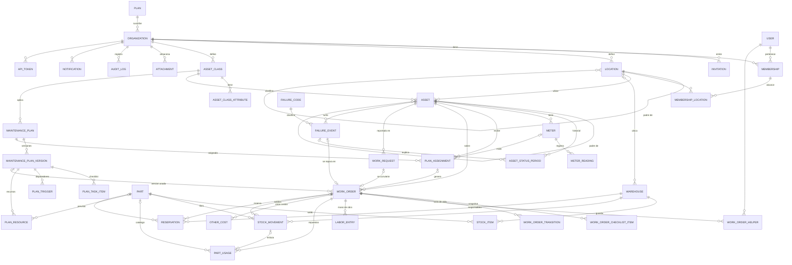

# 03 — Modelo de datos

**Estado:** borrador v0.1 (2026-09-24)

Los nombres de tablas y campos están en inglés (convención de código, ver
`CLAUDE.md`); las descripciones en español. Motor: PostgreSQL 16+.

## 1. Convenciones generales

| Regla | Detalle |
|---|---|
| **Clave primaria** | `id UUID` versión 7 (ordenable por tiempo), generado en la aplicación. Permite que el cliente offline genere IDs (ADR-011) y evita IDs adivinables. |
| **Tenant** | Toda tabla de negocio hereda de `TenantModel` y tiene `organization_id UUID NOT NULL` con FK a `organization`, **también las tablas hijas** (ej. `work_order_checklist_item`). Esto permite RLS sin joins y filtrado uniforme. |
| **Integridad entre tenants** | Las FK entre tablas de negocio se validan en el servicio (mismo `organization_id`). En tablas críticas se agrega FK compuesta `(organization_id, id)` para que la base lo garantice. |
| **Tiempos** | `timestamptz` en UTC. Campos `created_at`, `updated_at` en todas las tablas; `created_by_id` donde aplique. |
| **Borrado** | Sin borrado físico de datos de negocio con historial: `is_active` / estado *de baja* / `cancelled`. Borrado físico solo al eliminar una organización (X-04). |
| **Índices** | Todo índice compuesto de tabla de negocio empieza por `organization_id`. Unicidades de negocio siempre `UNIQUE (organization_id, code)`. |
| **Datos flexibles** | `JSONB` solo para atributos definidos por el cliente y snapshots; nunca para datos sobre los que se calculan KPI. |
| **Idempotencia** | Tablas que reciben escrituras desde móvil/API tienen `client_uuid` opcional con `UNIQUE (organization_id, client_uuid)`. |
| **Montos** | `NUMERIC(14,2)` + moneda de la organización (`CLP` por defecto). |
| **Medidas** | `NUMERIC(14,3)`. |

## 2. Entidades por módulo

### 2.1 Plataforma, organizaciones y usuarios

**`plan`** (catálogo de plataforma, sin tenant)
`code` (basic, pro, enterprise, trial) · `name` · `max_assets` · `max_users` (null = ilimitado) · `max_storage_mb` · `features JSONB` (lista de códigos de módulo) · `is_active`.
Inventario (F2): una migración de datos agrega el módulo `inventory` a los planes Prueba, Profesional y Empresa (y a `plans.DEFAULT_PLANS`); Básico no lo incluye.
Condición (F2, CBM-08): igual con el módulo `condition` (Prueba, Profesional y Empresa; Básico no).
Roles personalizados (F3, ORG-12): módulo `custom_roles` en Profesional y Empresa (migración de datos `organizations/0018`).
Asistente IA (F2, AI-05): `max_assistant_conversations` (conversaciones nuevas por mes calendario en la zona de la organización; null = sin límite) y módulo `assistant` solo en Profesional (100) y Empresa (500); la migración de datos `organizations/0017` los fija en los planes existentes sin pisar un cupo ya editado.

**`organization`** (tenant raíz)
`name` · `slug` (único) · `plan_id` · `status` (trial, active, suspended, pending_deletion, deleted) · `trial_ends_at` · `timezone` (IANA, ej. `America/Santiago`) · `locale` (`es-CL`) · `currency` · `primary_color` (#RRGGBB o vacío, ORG-09) · `mfa_policy` (admins_only, everyone, optional; ORG-08) · `logo` (clave de objeto) · `allow_anonymous_reports` (aviso por QR sin cuenta, REQ-02; columna propia, apagado por defecto) · `limits_override JSONB` · `settings JSONB` (ej. `require_close_approval`, `planning_horizon_days`, `status_labels`) · `storage_used_bytes BIGINT` · `deletion_requested_at` · `deletion_scheduled_for` · `deletion_requested_by_id` · `deleted_at` · `purge_summary JSONB` (borrado X-04: tras la purga la fila queda como lápida anonimizada, ADR-027).

**`data_export`** (X-03) — exportación completa de la organización.
`organization_id` · `requested_by_id` · `status` (pending, ready, failed, expired) · `file` (`org/<org_id>/exports/<uuid>.zip`) · `size_bytes` · `finished_at` · `expires_at` (7 días) · `error`. Índice `(organization_id, created_at DESC)`.

**`organization_feature`** — sobrescribe módulos del plan por organización.
`organization_id` · `feature_code` · `enabled`. `UNIQUE (organization_id, feature_code)`.

**`user`** (global, sin tenant)
`email` (único, login) · `full_name` · `password` (Argon2) · `is_platform_admin` · `locale` · `last_organization_id` · `is_active`.
Tablas de django‑allauth para verificación de correo y MFA. El SSO (ORG-11) no usa `socialaccount`: tiene sus tablas propias (`sso_configuration`, `sso_domain`, más abajo) y un usuario creado por SSO no tiene contraseña utilizable.

**`membership`** — relación usuario ↔ organización.
`user_id` · `organization_id` · `role` (admin, planner, supervisor, technician, viewer, external; con rol personalizado es su rol base) · `custom_role_id` (null; FK PROTECT a `custom_role` de la misma organización, ORG-12) · `hourly_cost` · `is_active` · `restricted_to_locations` (bool) · `weekly_capacity_hours` (decimal, por defecto 40; capacidad para el backlog en semanas y la carga del tablero semanal, REQ-04/05; solo cuenta en técnicos).
`UNIQUE (organization_id, user_id)`.

**`custom_role`** (ORG-12, ADR-031) — rol personalizado.
`organization_id` · `name` · `base_role` (planner, supervisor, technician, viewer, external; nunca admin) · `permissions JSONB` (lista de códigos de `Perm`, sin los de administración) · `is_active`.
`UNIQUE (organization_id, lower(name))`. Sin borrado físico: se desactiva cuando nadie activo ni una invitación pendiente lo usa. `membership` e `invitation` no son tablas de tenant: el modelo valida al guardar que `custom_role_id` sea de su misma organización.

**`sso_configuration`** (ORG-11, ADR-032) — proveedor OIDC de la organización (una por organización).
`organization_id` · `discovery_url` (https, termina en `/.well-known/openid-configuration`) · `client_id` · `client_secret_encrypted` (Fernet con `SSO_SECRET_KEY`; nunca se muestra, ni va a la auditoría ni a la exportación X-03, que omiten campos `secret`) · `default_role` (planner, supervisor, technician, viewer, external; nunca admin) · `default_custom_role_id` (null; FK PROTECT a `custom_role`, ORG-12) · `enforce_sso` · `is_active` · `provider_metadata JSONB` (emisor y endpoints del descubrimiento) · `metadata_fetched_at` · `last_tested_at` · `last_test_ok` · `last_test_error`.
`UNIQUE (organization_id)`. Implementado como `sso.SsoConfiguration`.

**`sso_domain`** (ORG-11) — dominio de correo de la organización.
`organization_id` · `domain` (minúsculas, IDNA) · `verification_token` (va en el TXT `_galbust-verification.<dominio>` = `galbust-domain-verification=<token>`) · `verified_at` · `last_checked_at`.
`UNIQUE (organization_id, domain)` y `UNIQUE (domain) WHERE verified_at IS NOT NULL`: pendiente lo pueden reclamar varias, verificado es de una sola en toda la plataforma. El ingreso lo busca por dominio con `all_tenants` (antes de conocer la organización). Es configuración: quitarlo lo borra (auditado). Implementado como `sso.SsoDomain`.

**`membership_location`** — alcance por sitio (si `restricted_to_locations`).
`organization_id` · `membership_id` · `location_id`. El acceso incluye descendientes.

**`invitation`**
`organization_id` · `email` · `role` · `custom_role_id` (null, ORG-12) · `token_hash` · `invited_by_id` · `expires_at` · `accepted_at` · `revoked_at`.

**`pending_signup`** (plataforma, sin tenant; ORG-02) — autoregistro esperando la verificación del correo.
`email` · `full_name` · `organization_name` · `password_hash` · `token_hash` · `expires_at` (2 días) · `completed_at`. Al confirmar se crean usuario, organización y membresía y se borra el hash de la contraseña.

**`onboarding_state`** (ORG-03) — avance del asistente de puesta en marcha, uno por organización.
`organization_id` · `current_step` (industry, locations, assets, plans, readings, calendar) · `completed_steps` (JSON) · `skipped_steps` (JSON) · `industry` · `started_at` · `finished_at` · `dismissed_at`.
`UNIQUE (organization_id)`. Se crea al confirmar el autoregistro con `started_at` vacío (el inicio lleva al asistente) o al abrirlo desde Configuración. Implementado como `onboarding.OnboardingState`.

**`api_token`**
`organization_id` · `name` · `prefix` (visible) · `token_hash` · `scope` (read, write) · `service_user_id` · `created_by_id` · `last_used_at` · `expires_at` · `revoked_at`.
> Implementado como `api.ApiToken` (X-05). El token completo (`gbt_<prefix>_<secreto>`)
> se muestra una sola vez; se guarda su SHA-256 (`UNIQUE`) y el `prefix` (`UNIQUE`).
> En vez de un arreglo de alcances hay un único `scope`: `read` (solo GET) o `write`.
> `service_user_id` (1:1) es un usuario técnico inactivo, sin clave ni membresía
> (`api-<prefix>@api.galbust.invalid`), al que se atribuyen OT, lecturas y la
> auditoría (`actor_type = api_token`). La búsqueda por hash usa `all_tenants`
> porque la organización se deduce del token. Índice `(organization_id, created_at DESC)`.

### 2.2 Ubicaciones

**`location`** — árbol con ruta materializada.
`organization_id` · `parent_id` (null = raíz) · `kind` (site, area, line, other) · `code` · `name` · `timezone` (null = hereda) · `path` (texto, ej. `0001.0003.0002`) · `depth` · `is_active`.
`UNIQUE (organization_id, code)`; índice `(organization_id, path text_pattern_ops)` para consultar descendientes con `LIKE 'path%'`.

### 2.3 Activos y medidores

**`asset_class`**
`organization_id` · `code` · `name` · `iso_category` (ej. rotating, mechanical, electrical, vehicle…) · `level_hint` (equipment, system, component) · `icon` · `is_active` · `source_template_id` (plantilla de origen, informativo).

**`asset_class_attribute`**
`organization_id` · `asset_class_id` · `key` · `label` · `data_type` (text, number, date, bool, choice) · `unit` · `choices JSONB` · `required` · `order` · `is_active`. `UNIQUE (asset_class_id, key)`.

**`asset`**
`organization_id` · `code` · `name` · `asset_class_id` · `location_id` · `parent_id` (jerarquía activo→sistema→componente) · `path` · `depth` · `status` (operational, stopped, in_maintenance, retired) · `criticality` (A, B, C) · `manufacturer` · `model` · `serial_number` · `year` · `in_service_on` (puesta en servicio) · `attributes JSONB` · `qr_token` (aleatorio, único global) · `is_active`.
`UNIQUE (organization_id, code)`; índices `(organization_id, location_id)`, `(organization_id, asset_class_id)`, `(organization_id, status)`, `(organization_id, path text_pattern_ops)`; índice GIN en `attributes` solo si se necesita filtrar por atributos.

**`asset_status_period`** — base de la disponibilidad.
`organization_id` · `asset_id` · `status` · `started_at` · `ended_at` (null = vigente) · `reason` · `work_order_id` · `failure_event_id` · `changed_by_id`.
Restricción: un solo período abierto por activo (índice único parcial `WHERE ended_at IS NULL`). Índice `(organization_id, asset_id, started_at)`.

**`meter`**
`organization_id` · `asset_id` · `kind` (hours, km, cycles, other) · `unit` · `name` · `is_cumulative` · `current_value` · `current_read_at` · `avg_daily_usage` (calculado, para proyecciones) · `is_active`.
Condición (F2, §2.11, ADR-029): `kind` suma los tipos variable `temperature`, `vibration`, `pressure`, `current` y `variable` (siempre `is_cumulative = false`, admiten valores negativos) y pasa a 20 caracteres (`temperature` tiene 11). `UNIQUE (asset_id, kind, name)` (`uniq_meter_per_asset`) es la clave de una variable en un activo.

**`meter_reading`**
`organization_id` · `meter_id` · `value` · `read_at` · `source` (manual, import, api, work_order) · `is_reset` · `work_order_id` · `created_by_id` · `client_uuid`.
Índice `(meter_id, read_at DESC)`. Diseñada para volumen alto; se podrá particionar por fecha sin cambiar la API.

### 2.4 Mantenimiento preventivo

**`maintenance_plan`** — datos generales; el contenido vive en versiones (ADR-016).
`organization_id` · `code` · `name` · `asset_class_id` (opcional: clase a la que aplica) · `current_version_id` (versión publicada vigente, null si solo hay borrador) · `is_active`.
`UNIQUE (organization_id, code)`. El manager por defecto hace `select_related("current_version")`; al llegar al plan por una relación hay que pedir `select_related("plan__current_version")`.

**`plan_version`** (inmutable una vez publicada)
`organization_id` · `plan_id` · `number` · `status` (draft, published, superseded) · `published_at` · `published_by_id` · `change_note` · `estimated_minutes` · `instructions` · disparadores: `calendar_interval` + `calendar_unit` (days, weeks, months; meses de calendario, mismo día ajustado a fin de mes) · `meter_kind` · `meter_interval` (vence lo que ocurra primero) · `schedule_mode` (floating, fixed) · `tolerance_pct`.
`UNIQUE (organization_id, plan_id, number)`; único parcial `(organization_id, plan_id) WHERE status = 'draft'` (un borrador por plan).
Los disparadores son campos de la versión y no una tabla `plan_trigger`: un plan tiene a lo sumo uno por calendario y uno por medidor (ADR-016).

**`plan_task_item`** — ítems del checklist de una versión (solo editables en borrador).
`organization_id` · `version_id` · `order` · `text` · `item_type` (check, measurement, text, photo = foto obligatoria, signature = firma por ítem) · `unit` · `min_value` · `max_value` · `required`.
Condición (F2, §2.11, CBM-06): `meter_kind` (20, vacío) y `meter_name` (80, vacío), solo en ítems `measurement` y solo con tipos variable: enlazan el ítem con la variable `(kind, name)` del activo; `ITEM_FIELDS` los incluye (un borrador nuevo los copia).

**`plan_resource`** — repuestos y herramientas previstos (solo editables en borrador).
`organization_id` · `version_id` · `kind` (part, tool) · `description` · `quantity` · `unit`. `part_id` se agrega con inventario (F2).
Inventario (F2, §2.10): `part_id` FK a `part` null, PROTECT; `RESOURCE_FIELDS` incluye `part` (un borrador nuevo lo copia). Excepción acotada al ADR-016: en una versión publicada, un recurso con `part_id` vacío se puede enlazar una sola vez (vacío → repuesto; nunca cambiar ni quitar), INV-11.

**`plan_absorption`** — «el plan mayor absorbe al menor» (PM‑05 CA3); dato del plan, no de la versión.
`organization_id` · `plan_id` (mayor) · `absorbed_plan_id` (menor). `UNIQUE (organization_id, plan_id, absorbed_plan_id)`; CHECK `plan_id <> absorbed_plan_id`; el servicio rechaza ciclos.
Regla: al generar la OT del mayor en un activo, un menor del mismo activo sin OT abierta se absorbe si vence a más tardar en el vencimiento del mayor + su tolerancia (`tolerance_pct` del mayor sobre su ciclo por calendario, en días; o sobre `meter_interval` si comparten medidor).

**`maintenance_settings`** — ajustes del programador, uno por organización (se crea al guardarlo).
`organization_id` · `horizon_days` (1–90, por defecto 14). `UNIQUE (organization_id)`.

Pendiente del diseño original: `work_type` del plan.

**`plan_assignment`** — plan aplicado a un activo; aquí vive el estado del programador.
`organization_id` · `plan_id` · `asset_id` · `meter_id` · `starts_on` · `anchor_day` · `last_done_at` · `last_done_meter_value` · `next_due_at` · `next_due_meter_value` · `open_work_order_id` · `is_active`.
`anchor_day` (1–31): día del mes del primer vencimiento; en modo fijo por meses cada vencimiento vuelve a ese día aunque el anterior se haya ajustado a un mes corto (31‑ene → 28/29‑feb → 31‑mar). Lo usan por igual el generador de OT y la proyección del calendario (`scheduling.next_fixed_date`).
`UNIQUE (organization_id, plan_id, asset_id)`; índices `(organization_id, next_due_at) WHERE is_active`, `(meter_id) WHERE is_active`.

### 2.5 Órdenes de trabajo

**`work_order_sequence`** — correlativos sin huecos por concurrencia.
`organization_id` · `work_type` · `last_number`. Se incrementa con `SELECT … FOR UPDATE` dentro de la transacción que crea la OT.
`UNIQUE (organization_id, work_type)`.

**`work_order`**
`organization_id` · `number` · `code` (ej. `OT-P-000123`, calculado) · `work_type` (preventive, corrective, predictive, improvement, inspection) · `status` · `priority` (1–4) · `title` · `description` · `asset_id` · `location_id` · `plan_assignment_id` · `plan_version_id` · `request_id` · `failure_event_id` · `parent_work_order_id` + `source_checklist_item_id` (correctiva nacida de un ítem No OK, WO‑06) · `due_at` · `due_meter_value` · `scheduled_for` (fecha; la fija la programación semanal, REQ-05, y se borra al volver a `planned`) · `estimated_minutes` · `started_at` · `completed_at` · `closed_at` · `closed_by_id` · `meter_value_at_completion` · `completion_notes` · `labor_cost` · `parts_cost` · `other_cost` · `total_cost` · `client_uuid`.
`UNIQUE (organization_id, work_type, number)`; `UNIQUE (organization_id, client_uuid)`; índices `(organization_id, status, due_at)`, `(organization_id, asset_id, completed_at)`, `(organization_id, scheduled_for)`.
Índice único parcial `(plan_assignment_id) WHERE status NOT IN ('closed','cancelled')`: garantiza que no existan dos OT abiertas de la misma asignación.

**`work_order_helper`** — responsables adicionales de la OT (el principal es
`work_order.assigned_to_id`).
`organization_id` · `work_order_id` · `user_id`. `UNIQUE (organization_id, work_order_id, user_id)`.
Se usa `user_id` (no `membership_id` + `is_lead`) igual que `assigned_to`; el
servicio exige que cada usuario tenga membresía activa en la organización.
`asset_id` y `location_id` de la OT son excluyentes: exactamente uno (CHECK).

**`work_order_absorption`** — asignaciones de planes menores absorbidas por la OT (PM‑05 CA3).
`organization_id` · `work_order_id` · `plan_assignment_id` · `plan_version_id` (PROTECT, versión cuyo checklist se copió). `UNIQUE (organization_id, work_order_id, plan_assignment_id)`. Mientras la OT esté abierta la asignación no genera otra OT; al cerrarla se reprograma igual que la principal.

**`work_order_transition`**
`organization_id` · `work_order_id` · `from_status` · `to_status` · `by_id` · `at` · `comment`.

**`work_order_checklist_item`** — snapshot del ítem del plan + resultado.
`organization_id` · `work_order_id` · `source_item_id` · `order` · `section` · `text` · `item_type` · `unit` · `min_value` · `max_value` · `required` (hasta aquí, copiados; `section` = nombre del plan cuando la OT reúne varios checklists) · `result` (ok, not_ok, na; done para texto, foto obligatoria y firma) · `value_number` · `value_text` · `note` · `answered_by_id` · `answered_at` · `client_uuid`.
Condición (F2, §2.11, CBM-06): `meter_kind` y `meter_name` (copiados del ítem del plan) y `meter_reading_id` (OneToOne a `meter_reading`, null, PROTECT): la lectura registrada al completar la OT; si ya existe no se registra otra (idempotente).

**`labor_entry`**
`organization_id` · `work_order_id` · `membership_id` · `started_at` · `ended_at` · `minutes` · `hourly_cost` (copiado) · `client_uuid`.
`UNIQUE (organization_id, client_uuid)` (implementado): reenviar horas desde el modo sin conexión (X-06) no las duplica. Hoy se guarda la persona (`user_id`) y solo `minutes`; inicio y fin explícitos quedan fuera de v1.

**`part_usage`**
`organization_id` · `work_order_id` · `description` · `quantity` · `unit` · `unit_cost` · `part_id` (F2) · `stock_movement_id` (F2) · `client_uuid`.
Inventario (F2, §2.10, INV-09): `part_id` FK a `part` null, PROTECT; `stock_movement_id` OneToOne a `stock_movement` null, PROTECT (la salida `issue`); índice `(organization_id, part_id) WHERE part_id IS NOT NULL`. Sin migración de datos: las líneas de texto libre previas quedan con `part_id` vacío. Con repuesto del catálogo, `description` = «código · nombre», `unit` del repuesto y `unit_cost` = promedio vigente al consumir; `client_uuid` se copia al movimiento.

**`other_cost`**
`organization_id` · `work_order_id` · `description` · `amount` · `supplier`.

### 2.6 Solicitudes y fallas

**`work_request`**
`organization_id` · `number` · `asset_id` · `location_id` · `description` · `asset_stopped` · `status` (new, accepted, rejected, merged) · `requested_by_id` (null si anónima) · `anonymous_name` · `is_anonymous` · `resolved_by_id` · `resolution_note` · `work_order_id` · `merged_into_id` · `client_uuid`.
Una solicitud anónima (REQ-02) no tiene OT hasta que se acepta; su foto es un `attachment` con `target_type = work_request`, y al aceptarla pasa a la OT nueva (`target_type = work_order`).

**`failure_code`** — catálogo estructurado según ISO 14224, contenido propio.
`organization_id` · `kind` (mode, cause, mechanism, detection) · `code` · `name` · `description` · `parent_id` (subcategorías) · `iso_categories` (array: a qué categorías de activo aplica) · `is_active`.
`UNIQUE (organization_id, kind, code)`.

**`failure_event`**
`organization_id` · `asset_id` · `component_id` (activo hijo, opcional) · `failure_mode_id` · `failure_cause_id` · `failure_mechanism_id` · `detection_method_id` · `impact` (total_stop, partial, none) · `started_at` · `ended_at` · `description` · `request_id` · `work_order_id`.
Índice `(organization_id, asset_id, started_at)`.
`asset_id` es obligatorio: la falla (ISO 14224) es de un equipo. Una OT
correctiva sobre una ubicación no registra `failure_event` y no entra en
MTBF/MTTR; si el problema resulta ser de un equipo, la OT se crea sobre él.

### 2.7 Transversales

**`attachment`**
`organization_id` · `target_type` (asset, asset_class, work_order, checklist_item, work_request, assistant_message) · `target_id` · `purpose` (photo, document, manual, signature; el logo es `organization.logo`, no un adjunto) · `storage_key` (campo `file`: `org/<org_id>/<uuid>.<ext>`) · `filename` · `content_type` · `size_bytes` · `width` · `height` · `sha256` · `uploaded_by_id` · `client_uuid`.
Índice `(organization_id, target_type, target_id)`. Se usa referencia genérica (`target_type` + `target_id`) y no `GenericForeignKey` de Django, para mantener simple la exportación.

**`document_page`** (M1, AST-06 CA3) — texto extraído de un manual, una fila por página.
`organization_id` · `attachment_id` · `page_number` · `text` · `search_vector` (`tsvector`, configuración `spanish`).
`UNIQUE (attachment_id, page_number)`; índice GIN `(search_vector)`; índice `(organization_id, attachment_id)`. Lo llena el worker al subir el PDF.
> Implementado como `attachments.DocumentPage` (tenant model). Diferencias con este diseño:
> sin columna `search_vector` ni índice GIN por ahora: la búsqueda (`/manuals/search/`) calcula
> `to_tsvector('spanish', text)` al consultar (volumen bajo por organización) y en SQLite cae a
> `icontains`; el índice GIN de expresión se agrega cuando el volumen lo pida. Unicidad
> `(organization_id, attachment_id, page_number)`. Solo se guardan páginas con texto (máx. 500
> por PDF). El manual es un `attachment` con `purpose = manual` y `target_type` asset o
> asset_class, más `text_status` (pending, done, no_text para escaneados, failed) y `page_count`.
> Quitar un manual lo borra con sus páginas (es material de consulta, no historial) y queda en
> la auditoría.

**`audit_log`** (solo inserción)
`organization_id` (null = evento de plataforma) · `actor_id` · `actor_type` (user, api_token, system) · `action` (create, update, delete, transition, login, export…) · `object_type` · `object_id` · `object_repr` · `changes JSONB` (antes/después de los campos cambiados) · `ip` · `user_agent` · `request_id` · `at`.
Índices `(organization_id, at DESC)`, `(organization_id, object_type, object_id)`. Candidata a particionarse por mes.
> Implementado como `audit.AuditEvent` (X-01). Diferencias con este diseño:
> `organization_id` es obligatorio porque hereda de `TenantModel`, así que los
> eventos de plataforma (organization_id nulo) quedan pendientes. El login se
> registra en la organización que abre la sesión; si el usuario no tiene
> organización, no se registra. `at` es `created_at`; `object_type` es
> `target_type` (content type). En `changes` nunca se guardan campos sensibles
> (password, secret, token, key). Consulta: `/audit/`, solo para administradores.
> Acciones además de las genéricas: `assign`, `checklist_edit`, `checklist_answer`
> (respuesta sobrescrita con antes/después, o descartada por llegar con
> `answered_at` anterior a la vigente; X-06), `cost_add`,
> `cost_remove`, `complete`, `close` (OT); `invite`, `invite_revoke`,
> `invite_accept`, `role_change`, `deactivate`, `reactivate` (equipo);
> `revoke` (tokens de API). Las decisiones sobre solicitudes son `transition`.
> Inventario (F2, INV-14) agrega `stock_receive`, `stock_adjust`,
> `stock_transfer`, `stock_issue`, `stock_return`, `reserve` y `release`.

**`notification`** (X-02)
`organization_id` · `recipient_id` · `kind` (wo_assigned, wo_scheduled, wo_due_soon, wo_overdue, request_new, request_resolved) · `title` · `body` · `url` · `work_order_id` · `work_request_id` · `in_app` · `dedupe_key` · `read_at`.
Índices `(organization_id, recipient_id, read_at)` (contador de la campana) y `(organization_id, recipient_id, created_at DESC)` (bandeja). `UNIQUE (organization_id, recipient_id, dedupe_key)` si `dedupe_key` no es vacío: el aviso diario de vencimiento usa `<kind>:<work_order_id>:<fecha>`, así que se envía una vez por OT, persona y día.
Inventario (F2, INV-12) agrega `kind = stock_low` (`dedupe_key` `stock_low:<stock_item_id>:<fecha>`).
Condición (F2, CBM-05) agrega `kind = condition_alert` (`dedupe_key` `condition_alert:<condition_alert_id>`: un aviso por alerta y persona).
> Implementado como `notifications.Notification`. Diferencias: no hay
> `emailed_at`; una fila con `in_app = false` registra un aviso que solo salió
> por correo (no aparece en la bandeja, pero evita repetir el envío). El
> título y el detalle se guardan ya traducidos al crearse.

**`notification_preference`**
`organization_id` · `user_id` · `kind` · `in_app` · `email`. `UNIQUE (organization_id, user_id, kind)`. Sin fila, ambos canales activos.

**`import_job` / `export_job`**
`organization_id` · `kind` · `status` (pending, validating, ready, running, done, failed) · `file_key` · `result_key` · `summary JSONB` (filas OK/errores) · `created_by_id` · `finished_at`.

### 2.8 Plantillas de plataforma (sin tenant)

`template_pack` (por rubro) → `template_asset_class`, `template_attribute`, `template_plan` (+ ítems y disparadores), `template_failure_code`.
Se **copian** a la organización al adoptarlas; nunca se referencian en vivo (un cambio en la plantilla no altera datos del cliente).

### 2.9 Fases posteriores (previstas, no se implementan en MVP)

| Módulo | Tablas | Punto de enganche en el MVP |
|---|---|---|
| Condición (F2, implementado; §2.11, ADR-029) | Medidores (`meter`) con tipos variable (temperature, vibration, pressure, current, variable) y sus `meter_reading`; `condition_rule`, `condition_state`, `condition_alert`. Ya no `measurement_point`/`measurement`. | `meter` y `meter_reading` existentes (lecturas, CSV, API bulk, cierre de OT, terreno); `work_order.work_type = predictive`. |
| Asistente IA (F2, implementado; §2.12, ADR-018) | `assistant_conversation`, `assistant_message`. | `failure_event.description` (síntoma) y `work_order.completion_notes` (acción) capturados desde el MVP; `document_page` desde M1; búsqueda de texto completo calculada al consultar (sin índices GIN en v1). |
| Offline (F2) | `sync_batch` (registro de lotes recibidos) | `client_uuid` en todas las tablas que escribe el técnico. |
| SSO (F3, OIDC implementado; §2.1, ADR-032) | `sso_configuration`, `sso_domain` (sin `socialaccount`). SAML fuera de v1. | `user` global + `membership`. |
| Facturación (F3) | `subscription`, `invoice` | `organization.plan_id`, cupos. |

El inventario (F2) dejó esta tabla: está hecho (2026-10) y su modelo está en §2.10.

### 2.10 Inventario y repuestos (F2, hecho)

App nueva `apps/inventory` (ADR-028); todas las tablas heredan de
`TenantModel`. Requisitos INV-01..INV-17 en [02_requisitos.md](02_requisitos.md) §6.
Cantidades `NUMERIC(14,3)`; montos `NUMERIC(14,2)`; costos unitarios y
promedio `NUMERIC(18,4)`.

**`part`** (INV-01) — repuesto del catálogo.
`organization_id` · `code` (40) · `name` (200) · `description` · `unit` (20, por defecto "un") · `category` (80, texto con sugerencias) · `manufacturer` (120) · `manufacturer_ref` (80) · `supplier` (150) · `notes` · `avg_cost` (18,4, por defecto 0; costo promedio ponderado por repuesto en la organización, INV-08) · `last_cost` (18,4, null) · `last_received_at` · `is_active` · `created_by_id`.
`UNIQUE (organization_id, UPPER(code))` (`uniq_part_code_ci`; el servicio además compara con `code__iexact`); CHECK `avg_cost >= 0`. Índices `(organization_id, is_active, name)`, `(organization_id, category)`. No se borra: se desactiva.

**`warehouse`** (INV-03) — bodega.
`organization_id` · `code` (20) · `name` (120) · `location_id` (null, PROTECT; cualquier nodo) · `is_default` · `is_active` · `notes`.
`UNIQUE (organization_id, UPPER(code))`; único parcial `(organization_id) WHERE is_default`; CHECK `NOT (is_default AND NOT is_active)`. Índice `(organization_id, location_id)`. "Bodega principal" (`BOD`) se crea sola al primer uso (`ensure_default_warehouse`).

**`stock_item`** (INV-04) — saldo materializado por repuesto y bodega.
`organization_id` · `part_id` (PROTECT) · `warehouse_id` (PROTECT) · `on_hand` (14,3; puede ser negativo) · `reserved` (14,3, ≥ 0) · `min_quantity` (14,3, por defecto 0) · `target_quantity` (14,3, null) · `bin_location` (40) · `last_movement_at`.
`UNIQUE (organization_id, part_id, warehouse_id)`; CHECK `reserved >= 0`, `min_quantity >= 0`, `target_quantity IS NULL OR target_quantity >= min_quantity`. Índices `(organization_id, warehouse_id)`, `(organization_id, part_id)`. Se crea al primer movimiento, reserva o mínimo (`get_or_create` bajo el bloqueo del repuesto). Disponible = `on_hand − reserved`. Es un caché transaccional: el libro manda.

**`stock_movement`** (INV-05..INV-09, INV-14) — libro inmutable.
`organization_id` · `part_id` · `warehouse_id` (PROTECT) · `kind` (receipt, issue, return, adjustment, transfer_out, transfer_in) · `reason` ("", count, import, initial, reconcile) · `quantity` (14,3, con signo) · `unit_cost` (18,4, costo aplicado) · `total_cost` (14,2 = round(q × c)) · `avg_cost_after` (18,4) · `on_hand_after` (14,3, de esa bodega) · `work_order_id` (null, PROTECT) · `reverses_id` (FK a sí misma, null; devolución → salida) · `transfer_group` (uuid, null) · `reference` (60, documento) · `supplier` (150) · `note` (500) · `occurred_at` (fecha real, acotada con `work.services.client_time`) · `created_by_id` · `client_uuid`.
CHECK `quantity <> 0`; signo según `kind` (receipt, return, transfer_in > 0; issue, transfer_out < 0; adjustment cualquiera); CHECK `kind <> 'issue' OR work_order_id IS NOT NULL`; `UNIQUE (organization_id, client_uuid)`. Índices `(organization_id, part_id, occurred_at DESC)`, `(organization_id, warehouse_id, occurred_at DESC)`, `(organization_id, work_order_id) WHERE work_order_id IS NOT NULL`, `(organization_id, kind, occurred_at)`.
Inmutable: `save()` lanza `ImmutableMovementError` si no es alta y `delete()` siempre; admin solo lectura; los errores se corrigen con un movimiento contrario. La purga (ADR-027) usa `_raw_delete`. Sin trigger SQL. En una transferencia, `client_uuid` va solo en `transfer_out`.

**`reservation`** (INV-10) — repuesto previsto para una OT.
`organization_id` · `work_order_id` (PROTECT) · `part_id` · `warehouse_id` · `quantity` (14,3, > 0) · `consumed_quantity` (14,3, por defecto 0) · `status` (active, fulfilled, released) · `source` (plan, manual) · `plan_resource_id` (null, SET_NULL) · `release_reason` ("", closed, cancelled, manual) · `released_at` · `created_by_id` (null = sistema).
Único parcial `(organization_id, work_order_id, part_id) WHERE status = 'active'`. Índices `(organization_id, work_order_id)`, `(organization_id, part_id, status)`. Pendiente = max(`quantity − consumed_quantity`, 0). Invariante: `stock_item.reserved` = Σ pendientes de las reservas activas de ese repuesto y bodega.

**Cambios en tablas existentes:** `part_usage.part_id` y `part_usage.stock_movement_id` (§2.5), `plan_resource.part_id` (§2.4), `notification.kind = stock_low` (§2.7), módulo `inventory` en `plan.features` (§2.1) y acciones de auditoría nuevas (§2.7).

**Orden de migraciones:** `inventory/0001` (part, warehouse, stock_item; depende de organizations) → `inventory/0002` (stock_movement, reservation; depende de la última de work y de maintenance) → `work/00NN` (`part_usage.part`, `stock_movement`; depende de `inventory/0002`) → `maintenance/00NN` (`plan_resource.part`; depende de `inventory/0001`).

**Concurrencia** (todo en `transaction.atomic`): 1) `_lock_parts(part_ids)` con `select_for_update` en orden de pk (primero el repuesto); 2) `select_for_update` de `stock_item` en orden de `warehouse_id`; 3) con el repuesto bloqueado se calcula Q (Σ `on_hand` del repuesto en todas las bodegas), el nuevo promedio, se crea el movimiento con `on_hand_after`/`avg_cost_after` y se actualiza el saldo con `F()`; 4) notificaciones con `on_commit`.

**Idempotencia:** `client_uuid` en el movimiento (el reenvío de una transferencia devuelve el par por `transfer_group`; la misma clave con otro repuesto o tipo es conflicto). En consumos, el `client_uuid` de `part_usage` se copia al movimiento. La clave se revisa siempre **antes** de las validaciones de estado.

**Consistencia:** `manage.py inventory_reconcile` verifica `on_hand` = Σ movimientos por ítem, `reserved` = Σ pendientes de reservas activas y que cada `part_usage` enlazado tenga su movimiento con cantidad opuesta (INV-14 CA4).

**Lecturas calculadas, sin tablas** (`apps/inventory/selectors.py`):
- "Dónde se usa" (INV-01 CA4, `part_where_used`): `plan_resource` con ese `part_id` cuya versión es la `current_version` de un plan activo (con su clase de activo; los recursos repetidos se suman) y `part_usage` con ese `part_id` sobre OT con activo en los últimos 24 meses, agrupado por activo (cantidad neta y última fecha = `occurred_at` de la salida), con el alcance por sitio de la membresía. Dos consultas.
- Indicadores (INV-15, `inventory_insights`, solo `inventory.cost_view`): valor = Σ `on_hand` positivo × `part.avg_cost` por bodega visible; consumo de 12 meses = −Σ `total_cost` de `issue` y `return` con `occurred_at` en los últimos 365 días; rotación aprox. = consumo ÷ valor actual; repuestos sin movimiento = con valor > 0 y sin movimientos en 365 días en las bodegas visibles. Cuatro consultas.

### 2.11 Mantenimiento por condición (F2, en curso)

App nueva `apps/condition` (ADR-029); todas las tablas heredan de
`TenantModel`. Requisitos CBM-01..CBM-10 en [02_requisitos.md](02_requisitos.md) §7.
Las variables son `meter` con tipos variable (§2.3) y sus lecturas son
`meter_reading`: no hay tablas de series aparte. Valores `NUMERIC(14,3)`.
Estado (2026-10): implementado (paquetes C1–C6, migración `condition/0001`);
este apartado coincide con `apps/condition/models.py`.

**`condition_rule`** (CBM-03) — umbral sobre una variable.
`organization_id` · `name` (120, vacío = descripción calculada) · alcance: `meter_id` (null, PROTECT) **o** `asset_class_id` (null, PROTECT) + `meter_kind` (20) + `meter_name` (80) · `operator` (gt, lt, outside, rate) · `threshold` (14,3, null; gt, lt y rate; en rate es cambio por día en valor absoluto) · `min_value` · `max_value` (14,3, null; outside) · `consecutive` (smallint, por defecto 1) · `action` (alert, alert_work_order; por defecto alert_work_order) · `work_order_title` (200, vacío = "Condición: <variable> en <activo>") · `work_order_priority` (1–4, null = según criticidad, como `work.services._suggest_priority`) · `work_order_instructions` (texto) · `is_active` · `created_by_id`.
CHECK alcance exactamente uno (`condition_rule_scope_exclusive`): `(meter_id IS NOT NULL AND asset_class_id IS NULL AND meter_kind = '' AND meter_name = '')` o `(meter_id IS NULL AND asset_class_id IS NOT NULL AND meter_kind <> '')`; CHECK `consecutive >= 1`; CHECK `operator <> 'outside' OR (min_value IS NOT NULL AND max_value IS NOT NULL AND min_value < max_value)`; CHECK `operator NOT IN ('gt','lt','rate') OR threshold IS NOT NULL`; CHECK `operator <> 'rate' OR threshold > 0`; CHECK `work_order_priority IS NULL OR work_order_priority BETWEEN 1 AND 4`. Índices `(organization_id, meter_id) WHERE is_active`, `(organization_id, asset_class_id, meter_kind, meter_name) WHERE is_active`. No se borra: se desactiva. `meter_kind` solo acepta tipos variable.

**`condition_state`** (CBM-04) — estado materializado por regla y medidor (histéresis).
`organization_id` · `rule_id` (PROTECT) · `meter_id` (PROTECT) · `status` (normal, alarm) · `consecutive_count` (smallint, por defecto 0) · `last_reading_id` (null, SET_NULL) · `last_value` (14,3, null) · `last_evaluated_at` · `open_alert_id` (null, SET_NULL; la alerta del episodio en curso).
`UNIQUE (organization_id, rule_id, meter_id)`; índice `(organization_id, meter_id)`. Se crea al evaluar la primera lectura del medidor contra la regla (`bulk_create` con `ignore_conflicts` y luego `select_for_update` en orden de regla); con una regla por clase, uno por medidor de la clase. Se escribe con `update()` (sin `save()`). Al desactivar la regla sus estados vuelven a normal (contador 0, sin alerta abierta).

**`condition_alert`** (CBM-05) — un episodio fuera de rango.
`organization_id` · `rule_id` (PROTECT) · `meter_id` (PROTECT) · `asset_id` (PROTECT; copiado del medidor para filtrar por activo y sitio sin join) · `reading_id` (PROTECT; la lectura que la abrió) · `value` (14,3) · `opened_at` (fecha de la lectura que la abrió) · `last_value` (14,3) · `last_read_at` · `status` (open, acknowledged, normalized, closed) · `work_order_id` (null, PROTECT; null si la regla solo alerta) · `acknowledged_by_id` · `acknowledged_at` · `normalized_at` · `closed_at`.
Único parcial `(organization_id, rule_id, meter_id) WHERE status IN ('open','acknowledged')` (un episodio abierto por regla y medidor). Índices `(organization_id, status, created_at DESC)`, `(organization_id, asset_id, created_at DESC)`, `(organization_id, work_order_id) WHERE work_order_id IS NOT NULL`. Inmutable salvo las transiciones de estado (`open` → `acknowledged`; `open`/`acknowledged` → `normalized` al volver a rango, al desactivar la regla o al reanudar la evaluación tras lecturas sin evaluar; cualquiera no cerrada → `closed` al cerrarse la OT vinculada), cada una auditada. Si un episodio nuevo empieza mientras la OT del anterior sigue abierta, la alerta nueva se enlaza a esa OT y no se crea otra (una OT abierta por regla y medidor).

**Evaluación** (`condition.services.evaluate_reading`, llamada desde `assets.services.record_meter_reading` después de guardar y solo si la lectura es la más reciente): con el módulo `condition` activo, se buscan las reglas activas del medidor y las de la clase de su activo con su `(kind, name)` (sobre los índices de arriba), se bloquea `condition_state` y se actualiza el contador; al pasar de normal a alarma se crea la alerta y, con `alert_work_order` y sin otra OT abierta de esa regla y medidor, la OT `predictive` (`work.services.create_work_order`, estado `planned`, `by=None`); el aviso va en `on_commit`. En `rate`, el cambio por día usa la lectura anterior del medidor; sin lectura anterior no evalúa. Si hubo lecturas sin evaluar entre la última evaluada y esta (módulo apagado o regla inactiva), el estado arranca en normal y el episodio anterior queda normalizado. Una variable desactivada (`meter.is_active = false`) rechaza lecturas de cualquier fuente, así que no se evalúa.

**Cambios en tablas existentes:** `meter.kind` (tipos variable, 20 caracteres; §2.3), `plan_version.meter_kind` (mismas choices: también pasa a 20 caracteres aunque el servicio rechace los tipos variable; §2.4), `plan_task_item.meter_kind`/`meter_name` (§2.4), `work_order_checklist_item.meter_kind`/`meter_name`/`meter_reading_id` (§2.5), `notification.kind = condition_alert` (§2.7) y módulo `condition` en `plan.features` (§2.1).

**Orden de migraciones:** `assets/00NN` (choices y largo de `meter.kind`) → `condition/0001` (rule, state, alert; depende de assets, work y la última de organizations) → `maintenance/00NN` (`plan_task_item.meter_kind`/`meter_name`, largo de `plan_version.meter_kind`) → `work/00NN` (campos del checklist de la OT) → `organizations/00NN` (datos: módulo `condition` en los planes) y `notifications/00NN` (choices).

### 2.12 Asistente de diagnóstico con IA (F2, implementado)

App nueva `apps/assistant` (ADR-018); las dos tablas heredan de `TenantModel`
(RLS como el resto, ADR-026). Requisitos AI-01..AI-05 en
[02_requisitos.md](02_requisitos.md) §10. Estado (2026-10-17): implementado (paquetes
A1–A3, migraciones `assistant/0001` y `assistant/0002`). Las dos tablas entran a la
exportación completa y a la purga (X-03, X-04) como todo `TenantModel`; la foto, como adjunto.

**`assistant_conversation`** (AI-01) — una consulta sobre un activo.
`organization_id` · `asset_id` (PROTECT) · `work_order_id` (null, PROTECT; debe ser una OT del mismo activo) · `started_by_id` (null, SET_NULL) · `title` (200; primera línea de la pregunta) · `status` (open, closed) · `model` (80; fijo durante la conversación: el caché y el razonamiento preservado son por modelo) · `helpful` (yes, partial, no o vacío; AI-04 CA2) · `helpful_marked_at` · `summary` (texto; nota de cierre propuesta, AI-04 CA1) · `summary_status` (vacío, pending, done, error) · `client_uuid`.
`UNIQUE (organization_id, client_uuid)`. Índices `(organization_id, created_at DESC)` (cupo mensual y lista del administrador), `(organization_id, started_by_id, created_at DESC)`, `(organization_id, asset_id, created_at DESC)`, `(organization_id, work_order_id) WHERE work_order_id IS NOT NULL`. No se borra.

**`assistant_message`** (AI-01..AI-05) — pregunta, respuesta o nota de cierre.
`organization_id` · `conversation_id` (PROTECT) · `role` (user, assistant) · `kind` (turn, summary) · `seq` (orden en la conversación) · `text` (lo visible; en el asistente, sin los marcadores de fuente inválidos) · `content JSONB` (mensajes de la API tal cual) · `sources JSONB` · `tool_sources JSONB` · `status` (pending, done, error, refused) · `error_code` (40) · `model` (80; el que respondió, también tras un fallback) · `input_tokens` · `output_tokens` · `cache_read_tokens` · `cache_creation_tokens` · `tool_calls` · `completed_at` · `client_uuid`.
`UNIQUE (organization_id, conversation_id, seq)`, `UNIQUE (organization_id, client_uuid)`. Índices `(organization_id, created_at)` (costo por mes, AI-05 CA2) y `(organization_id, status) WHERE status = 'pending'`.

- **Historial append-only:** `content` de una pregunta es la lista de bloques enviada (el
  contexto del activo como primer bloque con `cache_control` en la primera pregunta; la foto
  como `{"type": "galbust_photo", "attachment_id": …}`, que se expande a imagen base64 al
  enviar); el de una respuesta es la lista de mensajes `assistant` / `user` (resultados de
  herramientas) de todo el turno, con los bloques de razonamiento, tal como se recibieron.
  Cada turno reenvía los anteriores **sin editar** (Opus 5.5 invalida el razonamiento si se
  edita el historial). Una respuesta con error o rechazada queda con `content` vacío y no se
  reenvía; la nota de cierre (`kind = summary`) es una llamada aparte que no entra al historial.
- **Fuentes:** en una pregunta, `sources` son las que el backend puso en el contexto del
  activo; en una respuesta, `tool_sources` son las que devolvieron las herramientas en ese
  turno y `sources` las citadas que se validaron contra todo lo entregado en la conversación
  (las inventadas se descartan). Cada fuente: `id` (`OT-C-00012`, `MAN:<adjunto>:<página>`,
  `MED:<medidor>`), `type` (work_order, manual, meter), `label` e ids para enlazar.
- **Foto:** adjunto con `target_type = assistant_message` y `target_id` = la pregunta;
  se sirve si la conversación es visible para quien la pide.
- **Cupo:** conversaciones con `created_at` desde el inicio del mes calendario en la zona de
  la organización, contra `plan.max_assistant_conversations` (§2.1).
- **Costo (AI-05 CA2):** sin tabla propia. `AssistantUsage` es un modelo *proxy* de
  `assistant_message` (`assistant/0002`, sin cambios en la base) solo para la entrada del admin
  de Django; el informe agrega `assistant_message` (respuestas) y `assistant_conversation` con
  `all_tenants` por organización y mes calendario UTC (`TruncMonth`, sobre el índice
  `(organization_id, created_at)`) y calcula el costo con `AI_MODEL_PRICES_USD`. Los proxies no
  entran a RLS, exportación ni purga (se descubren solo modelos concretos).

**Cambios en tablas existentes:** `plan.max_assistant_conversations` y módulo `assistant` en
`plan.features` (§2.1), `attachment.target_type = assistant_message` (§2.7).

**Orden de migraciones:** `organizations/0016` (cupo en `plan`) → `organizations/0017`
(datos: módulo y cupos) · `attachments/0006` (choices) · `assistant/0001` (depende de
assets, work y `organizations/0016`) → `assistant/0002` (proxy `AssistantUsage`, solo estado).

## 3. Diagrama ER (núcleo MVP + inventario F2)

> Por legibilidad, el diagrama omite la relación de cada tabla con
> `ORGANIZATION` (todas la tienen).

## 4. Reglas de negocio clave a nivel de datos

1. **Disponibilidad** se calcula solo desde `asset_status_period` (estados
   `stopped` e `in_maintenance` cuentan como no disponible; las detenciones
   programadas se pueden excluir con un filtro).
2. **MTBF / MTTR** se calculan desde `failure_event` con `impact = total_stop`
   y `ended_at` no nulo.
3. **Cumplimiento del preventivo**: OT preventivas con `due_at` en el período;
   cumplida si `completed_at <= due_at + tolerancia`.
4. **Próximo vencimiento** (`plan_assignment`): al cerrar la OT, un servicio
   recalcula `next_due_at` y `next_due_meter_value` según `schedule_mode`; al
   registrar una lectura, un servicio revisa las asignaciones de ese medidor.
5. **Snapshot**: una OT generada desde un plan copia sus ítems al crearse; la
   versión del plan nunca se edita después de publicada.
6. **Plantillas de rubro** (ORG-03 CA3, PM-07, ADR-021): no son tablas; son
   archivos JSON versionados en `apps/maintenance/templates_library/`. Al
   aplicarlas se crean filas normales de `asset_class`,
   `asset_class_attribute`, `failure_code`, `maintenance_plan` y
   `plan_version` (v1 publicada) en la organización: copias editables, sin
   referencia a la plantilla. La auditoría guarda qué rubro y versión se
   aplicó.
7. **Importación de planes** (PM-08): un código nuevo crea el plan con su v1
   publicada; un código existente con cambios crea una `plan_version`
   borrador (nunca modifica la publicada); sin cambios, se omite.
8. **Backlog y programación** (REQ-04/05): backlog = OT abiertas (`requested`, `planned`,
   `scheduled`, `in_progress`, `on_hold`); una `completed` que espera aprobación ya no tiene
   trabajo pendiente. Puntaje = criticidad del activo (A 3, B 2, C 1; una OT sobre una
   ubicación cuenta como B) × prioridad (urgente 4, alta 3, normal 2, baja 1), calculado en
   SQL; desempate por `due_on` (sin fecha al final) y `created_at`. Backlog en semanas =
   Σ `estimated_minutes` / 60 ÷ Σ `weekly_capacity_hours` de los técnicos activos del alcance
   (sin alcance propio cuentan siempre; con alcance, si alguna de sus ubicaciones cae en el
   sitio filtrado). Carga diaria = estimación de las OT donde el técnico es responsable
   principal; capacidad diaria = semanal ÷ 5 de lunes a viernes, cero el fin de semana.
   Programar exige `requested`, `planned` o `scheduled` y un día desde hoy; pasa a
   `scheduled` con la transición normal y avisa (`wo_scheduled`) a responsable y apoyo.
