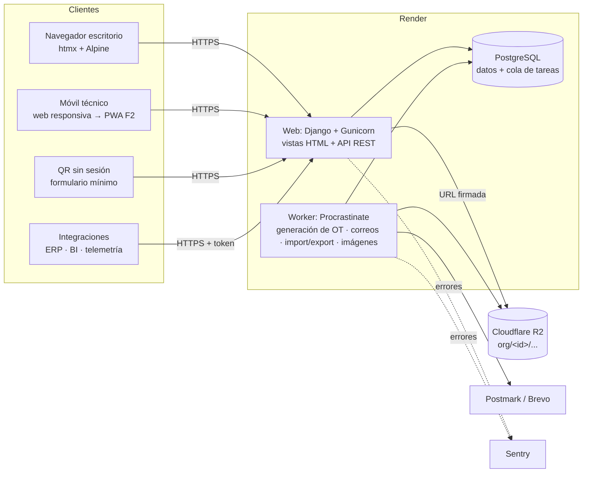

# 04 — Arquitectura

**Estado:** borrador v0.1 (2026-09-24)

## 1. Resumen

**Monolito modular** en Django sobre PostgreSQL, renderizado en servidor con
htmx + Alpine.js, API REST con OpenAPI para integraciones, tareas en segundo
plano con una cola sobre la misma base de datos y archivos en almacenamiento
S3‑compatible. Todo desplegado en un PaaS gestionado. Cero servicios que
operar aparte de Postgres.

| Pieza | Elección |
|---|---|
| Lenguaje / framework | Python 3.13, Django 5.2 LTS (soporte hasta abril de 2028) |
| Base de datos | PostgreSQL 16+ gestionado |
| Frontend | Plantillas Django + htmx 2 + Alpine.js 3, CSS propio con design tokens (sin paso de build en Node) |
| API | Django REST Framework + drf-spectacular (OpenAPI 3) |
| Autenticación | django-allauth (login por correo, verificación, MFA TOTP; SSO OIDC/SAML en F3) |
| Tareas en segundo plano y periódicas | Procrastinate (cola sobre PostgreSQL) |
| Archivos | django-storages → Cloudflare R2 (S3‑compatible) |
| Excel / PDF | openpyxl / reportlab (ADR-019) |
| Imágenes | Pillow (compresión y miniaturas en el worker) |
| Correo | Postmark o Brevo vía django-anymail |
| Asistente IA (F2) | API de Anthropic con el SDK oficial `anthropic`; búsqueda con texto completo de PostgreSQL (ADR-018) |
| Errores / logs | Sentry + logs JSON a stdout (formateador propio sobre `logging`, ADR-020) |
| Herramientas | uv, ruff (lint + formato), pytest + pytest-django + factory_boy, pre-commit, GitHub Actions |
| Hosting | Render (web + worker + Postgres), región US‑East |

## 2. Diagrama de componentes



## 3. Capas y estructura del código

```
config/                 settings (base, dev, test, prod), urls, wsgi/asgi
apps/
  core/                 TenantModel, contexto de tenant, UUIDv7, permisos base, utilidades
  accounts/             User, Membership, Invitation, roles/permisos, integración allauth
  organizations/        Organization, Plan, feature flags, cupos, Location, marca
  assets/               AssetClass, Asset, AssetStatusPeriod, Meter, MeterReading
  maintenance/          MaintenancePlan, versiones, disparadores, asignaciones, programador
  work/                 WorkOrder, checklist, mano de obra, costos, WorkRequest, FailureEvent, backlog
  inventory/            (F2, ADR-028) Part, Warehouse, StockItem, StockMovement, Reservation, reposición
  condition/            (F2, ADR-029) ConditionRule, ConditionState, ConditionAlert, evaluación de lecturas
  catalogs/             FailureCode, plantillas de plataforma (template packs)
  reporting/            KPIs, exportaciones Excel/PDF
  audit/                AuditLog y registro automático
  notifications/        Notification, preferencias, envío de correo
  files/                Attachment, subida, compresión, URLs firmadas, uso por tenant
  api/                  routers DRF, autenticación por token, versión v1
  ui/                   layout base, componentes de plantilla, /design-system/
static/                 css/tokens.css, css/components.css, js/, fonts/
templates/
tests/                  isolation/, permissions/ y tests de cada app
Marca/                  kit de marca original (fuente de verdad, no se edita)
```

Dentro de cada app:

| Archivo | Responsabilidad | Puede importar |
|---|---|---|
| `models.py` | Estructura de datos, restricciones, métodos triviales. Sin lógica de negocio. | `core` |
| `selectors.py` | **Lecturas**: funciones que reciben el contexto (organización, membresía) y devuelven querysets ya filtrados por permisos, con `select_related`/`prefetch_related`. | models de cualquier app |
| `services.py` | **Escrituras y reglas de negocio**: funciones con argumentos por nombre, transaccionales, que validan, escriben, auditan y encolan tareas. | selectors, models, services de otras apps |
| `views.py` | HTTP ↔ servicio/selector. Validan el formulario, llaman a una función, renderizan. Sin lógica. | forms, services, selectors |
| `forms.py` / `api/serializers.py` | Validación de entrada y forma de salida. | models |
| `tasks.py` | Tareas Procrastinate: envoltorios delgados que fijan el tenant y llaman a services. | services |

Reglas: las dependencias van **vista → servicio → selector → modelo**, nunca al
revés; los modelos no llaman servicios; las vistas HTML y la API llaman a
**los mismos** servicios (la API no duplica reglas).

## 4. Multi-tenancy

1. **Resolución** (ADR-003): la organización activa se guarda en la sesión
   (web) o se deduce del token (API). Un middleware carga
   `request.organization` y `request.membership`; si el usuario no tiene
   membresía activa en esa organización, 403.
2. **Contexto**: el middleware fija un `ContextVar` `current_organization`
   durante la petición. Las tareas lo fijan explícitamente con
   `with tenant_context(org):`.
3. **Filtrado que falla cerrado**: el manager por defecto de `TenantModel`
   filtra por la organización del contexto y **lanza `TenantNotSet`** si no
   hay contexto. Para operaciones de plataforma existe un manager explícito
   `all_tenants` que solo se usa en código revisado (comandos de admin,
   migraciones de datos) y se busca con grep en revisiones. Excepción
   acotada: el QR sin sesión (REQ-02) busca el activo por su token no
   adivinable y fija `tenant_context` con la organización de ese activo
   (`assets.selectors.asset_for_anonymous_report`).
4. **Escritura**: `TenantModel.save()` asigna `organization_id` desde el
   contexto y rechaza guardar si no coincide.
5. **Alcance por sitio**: los selectors aplican además el filtro de
   `membership_location` cuando la membresía está restringida.
6. **Archivos**: claves con prefijo `org/<organization_id>/`; se sirven
   solo mediante URL firmada tras verificar permisos. Cada adjunto usa el
   alcance de su objeto (`attachments.views._target_is_visible`): la foto de
   una solicitud (`work_request`) la ve quien ve la solicitud
   (`visible_requests`), también un técnico, por diseño
   (`tests/permissions/test_request_photo.py`).
7. **Tests de aislamiento** (`tests/isolation/`): para cada modelo, vista y
   endpoint, se crean dos organizaciones y se verifica que A no puede listar,
   ver, editar ni referenciar datos de B (incluido pasar IDs de B en
   formularios y en la API). Un test genérico recorre todos los modelos que
   heredan de `TenantModel` para que ningún modelo nuevo quede fuera.
8. **RLS (segunda defensa, ADR-026)**: en PostgreSQL toda tabla de un
   `TenantModel` tiene `FORCE ROW LEVEL SECURITY` y la política
   `tenant_isolation`, que compara `organization_id` con la variable de sesión
   `app.current_organization`. `tenant_context()` la fija al entrar y la
   restaura al salir; `request_finished` la limpia. Activa antes del piloto
   con datos reales.

## 5. Seguridad

| Tema | Medida |
|---|---|
| Autenticación | allauth, Argon2, verificación de correo, MFA TOTP con códigos de recuperación, exigible por organización. |
| Fuerza bruta | Límite de intentos por usuario e IP (django-axes o el rate limit de allauth), bloqueo temporal; límite de tasa en formularios públicos: registro (rate limit de allauth) y aviso por QR sin cuenta (por IP y por activo, `apps.accounts.antibot.consume_rate`), ambos con campo trampa, tiempo mínimo y suma firmada. |
| Sesión | Cookies `Secure`, `HttpOnly`, `SameSite=Lax`; rotación al iniciar sesión y al cambiar de organización; expiración por inactividad configurable. |
| Autorización | Permisos por rol verificados en servicios y selectors (no solo en la UI); objetos siempre obtenidos por selectors con alcance. |
| Transporte | HTTPS obligatorio, HSTS (1 año, preload cuando el dominio sea estable). |
| Cabeceras | CSP estricta en toda respuesta (ADR-023: sin scripts ni estilos en línea; htmx y Alpine servidos localmente; Alpine en su build compatible con CSP), `X-Content-Type-Options`, `Referrer-Policy`, `Permissions-Policy`. |
| API | Tokens por organización con alcances, guardados como hash, con prefijo visible; límite de tasa por token. |
| Archivos | Validación de tipo real (magic bytes) y tamaño; nombres aleatorios; sin ejecución; URLs firmadas de corta duración. |
| Secretos | Variables de entorno de Render; `.env` solo local e ignorado por git; gitleaks en CI. |
| Datos | Cifrado en reposo por el proveedor (Postgres y R2); respaldos cifrados. |
| Dependencias | Dependabot + `pip-audit` en CI. |
| Postura | Documento `docs/07_postura_de_seguridad.md` para clientes (se redacta en MVP‑1). |

## 6. Despliegue y operación

| Ambiente | Infraestructura | Despliegue |
|---|---|---|
| Desarrollo | Local en Windows: Python con uv, PostgreSQL local (instalador oficial o Docker Desktop), almacenamiento en disco. | — |
| Staging | Render: web + worker pequeños, Postgres básico, bucket R2 separado. Datos sintéticos. | Automático al hacer push a `main` con CI en verde. |
| Producción | Render: web + worker, Postgres con respaldos gestionados, bucket R2 de producción. | Manual (promoción del mismo commit) tras validar staging. |

Pipeline (GitHub Actions): ruff → verificación de migraciones faltantes →
pytest (con Postgres de servicio) → `check --deploy` → pip-audit/gitleaks.
Para cuidar los minutos de Actions (repo privado), corre una vez por push
(sin `pull_request`), omite cambios solo de documentación (`docs/`, `*.md`,
`Marca/`), cancela la corrida anterior de la misma rama y en las ramas prueba
solo Python 3.13 (la versión de Render); `main` prueba 3.11 y 3.13.

Operación:

- `/healthz` (proceso vivo) y `/readyz` (base de datos accesible y cola al día).
- Migraciones en el *pre-deploy command* de Render; migraciones compatibles
  hacia atrás (expand/contract) para no cortar el servicio.
- Respaldos: los del proveedor (recuperación a un punto en el tiempo) más un
  `pg_dump` diario a R2 con retención de 30 días; prueba de restauración en
  staging cada trimestre, registrada en `docs/operacion/`.
- Tareas periódicas (Procrastinate): generación de preventivos cada hora,
  avisos de vencimiento diarios, recálculo de uso de almacenamiento diario,
  respaldo lógico diario.

### Costo estimado de infraestructura

Precios de lista aproximados; verificarlos al contratar.

| Ítem | Staging | Producción |
|---|---|---|
| Render web | ~USD 7 | ~USD 7 → 25 al crecer |
| Render worker | ~USD 7 | ~USD 7 |
| Render Postgres | ~USD 6 | ~USD 19 (1 GB RAM) |
| Cloudflare R2 | gratis (< 10 GB) | ~USD 0–5 |
| Sentry, correo | plan gratuito | plan gratuito → ~USD 15 |
| **Total** | **~USD 20** | **~USD 33–55** |

Alternativas evaluadas: **Railway** (cobro por uso, similar en costo, menos
predecible); **Fly.io** (más barato, pero más operación y Postgres menos
gestionado); **DigitalOcean App Platform** (comparable; opción de respaldo);
**VPS Hetzner + Coolify** (~USD 10, pero respaldos, actualizaciones y seguridad
del servidor quedan a tu cargo: no vale la pena para una sola persona hasta
tener ingresos).

## 7. Zonas horarias e i18n

- `USE_TZ = True`; todo se guarda en UTC.
- Zona de visualización: la del sitio del activo si está definida; si no, la
  de la organización. Un middleware activa la zona de la organización; las
  plantillas que muestran datos de un sitio concreto usan un filtro
  `|site_tz`.
- Fechas "de calendario" (fecha límite de un preventivo por días) se calculan
  en la zona del sitio y se guardan como `timestamptz` al final del día local.
- `LANGUAGE_CODE = "es-cl"`; todo texto con `gettext`/``;
  `LOCALE_PATHS` en el repo; formato numérico y de fecha por locale.

## 8. Decisiones de arquitectura (ADR)

### ADR-001 · Monolito modular con Django y PostgreSQL
- **Contexto:** una sola persona con experiencia en Django; dominio con
  muchas relaciones y reportes.
- **Decisión:** un único proyecto Django organizado en apps por dominio,
  un solo despliegue y una sola base PostgreSQL.
- **Alternativas descartadas:** microservicios (costo operativo imposible
  para una persona); FastAPI + SPA (más código propio para admin, auth,
  formularios y migraciones).
- **Consecuencias:** despliegue y depuración simples; hay que cuidar los
  límites entre apps (reglas de dependencia de la §3) para no crear un
  monolito acoplado.

### ADR-002 · Multi-tenancy con base compartida, columna de tenant y filtrado que falla cerrado; RLS antes de producción paga
- **Contexto:** cientos de organizaciones pequeñas; hay que evitar fugas de
  datos entre ellas; hay que operar barato.
- **Decisión:** una base y un esquema compartidos; `organization_id` en toda
  tabla de negocio (también en las tablas hijas); manager por defecto que
  filtra por el contexto y lanza una excepción si no hay contexto; tests de
  aislamiento obligatorios. RLS de PostgreSQL se activa como segunda defensa
  **antes del primer cliente pagado** (fase MVP‑1), no en el MVP‑0.
  *Actualización:* se adelantó a antes del piloto con datos reales; el
  diseño está en ADR-026.
- **Por qué RLS no desde el día 1:** requiere un rol de base de datos sin
  `BYPASSRLS`, fijar la variable en cada transacción (interacción con pools
  de conexiones y con las tareas) y ajustar migraciones y tests. Como toda
  tabla ya trae `organization_id`, activarla después es solo agregar policies
  y un middleware, sin migrar datos.
- **Alternativas descartadas:** un esquema por tenant (django-tenants:
  migraciones que crecen con cada cliente y más complejidad); una base por
  tenant (solo como opción del plan Empresa en F3, con el mismo código).
- **Consecuencias:** cada índice empieza por `organization_id`; las consultas
  entre organizaciones (métricas de plataforma) usan el manager explícito.

### ADR-003 · Organización activa en la sesión, un solo dominio
- **Contexto:** los usuarios pueden pertenecer a varias organizaciones.
- **Decisión:** `app.<dominio>` único; la organización activa se guarda en la
  sesión y se cambia con un selector; en la API se deduce del token.
- **Alternativas descartadas:** subdominio por organización (DNS y
  certificados comodín, cookies por subdominio y fricción para usuarios con
  varias organizaciones); prefijo en la URL `/o/<slug>/` (es viable y se
  puede agregar después para enlaces compartibles).
- **Consecuencias:** los enlaces de los correos incluyen la organización
  (`?org=<organization_id>`, `notifications.services.email_link`). Al abrirlos,
  `TenantMiddleware` cambia la organización activa con el mismo servicio del
  selector (rota la sesión y la recuerda) si la persona tiene membresía activa
  ahí, y en todo caso redirige a la misma URL sin el parámetro: sin membresía se
  ignora y la respuesta es idéntica, así no revela si la organización existe;
  después aplica el 404/403 de siempre. Sin sesión, el parámetro viaja en
  `next` por el login. Se eligió el ID en claro y no un token firmado: el ID
  no es secreto ni da acceso (la membresía se verifica siempre) y el token no
  frenaría a un sitio ajeno, que igual podría usar un enlace legítimo. El
  riesgo real es de tipo CSRF: cambiar en segundo plano la organización activa
  mientras se trabaja en otra pestaña. Por eso solo se acepta en un GET de
  navegación de primer nivel (con Fetch Metadata: `Sec-Fetch-Dest: document` y
  `Sec-Fetch-Mode: navigate`; nunca imágenes, iframes, fetch ni htmx) y nunca
  en POST. Los avisos en la app no lo necesitan: la bandeja solo muestra los de
  la organización activa.

### ADR-004 · Renderizado en servidor con htmx + Alpine; offline acotado en F2
- **Contexto:** perfil Django/HTML/JS; hay que entregar muchas pantallas CRUD
  rápido; el modo offline solo lo necesita el técnico.
- **Decisión:** plantillas Django + htmx para interactividad parcial +
  Alpine.js para estado local de la UI. Sin SPA ni build en Node. El modo
  offline (F2) se implementa como una PWA acotada al flujo del técnico, con
  JS propio sobre la API REST (ADR-011).
- **Alternativas descartadas:** SPA en React/Vue (duplica rutas, validación y
  permisos, y exige un segundo stack); Tailwind (requiere paso de build y es
  redundante con los design tokens).
- **Consecuencias:** una sola fuente de verdad para permisos y validación;
  el offline requerirá una capa JS separada pero pequeña.

### ADR-005 · API REST con DRF y drf-spectacular
- **Decisión:** DRF por su ecosistema (permisos, throttling, filtros,
  paginación) y drf-spectacular para OpenAPI 3 en `/api/schema/` y
  `/api/docs/`. Versionado por URL (`/api/v1/`).
- **Alternativa descartada:** Django Ninja (más liviano, pero menos probado en
  permisos por objeto y throttling).
- **Consecuencias:** los serializers son delgados y llaman a los mismos
  servicios que las vistas.
- **Implementación (X-05, `apps/api`):**
  - **Autenticación:** solo `Authorization: Bearer gbt_…` (sin sesión, así no
    hay CSRF). El token fija el contexto de tenant y la zona horaria de su
    organización (`TenantAPIMixin`); revocado, vencido, inexistente o de una
    organización inactiva → 401.
  - **Principal de servicio:** el token actúa como una membresía en memoria con
    rol planificador sobre toda la organización (sin alcance por sitio) y un
    usuario técnico propio; nunca administra equipo, auditoría, configuración ni
    tokens. Alcance `read`: solo métodos GET; `write`: además escribe.
  - **Límite de tasa:** `TokenRateThrottle`, por token, `API_RATE_LIMIT`
    (por defecto `600/min`), sobre el caché en la base de datos.
  - **Endpoints:** `/api/v1/assets/` (lista, detalle, alta, PATCH),
    `/meters/`, `/readings/` (lista, alta, `bulk/`), `/work-orders/` (lista,
    detalle, alta, `{id}/transition/`), `/requests/` (lista, detalle, alta).
    Paginación por página (`page`, `page_size` ≤ 200). Altas de lecturas, OT y
    solicitudes idempotentes por `client_uuid`; la carga masiva, por
    (medidor, fecha, valor); repetir una transición al mismo estado no hace nada.
  - **Cierre y checklist desde la API (WO-03, REQ-03):**
    `POST /work-orders/{id}/complete/` valida con el mismo formulario de cierre
    de la web (ítems obligatorios, lectura si el plan usa medidor, impacto y
    —si la organización lo exige— modo y causa en correctivas) y llama a
    `complete_work_order`. Idempotente por `client_uuid`, guardado en
    `api.ApiIdempotencyKey` (UNIQUE por organización): reenviar la misma clave
    devuelve la OT actual (200); usarla en otra OT → 409 `conflict`.
    `POST /work-orders/{id}/checklist-items/{item_id}/answer/` usa
    `answer_checklist_item`; reenviar la misma respuesta devuelve el ítem sin
    cambios (también con la OT ya completada). Ambos exigen alcance `write`.
  - **Fotos desde la API (WO-03 CA2, AST-06):** `POST /work-orders/{id}/photos/`
    y `POST /work-orders/{id}/checklist-items/{item_id}/photos/` (multipart,
    campo `file` y `client_uuid` opcional) usan `add_work_order_photo` y
    `add_checklist_photo`: mismas validaciones, compresión, cupo, ruta
    `org/<organization_id>/` y auditoría que la web; solo OT visibles y abiertas,
    permiso de ejecutar OT y alcance `write`. Responden 201 con metadatos (nunca
    una URL: el archivo se descarga por la web con URL firmada); reenviar el
    mismo `client_uuid` devuelve la misma foto (200) y usarlo en otro objeto →
    409. En un ítem «foto obligatoria» la foto es la respuesta; después,
    `…/answer/` solo guarda la observación, y sin foto responde 400.
    `GET /work-orders/{id}/checklist-items/` (con `photo_count`) y
    `GET /work-orders/{id}/attachments/` listan ítems y adjuntos, paginados.
  - **Errores:** `{"error": {"code", "message", "details"}}` con textos en español.
  - **Documentación:** esquema en `/api/schema/` y Swagger UI en `/api/docs/`
    servido desde estáticos locales (`drf-spectacular-sidecar`) con el script de
    inicio en un archivo aparte, compatible con la CSP estricta (sin CDN ni JS en
    línea). Un test genera el esquema con `--fail-on-warn`.
  - **Pantalla:** `/settings/api-tokens/` (solo administradores, permiso
    `api_token.manage`), enlazada desde "Más".

### ADR-006 · Autenticación con django-allauth
- **Decisión:** allauth para registro, login por correo, verificación, MFA
  (TOTP + códigos de recuperación) y, en F3, SSO OIDC/SAML (Microsoft Entra
  ID), todo con una sola librería.
- **Alternativa descartada:** combinar django-otp, python3-saml y vistas
  propias (más piezas para mantener).
- **Consecuencias:** las invitaciones y las membresías son lógica propia
  sobre el usuario de allauth.

### ADR-007 · Tareas en segundo plano con Procrastinate sobre PostgreSQL
- **Contexto:** hay que generar preventivos, enviar correos, procesar
  importaciones y comprimir imágenes; la meta es no operar Redis.
- **Decisión:** Procrastinate (cola en Postgres con `LISTEN/NOTIFY`, tareas
  periódicas, reintentos) en un proceso worker.
- **Alternativas descartadas:** Celery + Redis (un servicio más que pagar y
  vigilar); cron del PaaS (sin reintentos ni cola).
- **Consecuencias:** el volumen de tareas está acotado por Postgres (de sobra
  para esta escala). Si algún día hace falta, se migra a otro backend sin
  cambiar los servicios, porque las tareas son envoltorios delgados.

### ADR-008 · Ciclo de vida de la OT fijo con pasos opcionales
- **Contexto:** el brief pide un ciclo configurable; el cliente objetivo
  valora la simplicidad; un motor de workflows es caro de construir y probar.
- **Decisión:** estados canónicos fijos en código
  (`requested → planned → scheduled → in_progress ⇄ on_hold → completed →
  closed`, más `cancelled`), con pasos activables por organización
  (aprobación de cierre, paso por *planned*) y nombres visibles editables.
- **Alternativa descartada:** estados y transiciones definidos por el cliente.
- **Consecuencias:** los KPI y reportes se apoyan en estados conocidos; si un
  cliente Empresa lo exige, se evalúa en F3.

### ADR-009 · Claves UUIDv7
- **Decisión:** PK `UUID` versión 7 generada en la aplicación.
- **Por qué:** el offline necesita IDs creados en el cliente; los UUIDv7 no
  son adivinables en URLs y, por ser ordenables en el tiempo, no degradan los
  índices B-tree como UUIDv4.
- **Consecuencias:** los números visibles para humanos (OT, solicitudes) son
  correlativos aparte (`work_order_sequence`).

### ADR-010 · Render + Cloudflare R2 + Sentry
- **Decisión:** ver §6. Región US‑East por latencia a Sudamérica.
- **Alternativas descartadas:** ver §6.
- **Consecuencias:** los datos quedan fuera de Chile; se declara en la
  postura de seguridad. Si un cliente exige residencia local, se evalúa la
  opción de base dedicada del plan Empresa en un proveedor con región
  sudamericana (ej. AWS São Paulo o Santiago).

### ADR-011 · Modo sin conexión del técnico: PWA en `/field/` sobre la sesión (X-06)
- **Alcance:** flujo del técnico: ver **todas las OT visibles** para su
  membresía (alcance por sitio, igual que en la web; primero las asignadas como
  responsable o apoyo), ejecutar checklist, registrar lecturas, horas y fotos,
  y crear solicitudes. Entrada opcional en v1 ("Modo sin conexión" en Mis OT,
  Mi semana y "Más") e instalable; tras el piloto se decide si es la vista por
  defecto. Fuera de v1: QR, ver fotos o manuales, Background Sync,
  push, crear/aprobar/cerrar OT y varias organizaciones a la vez.
- **Repuestos (F2, INV-13, ADR-028):** dejan de estar fuera: entraron con el
  paquete P6 de inventario (2026-10, sección "Repuestos" de la ejecución de la
  OT, `static/field/parts.js`; `POST work-orders/{id}/parts/` con el mismo
  servicio que la web y la v1). `reference/` suma el catálogo activo compacto (sin
  costos, tope 2.000 con `truncated`, solo con el módulo `inventory` y
  `inventory.view`) y `snapshot/` suma por OT `planned_parts` y `parts`. "Usar"
  un previsto o agregar un repuesto se encola con `client_uuid` y `used_at` en
  la cola de la OT, antes de "Completar". Como el stock negativo se permite,
  no hay conflictos de stock: solo 409 `cancelled`/`locked`, y el mismo
  `client_uuid` en otra OT → 409 `conflict`. El texto libre sin conexión no
  pide costo (queda en 0; quien gestiona la OT lo ajusta en la web) y el
  técnico no ve costos de inventario en las respuestas (Q3). Un envío
  rechazado (400) se corrige y reenvía con el mismo `client_uuid`. Crear
  repuestos sin conexión sigue fuera.
- **Correctiva desde hallazgo (F2, WO-06 CA2, paquete F1 de condición):** deja
  de estar fuera. En la ejecución de la OT, un ítem No OK muestra "Avisar
  hallazgo" (descripción opcional y "equipo detenido"); se encola con
  `client_uuid` después de la respuesta del ítem y antes de "Completar", y va
  a `POST work-orders/{id}/checklist-items/{item}/finding/`, que llama a
  `work.services.create_corrective_from_item` (idempotente por ítem; el
  técnico sin `work_order.manage` pasa por `report_failure`, como en la web).
  409 `cancelled` si la OT está cancelada (completada o cerrada se acepta: ver
  "Límites resueltos"); 400 si el ítem
  no está No OK. Las fotos del ítem viajan por la cola de fotos.
  **Implementado (2026-10):** `apps.api.services.report_finding_idempotent`
  bloquea la OT de origen (dos avisos simultáneos crean una sola correctiva)
  y guarda el `client_uuid` en `ApiIdempotencyKey` (acción
  `checklist_item.finding`): reenviarlo devuelve la misma correctiva (200)
  aunque la OT ya esté completada; usarlo en otro ítem u operación → 409
  `conflict`. Exige `request.create`, como la web. En el teléfono, el cambio
  `finding` va en el carril de la OT (FIFO), así que siempre sale después de
  la respuesta del ítem y antes de "Completar"; un hallazgo pendiente cuyo
  ítem deja de estar No OK se retira de la cola. El ítem muestra "Hallazgo
  por enviar" o "Hallazgo avisado · OT-C-… · Solicitud N°" y no deja avisar
  dos veces; el snapshot trae `finding_code` (correctiva abierta del ítem) y
  `variable` (la variable de condición que alimenta un ítem de medición).
  **Límites resueltos (2026-10):**
  1. *Excepción al carril de la OT:* la regla general sigue igual (un 409/404
     o un 400 bloquea lo que sigue de esa OT hasta resolverlo), pero el aviso
     de hallazgo es accesorio: si el servidor lo rechaza (400) o lo pone en
     conflicto (409/404), **sale del carril** (`sync.nextEntry` lo salta sin
     bloquear) y lo que sigue de la OT, incluido "Completar", se envía igual.
     El orden se mantiene: la respuesta del ítem sigue yendo antes que el
     aviso, y el aviso, mientras esté por enviar, antes que "Completar". En
     Conflictos el aviso ofrece "Corregir y reenviar" (descripción y "equipo
     detenido"): con el mismo `client_uuid` si fue un 400 (el servidor solo
     guarda la clave en `ApiIdempotencyKey` cuando crea la correctiva), con
     uno nuevo si fue 409 `conflict` (la clave ya se usó en otra operación).
     Con la OT cancelada (409 `cancelled`) explica que ya no puede avisarse
     desde ella y solo ofrece "Descartar". El ítem muestra "Hallazgo no
     enviado" (ícono + texto, con enlace a Conflictos).
  2. *Aviso tras "Completar":* como "Completar" puede adelantarse a un aviso
     rechazado, el endpoint acepta el aviso con la OT de origen completada o
     cerrada (también con un `client_uuid` nuevo) mientras el ítem siga No OK;
     solo la OT cancelada es 409 `cancelled`. Es lo que ya hace el servicio
     de la web (`create_corrective_from_item` no mira el estado de la OT de
     origen; la correctiva es otra OT y la de origen no cambia). La interfaz,
     como la web (WO-06 CA1), ofrece "Avisar hallazgo" solo con la OT abierta.
  3. *Insignias en vivo:* "Por enviar: N" de cada ítem y OT (respuestas,
     fotos, hallazgos) y el estado del hallazgo se actualizan al encolar,
     enviar, rechazar o descartar sin repintar el ítem (`ui.updateQueue`).
  4. *Snapshot:* cada ítem trae `finding_request_number` (N° de la solicitud
     de la correctiva abierta, anotado en la misma consulta): tras "Descargar
     de nuevo" el ítem muestra "Hallazgo avisado · OT-C-… · Solicitud N° …".
  5. *Ruta:* la canónica es `work-orders/{id}/checklist-items/{item}/finding/`
     (como `answer/` y `photos/`); `work-orders/{id}/checklist/{item}/finding/`
     queda como alias (`deprecated` en el esquema) para teléfonos con la PWA
     anterior.
- **Estado (2026-10):** implementado en cinco paquetes: P1 servicios en
  `apps/work` (horas del teléfono, regla de checklist, `LaborEntry.client_uuid`),
  P2 `/field/api/`, P3 shell/SW/manifest, P4 cola, sincronización, flujos y e2e,
  P5 borrado al salir o cambiar de organización, enlaces de entrada, horas de
  apoyo, job e2e manual en CI y revisión de seguridad.
- **Autenticación:** la sesión de Django (mismo origen, CSRF con la cookie
  `csrftoken`) bajo `/field/api/`, con `MembershipSessionAuthentication` y el
  módulo `work_orders` o `requests` del plan (sin exigir `api`). `/field/api/`
  **no** se exime de MFA (responde 403 JSON `mfa_required`); sin sesión, 401.
  Descartados: tokens por dispositivo (robables desde IndexedDB) y sesión en
  `/api/v1/` (cae en la exención de MFA de `/api/`).
- **Interfaz (`apps/field`, sin modelos):** `/field/` es un shell HTML propio
  (`templates/field/shell.html`, no hereda de `base.html`) **sin datos de la
  organización ni de la persona**, porque lo guarda el Service Worker; exige
  sesión, membresía y el módulo `work_orders`. Carga `static/field/app.js`
  (módulos ES sin build: `app.js` entrada y rutas, `api.js` cliente,
  `db.js` IndexedDB, `queue.js` cola, `sync.js` envío, `local.js` reglas
  locales, `forms.js` formularios, `photos.js` reducción de fotos, `ui.js`
  pantallas) y además `static/js/app.js` (el mismo "Salir" que la web), enruta
  por hash (`#/`, `#/wo/<id>`, `#/wo/<id>/complete`, `#/request`, `#/reading`,
  `#/conflicts`, `#/fix/<client_uuid>`), lleva el foco al `<h1>` al navegar y
  escribe solo con `textContent` y nodos clonados de `<template>` (un test
  prohíbe `innerHTML`, también en `static/js/app.js`). Los textos llegan
  traducidos en `data-msg-*` y `<template>`; fechas con `Intl` es-CL en la zona
  de la organización; nombres de estado desde `bootstrap`. Sin datos muestra
  "Sin conexión · sin datos descargados"; con `DEBUG`, `/field/demo.json`
  entrega el fixture del contrato (solo tests y demostraciones; la vista ya no
  lo carga). Barra con "Salir" (en móvil solo el ícono, con nombre accesible).
- **Entrada:** enlaces "Modo sin conexión" a `/field/` en Mis OT
  (`?scope=mine`), Mi semana y "Más", solo para quien puede ejecutar OT
  (`work_order.execute`) con el módulo `work_orders`.
- **Módulos ES con hash:** `config.storage.ModuleManifestStaticFilesStorage`
  (whitenoise + `support_js_module_import_aggregation`) reescribe en
  `collectstatic` los `import` relativos a los nombres con hash (probado en
  `tests/test_field.py`). Sin import maps (serían JS en línea).
- **Service Worker (`/field/sw.js`, alcance `/field/`):** vista sin sesión,
  `application/javascript`, `Cache-Control: no-cache`, exenta de MFA, del
  bloqueo por módulo y de `no-store`. Precarga solo el shell: `/field/`, el
  manifest, `field/*.js`, tokens.css, components.css, theme.js, `js/app.js`,
  signature-pad.js, fuentes, isotipo e íconos; la precarga usa
  `redirect: "error"`, así que con la sesión vencida la instalación falla y se
  reintenta en vez de guardar el login como shell. `CACHE_VERSION` = sha1 de las
  URL con hash + `RENDER_GIT_COMMIT` (en desarrollo, del contenido): cada
  despliegue instala una caché `field-<versión>`, `activate` borra las
  anteriores y la página ofrece "Hay una versión nueva · Actualizar"
  (`SKIP_WAITING`). Navegación a `/field/`: red primero (3 s) y si no, el shell
  guardado (una redirección al login nunca se guarda); estáticos precargados:
  caché primero. Nunca pasan por la caché `/field/api/`, `/files/`,
  `/accounts/`, `/org-theme.css`, POST ni otra navegación.
- **Manifest (`/field/manifest.webmanifest`):** "GALBUST · Terreno",
  `start_url`/`scope` `/field/`, `standalone`, es-CL, `theme_color` y
  `background_color` = `--color-nav-bg` y `--color-bg` (test contra
  tokens.css), íconos 192, 512 y maskable 512 exportados de `Marca/`.
- **Datos en el teléfono:** IndexedDB `galbust-field` v1 con `meta` (user_id,
  organization_id, synced_at, client_version, bootstrap), `work_orders`
  (checklist incrustado), `reference`, `queue` (índices `wo_id`, `status`;
  cada entrada con user_id y organization_id) y `blobs` (fotos). Un snapshot
  de más de 14 días se borra. Si `bootstrap` trae otra persona u organización
  se borran OT, catálogos y `meta` (la cola ajena se retiene sin mostrar su
  contenido: misma persona → "Cambia a «org»"; otra → solo conteo y
  "Descartar"). Con conexión, `/field/` no muestra nada guardado hasta que
  `bootstrap` confirma la identidad; sin conexión muestra lo guardado.
- **Borrado (`static/js/app.js`, sin `Clear-Site-Data`):** "Salir" (barra de
  la web, "Más" y la barra de `/field/`) y el
  cambio de organización se interceptan. Salir: cola vacía → se borra la base
  `galbust-field` completa y se sale; con pendientes → `<dialog>` modal que
  dice cuántos cambios se pierden, con "Ir a sincronizar" (foco inicial),
  "Salir y descartar" y "Cancelar". Cambiar de organización: cola vacía → se
  borra la base; con pendientes → mismo diálogo, y al confirmar se borran solo
  los datos descargados (la cola espera a volver a esa organización). Además,
  toda página de la web lleva `data-user-id` y `data-organization-id` en
  `<body>` y borra los datos descargados de otra persona u organización (p. ej.
  sesión vencida y entra otra persona). Las pestañas de `/field/` sueltan la
  base en `versionchange` y se recargan vacías. Cache Storage solo guarda la
  estructura (sin datos), por eso no se borra. El shell guardado no lleva
  token CSRF: "Salir" envía el valor de la cookie `csrftoken`.
- **Escrituras y conflictos:** cada cambio se encola con `client_uuid` y se
  envía desde la página (no desde el SW), de a uno y en orden por OT; el
  servidor es **idempotente por `client_uuid`** y los correlativos llegan al
  sincronizar. Horas del teléfono con `client_time(at, not_before=…)` (futuro
  → ahora, antes de la creación → creación, > 30 días → ahora y queda en
  auditoría). Checklist: **gana la última por `answered_at`** y la descartada
  o sobrescrita queda en auditoría (`CHECKLIST_ANSWER`, también en la web).
  Transiciones offline solo de ejecución (iniciar, pausar, reanudar,
  completar); OT cancelada o cerrada → 409 `cancelled`/`locked`; no hay regla
  de "reasignada". Lecturas y fotos se agregan sin conflicto (fotos hasta
  `completed_at`, reducidas en el teléfono a ≤ 2000 px). 401 o `mfa_required`
  pausan la cola ("Inicia sesión para enviar N cambios"); 409/404 bloquean esa
  OT hasta "Descartar"; 400 permite "Corregir y reenviar" con el mismo
  `client_uuid`; red o 5xx reintentan con espera exponencial. Excepción: un
  aviso de hallazgo rechazado o en conflicto no bloquea la OT (ver
  "Correctiva desde hallazgo"). Horas de
  apoyo: formulario de minutos en la OT (hasta que se cierra o cancela) que se
  encola y va a `labor/` con `client_uuid`. Cada envío lleva
  `X-Field-Organization` (la organización donde se hizo el cambio): si la
  sesión ya es de otra, 409 `organization_changed`; el teléfono pausa, repite
  `bootstrap` y deja esos cambios en cola (nunca se aplican en otra
  organización ni quedan como conflicto).

#### Contrato de `/field/api/` (referencia para la implementación)
Subclases de los viewsets de v1 con `FieldAPIMixin`: `readings/` POST,
`meters/` GET, `requests/` POST (multipart con `photo` y `reported_at`),
`work-orders/{id}/checklist-items/`, `…/checklist-items/{item}/answer/`
(+ `answered_at`; responde `answered_at` y `superseded`), `…/photos/` y
`…/checklist-items/{item}/photos/` (+ `taken_at`), `…/complete/` (+ `at`).
Nuevos: `work-orders/{id}/transition/` (+ `client_uuid`, `at`),
`work-orders/{id}/labor/` (`minutes`, `client_uuid`),
`work-orders/{id}/checklist-items/{item}/finding/` (`description`, `asset_stopped`,
`client_uuid`; WO-06 CA2; alias anterior `…/checklist/{item}/finding/`), `bootstrap/`,
`snapshot/?days=N` (7 por defecto, máx. 14) y `reference/` (códigos de falla
activos por tipo, activos visibles compactos con tope 2000 y `truncated`,
medidores activos). Errores 409 con código `cancelled`, `locked`, `conflict`,
`organization_changed` (encabezado `X-Field-Organization` distinto de la
organización de la sesión) o `upgrade_required` (el cliente envía su versión en `X-Client-Version`; menor
que `min_client_version` → 409 con `details.min_client_version`; `bootstrap/`
nunca lo rechaza). La v1 recibe lo aditivo (`at`, `answered_at`, `superseded`,
`taken_at`, `client_uuid` en `transition/`) pero sigue respondiendo 400 en los
errores de estado. Horas de `bootstrap`, `snapshot` y `reference` en UTC (`Z`).
Detalle de uso en `docs/08_api.md`.
Forma de `bootstrap` y `snapshot` (ejemplo completo en
`apps/field/fixtures/demo.json`, verificado por `tests/test_field.py`):

```json
{
  "bootstrap": {
    "user": {"id": "…", "name": "…"},
    "organization": {"id": "…", "name": "…", "timezone": "America/Santiago",
                     "require_failure_details": false},
    "role": "technician",
    "permissions": {"execute": true, "request_create": true, "reading_create": true},
    "horizon_days": 7,
    "status_labels": {"scheduled": "Programada", "in_progress": "En ejecución", "…": "…"},
    "execution_transitions": {"start": {"from": ["requested", "planned", "scheduled"],
                                        "to": "in_progress"},
                              "pause": {"from": ["in_progress"], "to": "on_hold"},
                              "resume": {"from": ["on_hold"], "to": "in_progress"},
                              "complete": {"from": ["in_progress"], "to": "completed"}},
    "server_time": "2026-09-28T13:00:00Z",
    "min_client_version": 1
  },
  "snapshot": {
    "generated_at": "…", "days": 7, "truncated": false,
    "work_orders": [{
      "id": "…", "code": "OT-P-00118", "title": "…", "work_type": "preventive",
      "status": "scheduled", "priority": 3, "scheduled_for": "2026-09-28",
      "due_on": "2026-09-30", "estimated_minutes": 90, "description": "",
      "assigned_to_me": true, "assigned_to": {"id": "…", "name": "…"},
      "asset": {"id": "…", "code": "CMP-01", "name": "…"},
      "location": null,
      "meter": {"id": "…", "name": "Horómetro", "unit": "h"}, "meter_required": true,
      "allowed_transitions": ["in_progress"], "updated_at": "…",
      "checklist": [{"id": "…", "position": 1, "section": "…", "text": "…",
                     "item_type": "measurement", "unit": "bar", "min_value": "6.5",
                     "max_value": "8", "required": true, "result": "ok",
                     "value_number": "7.2", "value_text": "", "note": "",
                     "answered_at": "…", "photo_count": 0}]
    }]
  }
}
```
`snapshot` incluye las OT visibles en estados abiertos con `scheduled_for` o
`due_on` ≤ hoy + N, más las en ejecución o en espera, las vencidas y las sin
fecha; asignadas a la persona primero; tope 200 con `truncated`. `location`
lleva `{id, name, path}`; los decimales van como texto; consultas acotadas
(`photo_count` en lote).

### ADR-012 · Código en inglés, interfaz en español vía i18n
- **Decisión:** identificadores, modelos, tablas y commits en inglés;
  interfaz en español (es-CL) mediante archivos de traducción; documentación
  en español.
- **Por qué:** el ecosistema y las librerías están en inglés; evita mezclas
  (`get_activos_by_sitio`) y deja listo el paso a inglés y portugués.
- **Consecuencias:** el glosario de `CLAUDE.md` mapea los términos del
  dominio (activo = asset, OT = work order, etc.).

### ADR-013 · Roles fijos con permisos en código y alcance por sitio
- **Decisión:** seis roles con una matriz de permisos en código
  (`accounts/permissions.py`); cada membresía puede restringirse a sitios.
  Los roles personalizados quedan para F3.
- **Alternativa descartada:** grupos y permisos de Django por organización
  (difíciles de probar y de explicar a una pyme).
- **Consecuencias:** cada permiso sensible tiene un test en
  `tests/permissions/`.

### ADR-014 · Archivos en R2 con prefijo por organización y procesamiento en el worker
- **Decisión:** subida al servidor → validación → almacenamiento del original
  temporal → tarea que comprime y redimensiona las imágenes (WebP/JPEG, lado
  mayor ≤ 2000 px, miniatura de 400 px) → `size_bytes` suma al uso de la
  organización. Descarga por URL firmada (5 minutos).
- **Alternativa descartada por ahora:** subida directa del navegador a R2 con
  URL prefirmada (menos carga en el servidor, pero más complejidad; se
  reevalúa si los archivos grandes afectan el rendimiento).

### ADR-015 · CSS propio con design tokens, sin framework
- **Decisión:** `tokens.css` (variables en `:root` y en `[data-theme=dark]`) +
  `components.css` con clases de componentes. Sin Bootstrap ni Tailwind.
- **Por qué:** control total sobre la marca y el contraste, sin paso de build
  y con un catálogo acotado de componentes.
- **Consecuencias:** mantener el catálogo en `/design-system/` y no escribir
  estilos sueltos en las plantillas.

### ADR-016 · Versiones inmutables de planes preventivos
- **Contexto:** PM-03 exige que editar un plan no altere OT existentes y que
  las OT futuras usen la nueva definición. Los planes cambian (frecuencia,
  checklist, repuestos) mientras hay OT abiertas y asignaciones programadas.
- **Decisión:**
  - El contenido del plan (frecuencia, modo de reprogramación, tolerancia,
    duración, instrucciones, checklist y recursos) vive en `plan_version`.
    `maintenance_plan.current_version` apunta a la publicada vigente.
  - Flujo: *borrador → publicar*. Hay un solo borrador por plan, y se crea
    copiando la versión vigente. Publicar marca la anterior como
    `superseded`.
  - Una versión publicada es **inmutable**: `PlanVersion.save()` rechaza
    cambios de contenido (solo puede cambiar de estado), y los ítems y
    recursos solo se crean, editan o borran en borradores.
  - La OT guarda `plan_version` (PROTECT) y copia el checklist para
    registrar resultados. Los recursos previstos se leen de la versión, que
    no cambia.
  - Las asignaciones apuntan al **plan**, no a la versión. La generación y
    la reprogramación usan la versión vigente en ese momento, así que
    publicar no obliga a reasignar N activos.
  - Si la nueva versión cambia la frecuencia, `publish_version` recalcula en
    la misma transacción el próximo vencimiento de las asignaciones **sin
    OT abierta**. Lo cuenta desde la última ejecución o lectura de cierre;
    si nunca se ejecutó, desde el inicio implícito del ciclo anterior. Así,
    acortar de 30 a 7 días se nota de inmediato. Las asignaciones con OT
    abierta se reprograman al cerrarla.
  - Los disparadores son campos de la versión (uno por calendario y uno por
    medidor, vence lo que ocurra primero), no una tabla `plan_trigger`.
  - Modo fijo: el siguiente objetivo es el anterior + k·intervalo, con el
    menor k que lo deja después de la ejecución. Una OT muy atrasada no
    genera OT en el pasado.
  - La frecuencia por calendario es `calendar_interval` + `calendar_unit`
    (días, semanas = 7 días, meses de calendario). Un mes suma el mismo día
    del mes ajustado al último día si no existe (31‑ene + 1 mes = 28/29‑feb);
    en modo fijo se suman k meses desde el objetivo anterior de una vez.
    Cambiar la unidad cuenta como cambio de frecuencia al publicar.
  - Absorción (PM‑05 CA3): `plan_absorption` es un dato del plan (rige sin
    publicar). La OT del plan mayor copia el checklist de su versión y el de
    la versión vigente de cada menor absorbido, en secciones rotuladas;
    `work_order_absorption` guarda la asignación y la versión del menor.
  - El horizonte de generación vive en `maintenance_settings` (por
    organización, 14 días por defecto).
- **Alternativas descartadas:**
  - Editar el plan en sitio y confiar solo en el snapshot del checklist:
    pierde la trazabilidad de frecuencia y recursos.
  - Asignaciones apuntando a una versión: cada publicación tendría que
    migrarlas.
  - Tabla de disparadores: más flexibilidad de la que el dominio necesita.
- **Consecuencias:**
  - La inmutabilidad se aplica en `save()`/`delete()`; `QuerySet.update()`
    y `bulk_*` la saltan. Los servicios no los usan sobre versiones, ítems
    ni recursos de versiones publicadas, salvo `bulk_create` al crear un
    borrador.
  - Las propiedades de frecuencia del plan (`interval_days`,
    `frequency_label`, `uses_meter`…) delegan en la versión vigente y
    devuelven vacío si no la hay.
  - Las versiones usadas por OT no se pueden borrar.
- **Excepción acotada (F2, inventario, ADR-028):** en una versión
  **publicada**, un `plan_resource` de tipo repuesto con `part` vacío se puede
  enlazar una sola vez al catálogo (`link_published_resource`: vacío →
  repuesto; nunca cambiar ni quitar un enlace). Es el único cambio permitido
  sobre una versión publicada: no altera lo que el plan pide (descripción,
  cantidad y unidad quedan igual), solo identifica el repuesto para reservarlo
  (INV-10, INV-11) y evita obligar a publicar una versión nueva de cada plan
  al adoptar el inventario. Un borrador copia `part` y al publicar se
  conservan los enlaces.

### ADR-017 · Toda la aplicación es usable completa desde un smartphone
- **Contexto:** los clientes son pymes donde el administrador, el
  planificador y el técnico suelen ser la misma persona y trabajan en planta,
  no en un escritorio. NF-17 decía "mobile first", pero solo las vistas de
  técnico tenían reglas concretas y la verificación era manual.
- **Decisión:**
  - **Toda** funcionalidad web (técnico, planificador, administrador,
    reportes, importación, configuración) se puede **completar** desde un
    teléfono de 360 px de ancho, en vertical, sin scroll horizontal de la
    página. "Consultable pero no editable en móvil" no es aceptable.
  - Se diseña primero para 360 px y se amplía hacia escritorio; el
    escritorio puede ser más denso, pero no tener funciones exclusivas.
  - Cortes de pantalla únicos, definidos en `docs/06_sistema_de_diseno.md`
    §5: **720 px** (una columna, tablas a tarjetas) y **1100 px**
    (navegación compacta). Ningún componente inventa otro corte.
  - Toda `<td>` de una `.table` lleva `data-label`, porque bajo 720 px la
    fila se apila como tarjeta y la etiqueta reemplaza al encabezado.
  - Todo destino de la navegación de escritorio tiene un acceso en la
    navegación móvil.
  - Una vista no se da por terminada sin probarla a 360 px (DevTools basta
    en desarrollo; teléfono real en cada release).
- **Por qué:** cubre el uso real del cliente objetivo sin mantener dos
  aplicaciones, y es coherente con ADR-004 (renderizado en servidor) y con la
  PWA de F2 (ADR-011).
- **Alternativas descartadas:**
  - Móvil solo para técnicos y escritorio para administración: obliga al
    dueño de la pyme a ir a un computador para tareas cortas.
  - App nativa: segundo código que mantener; se reevalúa solo si la PWA no
    alcanza (cámara, offline).
- **Consecuencias:**
  - `tests/ui/test_mobile.py` falla si una `.table` tiene celdas sin
    `data-label`.
  - Tareas de escritorio intensivas (importación de Excel, edición de
    checklists largos) necesitan un diseño móvil propio: pasos cortos,
    tarjetas en vez de grillas, subida de archivo desde el teléfono.
  - La navegación móvil actual (Inicio, Mis OT, Activos) no expone Equipo
    ni Configuración: requiere un destino "Más" con el resto del menú.
  - Configuración vive hoy en el admin de Django, cuyo uso en móvil es
    limitado; las pantallas de configuración que use el cliente se mueven
    a vistas propias a medida que se construyen.

### ADR-018 · Asistente de diagnóstico con IA sobre el historial propio
- **Contexto:** en las pymes el conocimiento de cada máquina vive en uno o
  dos técnicos expertos. Cuando se van, se pierde. Un chat de IA genérico no
  resuelve esto (cualquier técnico ya lo tiene gratis en su teléfono); lo que
  vale es responder con **el historial y los manuales de ese equipo en esa
  empresa**. El asistente es tan bueno como los datos que el sistema capturó,
  así que la decisión tiene dos mitades: capturar desde el MVP y consultar
  después (requisitos `AI-*` en 02).
- **Decisión:**
  - **Captura (MVP):** al cerrar una OT correctiva se registra síntoma
    observado, causa (catálogo ISO 14224) y acción realizada en texto libre
    (REQ-03). El técnico puede dictar con el micrófono del teclado del
    teléfono; no se construye reconocimiento de voz propio. Los manuales se
    adjuntan al activo o a su clase (AST-06).
  - **Consulta (F2):** un botón "Pedir ayuda" en la ficha del activo y en la
    OT abre una conversación que ya conoce el activo (clase, modelo,
    medidores, fallas recientes, OT abierta).
  - **Recuperación por herramientas, no por volcado de datos:** el modelo
    recibe herramientas que ejecuta el backend (`search_work_orders`,
    `asset_failure_history`, `search_manuals`…). Cada herramienta llama a un
    selector con la `membership` del usuario, dentro de `tenant_context`: el
    aislamiento y el alcance por sitio los garantiza nuestro código, no el
    modelo, y se prueban en `tests/isolation/` como cualquier vista.
  - **Búsqueda con PostgreSQL:** texto completo en español (`tsvector`) sobre
    OT, fallas y páginas de manuales. `pgvector`, en la misma base, solo si
    las pruebas muestran que la búsqueda por palabras no alcanza.
    *Implementado (A1):* `SearchVector`/`SearchQuery` con configuración
    `spanish` calculados al consultar (basta una palabra, orden por
    relevancia), sin índices GIN en v1; en SQLite, `icontains`.
  - **Manuales:** al subir un PDF, el worker extrae el texto por página a
    `document_page` (con número de página) y lo indexa. Así cada respuesta
    cita "Manual X, p. 45". *Implementado en M1 (AST-06 CA3):* `pypdf`
    extrae hasta 500 páginas; los PDF escaneados quedan `no_text` (sin OCR).
    El selector `search_manual_pages(membership, query)` ya aplica
    aislamiento y alcance por sitio y es la base de la futura herramienta
    `search_manuals`.
  - **Citas obligatorias:** cada afirmación indica su origen: manual
    (documento y página), historial (código de OT) o conocimiento general,
    este último marcado como de menor confianza. La interfaz enlaza cada
    fuente. El modelo cita con el id que entregó el backend entre corchetes
    (`[OT-C-00012]`, `[MAN:<adjunto>:<página>]`, `[MED:<medidor>]`); el
    backend solo enlaza ids entregados en esa conversación (contexto del
    activo o herramientas) y descarta los inventados; un párrafo sin fuente
    se muestra como conocimiento general (`citations.segments`).
  - **Ejecución en el worker:** cada turno corre como tarea de Procrastinate
    (`assistant.run_turn`, cola `assistant`, con `organization_id`, sin
    reintentos automáticos para no cobrar dos veces) cuando
    `AI_ASSISTANT_USE_QUEUE=1`; si no (demo sin worker, SQLite), en
    `transaction.on_commit` de la misma petición, como la extracción de
    manuales. La pregunta deja un mensaje del asistente `pending` y la página
    consulta el resultado con htmx. Un pendiente de más de 15 minutos pasa a
    error (`expire_stale_messages`).
  - **Proveedor y modelo (decisión 2026-10-17):** API de Anthropic con el SDK
    oficial `anthropic` (único punto de contacto: `apps/assistant/llm.py`,
    cuyo `get_client()` reemplazan los tests por un cliente falso con
    respuestas guionizadas; ningún test llama a la API real). Modelo por
    ajuste `AI_ASSISTANT_MODEL`, por defecto **Claude Opus 5.5**
    (`claude-opus-5-5`), guardado en cada conversación (el caché y el
    razonamiento son por modelo: cambiar el ajuste afecta solo a las
    conversaciones nuevas). Se compara con Claude Sonnet 5.5
    (`claude-sonnet-5-5`) usando las marcas "¿Te sirvió?" del piloto antes de
    fijar el de producción. Sin `ANTHROPIC_API_KEY` el asistente queda "no
    configurado": se muestra, avisa y no falla.
  - **Llamada:** `client.beta.messages.stream(...).get_final_message()`
    (streaming para no chocar con tiempos de espera HTTP; la pantalla no
    muestra token a token), `max_tokens` 16 000, esfuerzo
    `output_config.effort` = `AI_ASSISTANT_EFFORT` (por defecto `medium`, que
    es también el de Opus 5.5) y sin `thinking` explícito: en Opus 5.5 el
    razonamiento adaptativo es el por defecto y `disabled` responde 400.
    Rechazos del clasificador: `fallbacks: "default"` con la beta
    `server-side-fallback-2026-07-01` (la API reintenta en el modelo
    recomendado); si toda la cadena rechaza (`stop_reason: refusal`), el
    mensaje queda `refused`. `max_tokens` y los errores tipados del SDK
    (límite de tasa, estado de la API, conexión) dejan el mensaje en `error`
    con un código y un texto amable.
  - **Bucle manual de herramientas** (no el tool runner beta): `tool_choice`
    auto (Opus 5.5 rechaza forzar una herramienta), herramientas con
    `strict: true` ordenadas por nombre, máximo
    `AI_ASSISTANT_MAX_TOOL_ROUNDS` = 6 rondas; pasado el límite las llamadas
    reciben un error "responde con lo reunido" y, si insiste, el turno
    termina en error. Herramientas: `search_work_orders(query, asset_only)`,
    `asset_failure_history(asset_code)`, `search_manuals(query)` y
    `recent_meter_readings(asset_code)` (código vacío = el activo de la
    conversación); cada resultado (máx. 8, textos truncados, sin nombres de
    personas) lleva un id de fuente.
  - **Historial append-only:** cada mensaje guarda los bloques crudos de la
    API (`content`) y se reenvían sin editar: el razonamiento preservado de
    Opus 5.5 se invalida si se edita un turno anterior. Turnos con error o
    rechazados no se reenvían; la nota de cierre es una llamada aparte con el
    mismo prefijo (no entra al historial).
  - **Caché:** instrucciones del sistema y herramientas fijas (sin fechas ni
    datos del usuario) con un punto de caché al final del sistema; otro punto
    en el contexto del activo (primer bloque de la primera pregunta, guardado
    tal cual) y el automático al final de cada petición. Los tokens leídos y
    escritos en caché se guardan por turno.
  - **Cupos y planes (decisión 2026-10-17):** módulo `assistant` solo en
    Profesional y Empresa; `plan.max_assistant_conversations` (Profesional
    100, Empresa 500, en blanco = sin límite) cuenta las conversaciones nuevas
    del mes calendario en la zona de la organización, con la fila de la
    organización bloqueada al crear. Agotado el cupo no se crea la
    conversación; el resto del sistema sigue igual. Precios por modelo en
    `AI_MODEL_PRICES_USD` para el costo estimado.
  - **Reglas de seguridad en las instrucciones del sistema:** recordar
    bloqueo y etiquetado (LOTO) antes de intervenir; nunca sugerir anular
    protecciones o enclavamientos; decir "no lo sé" si no hay fuente; la
    decisión y la responsabilidad son del técnico, y así se muestra en
    pantalla.
  - **Cierre del ciclo:** al completar la OT se propone un resumen de la
    conversación como nota de cierre (el técnico la edita o descarta), y el
    técnico marca si la ayuda sirvió. Esas marcas forman el conjunto de
    evaluación para cambiar de modelo o de instrucciones.
  - **Costo acotado:** módulo por plan con cupo mensual de conversaciones por
    organización (ORG-10). Cada turno guarda los tokens usados para medir el
    costo real por cliente.
- **Por qué:** convierte el historial del CMMS en el diferenciador: el valor
  crece con cada mes de uso y retiene al cliente. Reutiliza Postgres,
  Procrastinate, R2 y los selectors existentes, sin servicios nuevos que
  operar.
- **Alternativas descartadas:**
  - Chat genérico sin datos propios: no diferencia.
  - Base vectorial externa (Pinecone u otra): un servicio más que operar y
    otro lugar donde aislar tenants.
  - Enviar al modelo todo el historial del activo en cada turno: caro y
    arriesga mezclar datos fuera del alcance del usuario.
  - Ajuste fino (fine-tuning) por cliente: caro, lento de actualizar y sin
    citas verificables.
- **Consecuencias:**
  - Datos del cliente (manuales, historial, conversaciones) se envían a un
    proveedor en EE. UU.: se declara en la postura de seguridad y en el
    contrato (Ley 21.719); en el contexto no se envían datos personales
    innecesarios (nombres de técnicos se reemplazan por su rol). Se verifican
    los términos de retención y uso de datos del proveedor antes de producción.
  - Requiere conexión: el asistente no está disponible offline (ADR-011); es
    ayuda, nunca un paso obligatorio del flujo.
  - Cliente nuevo sin historial: el asistente se apoya en los manuales y en
    la biblioteca de clases de activo de GALBUST hasta acumular OT propias.
  - Conversaciones y mensajes son modelos con tenant, en la auditoría y en
    la exportación completa (X-03).
- **Estado (2026-10-17): implementado** (paquetes A1–A3). El costo estimado
  por organización y mes (UTC, últimos 12 meses) es un informe del admin de
  Django solo para el superadmin, sobre un modelo *proxy* de
  `assistant_message` (sin tabla) que lee con `all_tenants`; los precios por
  millón de tokens (entrada, salida, lectura y escritura de caché) están en
  `AI_MODEL_PRICES_USD` y se actualizan en el código. La demo de Render no
  tiene clave ni worker: `seed_demo` siembra manuales y conversaciones ya
  respondidas armadas con el contexto y las herramientas reales (sin llamar
  a la API) y "Pedir ayuda" avisa que no está configurado. Quedó fuera de v1:
  asistente sin conexión o en `/field/` (a lo más un enlace), endpoints en la
  API v1, reconocimiento de voz propio, `pgvector` y búsqueda semántica,
  índices GIN de texto completo, OCR de manuales escaneados, respuesta token a
  token en pantalla, varias fotos o PDF por pregunta, compartir
  conversaciones entre técnicos, el conjunto de evaluación automatizado (se
  arma con las marcas "¿Te sirvió?" del piloto para comparar Opus 5.5 con
  Sonnet 5.5) y el costo en la moneda del cliente o con alertas de gasto (el
  límite de gasto se fija en la consola del proveedor).

### ADR-019 · PDF con reportlab (Python puro), no WeasyPrint
- **Contexto:** AST-05 CA2 pide etiquetas QR en lote, en PDF y varias por
  hoja. El resumen de arquitectura proponía WeasyPrint, que depende de
  Pango/Cairo del sistema: en Render exige un build con paquetes nativos o
  Docker, y cada actualización de la imagen puede romperlo.
- **Decisión:** los PDF se generan con **reportlab** (dibujo directo sobre un
  lienzo A4, sin librerías del sistema; solo depende de Pillow, que ya está).
  El QR se dibuja como vectores a partir de la matriz de `segno`, el mismo
  generador de la ficha del activo. Las etiquetas usan fuentes TTF
  incrustadas (DejaVu Sans, Sans Bold y Sans Mono Bold, licencia libre, en
  `apps/assets/fonts/` junto a su licencia), que cubren Latin extendido,
  griego, cirílico y símbolos comunes (–, Nº, ø, ✓); reportlab incrusta solo
  los glifos usados.
- **Por qué:** se instala con `uv` como cualquier paquete, funciona igual en
  Windows, en el CI y en Render, y genera 500 etiquetas en menos de un
  segundo sin un proceso aparte. Es una librería madura y mantenida.
- **Alternativas descartadas:**
  - WeasyPrint (HTML → PDF): reutiliza plantillas, pero agrega dependencias
    nativas que operar.
  - Imprimir la página HTML desde el navegador (lo anterior): el tamaño y la
    grilla dependen del navegador y de la impresora; no hay "varias por hoja"
    confiable ni un archivo que guardar.
- **Consecuencias:**
  - Los reportes PDF futuros (OT, informes) se dibujan con reportlab
    (`platypus` para documentos con flujo de texto) o se reevalúa este ADR
    si un reporte necesita maquetación HTML compleja.
  - Las fuentes estándar del PDF (Helvetica, Courier) solo cubren Latin-1, por
    eso no se usan. Alfabetos fuera de DejaVu (CJK, árabe con ligaduras) no
    se ven bien; si un cliente los necesita se registra otra TTF.
  - El PDF de etiquetas tiene un tope de 500 por archivo (21 hojas de 24)
    para acotar memoria y tiempo de la petición web; sobre eso se filtra.

### ADR-020 · Infraestructura de producción en el código, activada por variables de entorno
- **Contexto:** la demo corre en el plan gratis de Render sin worker, R2,
  Sentry ni proveedor de correo; las cuentas pagadas se crean más adelante.
  El código de producción debe existir y probarse ya, sin cambiar la demo.
- **Decisión:** cada pieza se enciende sola al definir sus variables
  (lista completa y checklist en `docs/07_operacion.md`):
  - **Cola (ADR-007):** `procrastinate.contrib.django` se instala solo con
    PostgreSQL (no soporta SQLite); el esquema llega con `migrate`. Tareas en
    `apps/<app>/tasks.py`: preventivos cada hora, una tarea por organización
    con `tenant_context` (PM-05 CA1); limpieza diaria de la cola; respaldo
    diario si `BACKUPS_ENABLED=1`; avisos de OT por vencer y vencidas cada
    día a las 11:00 UTC, una tarea por organización (X-02,
    `apps/notifications/tasks.py`). Nada corre sin el proceso
    `manage.py procrastinate worker`; mientras tanto, un cron puede llamar a
    `manage.py send_due_notifications` (idempotente por OT, persona y día).
  - **Notificaciones (X-02):** los servicios de OT y solicitudes llaman a
    `apps.notifications.services` dentro de su transacción; el aviso en la
    app se crea en `transaction.on_commit` (sin worker, en la misma
    petición) y el correo sale por `send_mail`, que pasa por la cola si
    `EMAIL_USE_QUEUE=1`. Los enlaces de los correos usan `SITE_URL` (por
    defecto el dominio de Render). La campana del encabezado pide su
    contador por htmx al cargar y cada 60 s (sin JS en línea).
  - **Archivos (ADR-014):** con `R2_BUCKET`, `R2_ENDPOINT_URL`,
    `R2_ACCESS_KEY_ID` y `R2_SECRET_ACCESS_KEY` el almacenamiento pasa a R2
    (bucket privado); las vistas con permisos siguen siendo la entrada y
    redirigen a una URL firmada de 5 minutos (`apps.core.files`). Sin ellas,
    disco local.
  - **Errores y logs (NF-15):** Sentry solo con `SENTRY_DSN`,
    `send_default_pii=False`; `LOG_FORMAT=json` emite JSON con `request_id`
    (stdlib, sin structlog: una dependencia menos). `/readyz` verifica la
    base y las tablas de la cola; `/healthz` no cambia.
  - **Correo:** SMTP de Postmark o Brevo por `EMAIL_*`; consola si no hay
    `EMAIL_HOST`. `EMAIL_USE_QUEUE=1` envía desde el worker sin cambiar a
    quienes llaman.
  - **Texto de manuales (AST-06 CA3):** con `DOCUMENT_TEXT_USE_QUEUE=1` (y
    PostgreSQL) la extracción corre en el worker (`attachments.extract_document_text`,
    cola `documents`, recibe `organization_id`). Sin el flag (demo sin
    worker, SQLite) se extrae en la misma petición al confirmar la
    transacción. `manage.py extract_document_text [--retry-failed]` procesa
    los pendientes (p. ej. si se activó la cola sin worker).
  - **Respaldos (NF-09):** `manage.py backup_database` (`pg_dump` formato
    custom) a `backups/` en R2 o a `BACKUP_DIR`, con retención.
- **Consecuencias:** la demo solo gana `/readyz` y las tablas vacías de la
  cola. `render.production.example.yaml` describe web + worker + Postgres
  pagados, pero Render solo lee `render.yaml`. Mientras la demo no tenga
  worker, los preventivos siguen generándose al arrancar el servidor.

### ADR-021 · Plantillas de rubro como archivos versionados que se copian
- **Contexto:** la puesta en marcha (ORG-03) y la biblioteca de planes (PM-07)
  necesitan clases de activo, atributos, catálogo de fallas y planes típicos
  por rubro. Una sola persona los mantiene y el dueño debe poder revisarlos.
- **Decisión:** cada rubro es un JSON en
  `apps/maintenance/templates_library/<rubro>.json` (flota, planta
  industrial, alimentos, edificios), revisado como código y validado por un
  test (tipos, unidades, medidores, rangos, códigos únicos). JSON y no YAML:
  sin dependencias nuevas. El contenido es un dato en español, no pasa por
  gettext. `industry_templates.apply_industry_template(*, organization,
  industry, by, parts, plan_codes)` copia a la organización lo que aún no
  tiene (por código), sin sobrescribir nada, por lotes (consultas acotadas);
  `preview_industry_template` muestra lo mismo sin escribir. Los planes se
  crean con su v1 publicada (`services.bulk_create_published_plans`). La
  web ofrece «Cargar plantilla de rubro» (vista previa y confirmación) y
  `manage.py apply_industry_template` sirve a la plataforma. El asistente
  ORG-03 reutiliza el servicio con `parts` y `plan_codes`.
- **Consecuencias:** las organizaciones reciben copias editables; cambiar la
  plantilla no toca a quien ya la aplicó (la auditoría registra rubro y
  versión). Cada archivo lleva `review_status` y `review_note`; mientras sea
  `draft` («Borrador — revisar antes del piloto») los administradores de la
  plataforma lo ven marcado en la interfaz.

### ADR-022 · MFA de allauth con política por organización
- **Decisión:** `allauth.mfa` con app de autenticación (TOTP) y códigos de
  recuperación (sin llaves WebAuthn por ahora: exigen JS propio). Cada
  organización elige `mfa_policy`: `admins_only` (por defecto: obligatoria para
  administradores), `everyone` u `optional`. `MFARequiredMiddleware` (después de
  `TenantMiddleware`) manda a `/accounts/2fa/totp/activate/` a quien debe tener
  segundo factor y no lo tiene, con la política de la **organización activa**:
  un usuario en dos organizaciones cumple la de la que tiene abierta. Quedan
  abiertas las rutas de `/accounts/` (configurar, salir, correo), estáticos,
  salud, `/org/switch/` y la API, que usa tokens de organización sin sesión y
  no se ve afectada. Con htmx la redirección va en `HX-Redirect`.
- **Consecuencias:** `MFA_ENFORCE=0` apaga la obligación (los tests que no
  tratan de MFA la apagan en `conftest.py`). La demo pública (`seed_demo`)
  usa `optional` porque sus usuarios son compartidos. El ingreso con código de
  recuperación usa la misma pantalla que el código TOTP.

### ADR-023 · Content-Security-Policy propia, estricta y sin excepciones en línea
- **Decisión:** un middleware pequeño (`apps.core.middleware.ContentSecurityPolicyMiddleware`,
  sin django-csp) agrega a toda respuesta la política armada en
  `config.infra.content_security_policy`: `default-src 'self'; script-src 'self';
  style-src 'self'; img-src 'self' data: blob:` (+ host de R2 y subdominios si
  hay R2, + `CSP_EXTRA_IMG_SRC`); `font-src`, `connect-src` y `base-uri 'self'`;
  `object-src 'none'; form-action 'self'; frame-ancestors 'none'`. Sin nonces
  ni `unsafe-inline`: las fuentes son locales, htmx y el JS propio se sirven
  como archivos. `data:` cubre el QR de la verificación en dos pasos; `blob:`,
  las vistas previas de fotos.
- **Ajustes:** htmx no inyecta su `<style>` de indicadores
  (`<meta name="htmx-config">` con `includeIndicatorStyles: false`); Swagger UI
  (`/api/docs/`) usa una plantilla propia sin el `<style>` de drf-spectacular
  (`static/css/swagger.css`) y su script de inicio ya era un archivo aparte; el
  color de cada organización se sirve como hoja `/org-theme.css` (ORG-09).
  `tests/test_csp.py` verifica la cabecera y que ninguna plantilla tenga
  `<script>` sin `src`, `<style>`, atributos `style=` ni manejadores `on*=`.
- **Consecuencias:** nada de JS o CSS en línea, tampoco en plantillas de
  terceros que se sobrescriban. Alpine, cuando entre, debe ser su build
  compatible con CSP.

### ADR-024 · Asistente de puesta en marcha como app propia que solo orquesta servicios
- **Decisión:** ORG-03 vive en `apps/onboarding`: un modelo de avance por
  organización (`OnboardingState`) y seis pantallas server-rendered, sin JS.
  Cada paso llama al servicio que ya existe (`apply_industry_template` con
  `parts`/`plan_codes`, `create_location`, `create_asset`, la importación Excel,
  `assign_plan_to_class`, `record_meter_reading`, `plan_calendar`); el asistente
  no escribe reglas propias salvo generar códigos (sitio, área, activo), crear
  el medidor que exige un plan por uso y recalcular el vencimiento por uso tras
  la primera lectura. Cada paso es idempotente (repetirlo no duplica) y se
  puede saltar y retomar.
- **Entrada:** la confirmación del autoregistro crea el avance y redirige a
  `/onboarding/`; si la política exige segundo factor, `MFARequiredMiddleware`
  lo pide antes y, al volver al inicio, el tablero lleva al asistente mientras
  `started_at` esté vacío. Las organizaciones existentes no son forzadas: su
  administrador lo abre desde Configuración y ve un aviso en el inicio hasta
  terminar o descartarlo. Solo administradores (`organization.manage`).

### ADR-025 · Tablero semanal con arrastrar y soltar como mejora progresiva
- **Decisión:** REQ-05 se programa con un formulario por tarjeta («Programar»: día y
  responsable) que funciona sin JS y en el teléfono; `static/js/board.js` agrega
  arrastrar y soltar (HTML5 drag-and-drop) en escritorio y envía el mismo formulario
  con `fetch` y el encabezado `X-CSRFToken`. La vista responde 204/400 con el mensaje
  cuando llega `X-Board-Drop` y redirige en el resto de los casos. Sin librerías ni JS
  en línea (ADR-023).
- **Por técnico:** `?lanes=1` muestra una fila por técnico en alcance (más otros
  responsables y «Sin asignar») × días, con su carga vs. capacidad; soltar en la
  celda de un técnico envía el mismo formulario con `assigned_to`. Se arma con las
  OT y técnicos ya consultados (sin consultas por técnico); en el teléfono cada
  técnico es una lista por día.
- **Capacidad:** `membership.weekly_capacity_hours` (la edita el administrador en
  Equipo); no se crea un modelo de turnos hasta que un cliente lo pida.
- **Puntaje del backlog:** expresión `CASE` en SQL (criticidad × prioridad) para
  ordenar y paginar en la base, sin columnas guardadas que haya que mantener.

### ADR-026 · Row-Level Security en PostgreSQL como segunda defensa del aislamiento
- **Contexto:** NF-07 y ADR-002. El manager que falla cerrado protege el ORM,
  pero no el SQL crudo, `all_tenants` mal usado, el `_base_manager` de Django
  (FK hacia adelante, `refresh_from_db`) ni un filtro olvidado. Decisión del
  dueño: RLS activo **antes del piloto con datos reales**.
- **Decisión:**
  - Toda tabla de un `TenantModel` concreto (descubierta en tiempo de
    ejecución, no listada) queda con `ENABLE` + `FORCE ROW LEVEL SECURITY` y
    la política `tenant_isolation`: `USING` y `WITH CHECK`
    `current_setting('app.bypass_rls', true) = 'on' OR organization_id =
    NULLIF(current_setting('app.current_organization', true), '')::uuid`.
    Sin variable no se ve ni escribe ninguna fila (falla cerrado).
  - **Instalación:** un receptor de `post_migrate` (`apps/core/rls.py`) las
    (re)aplica de forma idempotente tras cada `migrate`, así que una tabla
    nueva queda cubierta en el mismo despliegue sin migración a mano.
    `pre_migrate` activa el bypass para que las migraciones de datos vean
    todas las filas; al terminar vuelve al contexto. `tests/isolation/test_rls.py`
    y `manage.py rls_status` fallan si una tabla de TenantModel no tiene la
    política.
  - **Variables de sesión:** `tenant_context()` (que usan el middleware, el
    token de la API, las tareas y el reporte anónimo por QR) ejecuta
    `set_config(..., false)` en la conexión al entrar y restaura el valor
    anterior al salir; `platform_context()` hace lo mismo con
    `app.bypass_rls`. Se ejecuta en el cursor nativo de psycopg (no cuenta en
    los tests de cantidad de consultas). `request_finished` vuelve a
    sincronizar la conexión con el contexto (vacío tras la petición), así que
    nada se filtra entre peticiones con `CONN_MAX_AGE` ni entre tareas de
    Procrastinate. `connection_created` aplica el contexto a una conexión
    nueva o reconectada. Dentro de una transacción abortada no se ejecuta: el
    `ROLLBACK` devuelve la variable al valor previo a la transacción.
  - **`all_tenants`** usa `PlatformQuerySet`, que evalúa cada consulta
    (iteración, `count`, `exists`, `aggregate`, `update`, `delete`,
    `bulk_*`, `iterator`) dentro de `platform_context()`. Usado como
    subconsulta dentro de otra consulta rige el contexto externo: ahí se
    envuelve la consulta externa en `platform_context()` (ej.
    `attachments.selectors.storage_usage`). Código de plataforma explícito
    (`seed_demo`, comandos) usa `platform_context()`.
  - **Cobertura:** solo tablas de `TenantModel`. `organizations_organization`,
    planes, `accounts_user`, `Membership`, invitaciones, tablas de allauth,
    sesiones y Procrastinate no tienen RLS: se consultan antes de conocer la
    organización (login, selección de organización) y siguen protegidas por
    los selectores y los tests de aislamiento.
- **Modelo de amenaza:** RLS protege contra **errores de la aplicación** que
  olvidan el filtro por organización (SQL crudo, managers sin filtro, FK
  cruzadas). **No** protege contra un rol de aplicación comprometido: el mismo
  rol puede fijar `app.bypass_rls` o cualquier organización. El rol de la
  aplicación no debe ser superusuario ni tener `BYPASSRLS` (lo ignorarían);
  el dueño de las tablas sí queda sujeto gracias a `FORCE`.
- **Rendimiento:** `current_setting` es estable y se evalúa una vez por
  consulta; la condición sobre `organization_id` usa los índices compuestos
  que ya empiezan por esa columna. Costo extra: un `SELECT set_config` al
  entrar y salir de cada contexto (dos por petición autenticada) y por cada
  evaluación de `all_tenants`.
- **Alternativas descartadas:** `SET LOCAL` por transacción (Django corre en
  autocommit y habría que abrir transacción en cada consulta); roles de base
  por organización (inmanejable con cientos de organizaciones).

### ADR-027 · Exportación completa y borrado de organización (X-03, X-04)
- **Contexto:** NF-08 exige que el cliente pueda llevarse todos sus datos y
  pedir su borrado. Debe respetar el aislamiento (NF-07, ADR-026) y no agregar
  pasos: el administrador pide, el sistema hace el resto.
- **Decisión (exportación):**
  - El administrador pide un ZIP desde `/settings/` (tarjeta "Exportar todos
    los datos") o desde la página de borrado. Fila `DataExport`
    (`TenantModel`): estado `pending` → `ready`/`failed` → `expired`. Una en
    preparación a la vez por organización.
  - Formato: **un CSV por tabla** (UTF-8 con BOM para Excel, separador coma,
    fechas ISO 8601 en UTC) bajo `datos/`, más `organizacion.csv`,
    `membresias.csv` (con correo y nombre) e `invitaciones.csv`; archivos
    (adjuntos por tipo y propósito, y el logo) bajo `archivos/`; `LEEME.txt`
    describe el contenido y los conteos. CSV antes que XLSX: portable, sin
    límite de filas y en streaming.
  - Las tablas se descubren (todo `TenantModel` concreto), salvo
    `DataExport` y `DocumentPage` (texto derivado de los PDF, que van
    completos). Se omiten columnas con nombre sensible (`password`,
    `secret`, `token`, `key`: el mismo criterio de la auditoría).
  - Se arma dentro de `tenant_context(organización)` con filtro explícito por
    `organization_id`; en PostgreSQL RLS impide además que entre una fila de
    otra organización (`tests/isolation/test_org_export_delete.py`).
  - Con `DATA_EXPORT_USE_QUEUE=1` lo arma el worker
    (`organizations.build_data_export`, cola `exports`, con
    `organization_id`); si no, se arma en `transaction.on_commit` de la misma
    petición. El ZIP se escribe a un temporal (`SpooledTemporaryFile`, 16 MB
    en memoria y luego disco) y se guarda en
    `org/<organization_id>/exports/<uuid>.zip`; se sirve solo por
    `/settings/export/<id>/` (administrador, `private_file_response`, URL
    firmada en R2). Vence a los 7 días (`DATA_EXPORT_TTL_DAYS`): la tarea
    diaria borra el archivo y deja la fila en `expired`.
  - Aviso al terminar: notificación `data_export_ready` (app y correo, según
    preferencias) a quien la pidió. Auditoría: creación y cada descarga
    (`download`).
- **Decisión (borrado):**
  - El administrador confirma con su contraseña y escribiendo el nombre de la
    organización, después de ver la oferta de exportación. La organización
    pasa a `pending_deletion` con `deletion_scheduled_for` = ahora + 30 días
    (`ORGANIZATION_DELETION_GRACE_DAYS`). Todos ven un aviso con la fecha;
    los administradores, el botón "Cancelar eliminación", que la devuelve a
    `active` (o `trial` si la prueba sigue vigente). Ambas acciones quedan en
    la auditoría.
  - Durante la gracia la organización **sigue funcionando normalmente** (no
    se fuerza solo lectura): más simple, y cancelar no pierde nada.
  - La purga (tarea diaria `organizations.purge_organizations` a las 08:00
    UTC o `manage.py purge_organizations`) es código de plataforma con
    `platform_context()`: borra con `_raw_delete` todas las filas de todo
    `TenantModel` con ese `organization_id` (las FK de Django son `DEFERRABLE
    INITIALLY DEFERRED`: el orden no importa y se verifican al confirmar),
    las membresías, invitaciones y los usuarios de servicio de sus tokens de
    API; tras confirmar, todos los archivos bajo `org/<organization_id>/`.
  - **Lápida:** la fila `organization` no se borra: queda anonimizada (nombre
    "—", slug `deleted-<id>`, sin logo ni color, `is_active=False`, estado
    `deleted`) con `deleted_at` y `purge_summary` (filas por tabla, archivos,
    quién y cuándo la pidió). Es el registro de plataforma que sobrevive,
    porque la auditoría de la organización se borra con ella; la purga
    también escribe una línea de log. Es idempotente.
  - Las cuentas de usuario no se borran: quien solo pertenecía a esa
    organización conserva su cuenta (sin datos ni membresías) y puede ser
    invitado a otra. Borrar la cuenta personal es otro flujo (fuera de X-04).
- **Límites conocidos:** los respaldos de la base conservan los datos
  borrados hasta que vencen (`BACKUP_RETENTION_DAYS`, ver
  `docs/07_operacion.md`). La exportación síncrona (sin worker) depende del
  tamaño de la organización, acotado por el cupo de almacenamiento del plan.

### ADR-028 · Inventario: saldo materializado + libro inmutable, costo promedio por repuesto, stock negativo permitido
- **Contexto:** F2 agrega inventario y repuestos (INV-01..INV-17,
  [02_requisitos.md](02_requisitos.md) §6). Hoy el repuesto de la OT es texto
  (`part_usage`) y el del plan también (`plan_resource`). Los clientes son
  pymes sin bodeguero dedicado: el técnico consume en terreno, a veces sin
  señal, y el jefe de mantención compra según lo que falta. El inventario
  debe reducir pasos (principio rector): nadie elige bodega ni escribe costos
  al consumir, y nada debe bloquear el cierre de una OT. Decisiones de
  producto de Felipe (2026-10-10): Q1 stock negativo permitido siempre; Q2
  previstos pre-marcados al completar una preventiva en la web (en API y PWA
  el consumo es explícito); Q3 técnicos y externos no ven costos de
  inventario; Q4 módulo `inventory` en planes Prueba, Profesional y Empresa;
  Q5 sin órdenes de compra en v1 (solo reposición + Excel).
- **Decisión:**
  1. **App propia `apps/inventory`** (no dentro de `work` ni de un catálogo
     general): modelos `Part`, `Warehouse`, `StockItem`, `StockMovement` y
     `Reservation`, todos `TenantModel`.
  2. **Saldo materializado + libro inmutable:** `stock_movement` es el libro
     (solo inserción: `save()` fuera del alta y `delete()` lanzan
     `ImmutableMovementError`; admin solo lectura; los errores se corrigen
     con un movimiento contrario; la purga de ADR-027 usa `_raw_delete`; sin
     trigger SQL). `stock_item` guarda `on_hand` y `reserved` como caché
     transaccional que solo cambian los servicios, en la misma transacción
     que el movimiento. El libro manda: `manage.py inventory_reconcile`
     verifica (y con `--fix` reescribe) el saldo desde el libro; una tarea
     semanal sin `--fix` reporta desvíos a Sentry.
  3. **Costo promedio ponderado por repuesto en la organización**
     (`part.avg_cost`), no por bodega. Q = Σ `on_hand` del repuesto en todas
     las bodegas antes del movimiento; si Q ≤ 0 el promedio pasa a ser el
     costo entrante. Solo lo cambian entradas con costo, devoluciones desde la
     OT y conteos/importaciones con costo cuando el stock es ≤ 0; cada
     movimiento guarda `unit_cost` aplicado y `avg_cost_after`.
  4. **Stock negativo permitido** (Q1): un consumo nunca se rechaza por falta
     de stock; se marca "Negativo · regularizar" y encabeza la reposición.
  5. **Bodega por defecto creada sola y en diferido:** "Bodega principal"
     (`BOD`) aparece al primer uso del inventario (`ensure_default_warehouse`),
     no en el asistente de puesta en marcha. Con una sola bodega no hay
     selector.
  6. **Un solo punto de consumo:** `work.services.add_part_usage(part=…)`
     delega en `inventory.services.issue_to_work_order` para la web, la API v1
     y `/field/api/`. El servidor fija descripción, unidad, costo (promedio
     vigente) y bodega (reserva → bodega del ancestro más cercano de la
     ubicación → por defecto). Quitar la línea crea una devolución. El texto
     libre sigue posible.
  7. **Las reservas informan, no bloquean:** al generar una preventiva se
     reservan los repuestos previstos (principal y absorbidas); faltar stock
     solo muestra "Faltan N". `stock_item.reserved` = Σ pendientes de
     reservas activas.
  8. **Enlace único vacío → repuesto en un recurso de una versión publicada:**
     excepción acotada a ADR-016 (ver la nota allí).
  9. **"Dónde se usa" calculado** desde los planes vigentes y los consumos
     de 24 meses, sin BOM manual.
  10. **Categoría como texto con sugerencias**, no tabla.
  11. **Liberación de reservas con llamadas explícitas** en
      `transition(CANCELLED)` y `_close` de `work.services`, no con signals.
  12. **Sin ajustes de inventario por organización en v1** (umbrales y
      reglas fijas).
  - Concurrencia: todo en `transaction.atomic`; se bloquea primero el
    repuesto (`select_for_update` en orden de pk), luego los `stock_item` en
    orden de `warehouse_id`; con el repuesto bloqueado se calcula el promedio,
    se crea el movimiento y se actualiza el saldo con `F()`; notificaciones
    (`stock_low`) con `on_commit`. Test de concurrencia solo en PostgreSQL.
  - Idempotencia por `client_uuid` en el movimiento (y en `part_usage`, que lo
    copia), revisada **antes** de las validaciones de estado: el reenvío
    devuelve lo mismo aunque la OT ya esté cerrada; la misma clave en otra OT
    o con otro repuesto es conflicto.
  - Permisos nuevos `inventory.view`, `inventory.cost_view`,
    `inventory.move` e `inventory.manage` (INV-16); consumir sigue siendo
    `work_order.execute` y reservar `work_order.manage`.
- **Alternativas descartadas:**
  - Inventario dentro de `work` o de un catálogo común: mezcla
    responsabilidades y migraciones; `work` ya es la app más grande.
  - Saldo siempre calculado desde el libro: simple de mantener consistente,
    pero cada lista y alerta suma todo el historial. Solo saldo, sin libro:
    sin trazabilidad ni forma de reconciliar.
  - Promedio por bodega: una transferencia cambiaría el costo y complica el
    cálculo sin beneficio para una pyme. FIFO o costo estándar: exigen capas
    de costo o mantenimiento de precios; fuera de v1.
  - Rechazar consumos sin stock: bloquea el cierre de OT y genera conflictos
    en el modo sin conexión, con stock que muchas veces está mal registrado.
  - Crear la bodega en el asistente: agrega un paso que la mayoría no
    necesita.
  - Reservas que bloquean: la reserva se crea hasta 14 días antes y el stock
    real lo maneja el jefe, no el sistema.
  - Exigir una nueva versión del plan para enlazar repuestos: obligaría a
    republicar todos los planes al adoptar el inventario.
  - BOM manual por activo, tabla de categorías, signals para liberar
    reservas: más pasos o efectos ocultos.
- **Consecuencias:**
  - El saldo puede desviarse del libro si alguien escribe fuera de los
    servicios: mitigado con admin solo lectura, reconciliación semanal y un
    fixture que reconcilia al final de cada test de inventario, más un test
    de propiedad con secuencias aleatorias.
  - Orden fijo de bloqueo para evitar interbloqueos; transacciones cortas.
  - El promedio se puede distorsionar con costo cero o stock negativo:
    advertencias, marcas "Sin costo" y "Negativo" y fixtures de resultado
    conocido.
  - Las reservas se crean hasta 14 días antes (horizonte del programador) e
    inflan el reservado: es informativo y no bloquea.
  - Si se desactiva el módulo, los datos se ocultan; `part_usage` conserva su
    texto y costo, así que KPI-02, PDF y Excel no cambian.
  - Fuera de v1 (Q5 y alcance): órdenes de compra, proveedores como entidad,
    lotes y series, conversión de unidades, FIFO, integración contable,
    códigos de barra de repuestos y crear repuestos sin conexión.
  - Modo sin conexión: los repuestos entran a ADR-011 con INV-13.
- **Estado (2026-10):** implementado en los paquetes P0–P7 (INV-01..INV-17
  cumplidos, ver [02_requisitos.md](02_requisitos.md) §6). P7 sumó los
  indicadores del inicio de inventario (INV-15), "Dónde se usa" calculado
  en la ficha del repuesto (decisión 9), el inventario de `seed_demo` y la
  verificación de exportación y purga con los enlaces desde OT y planes.

### ADR-029 · Condición sobre medidores existentes, reglas con estado materializado y OT predictiva automática
- **Contexto:** F2 agrega mantenimiento por condición (CBM-01..CBM-10,
  [02_requisitos.md](02_requisitos.md) §7). El diseño previo (docs/03 §2.9)
  reservaba tablas aparte `measurement_point` y `measurement` (serie de tiempo
  particionada). Los clientes son pymes que miden a mano o con un CSV diario
  unas pocas variables por equipo (temperatura de rodamientos, vibración,
  presión, corriente); no tienen sensores en línea. Ya existen medidores con
  lecturas, CSV, API bulk, lecturas desde la OT y desde terreno. El principio
  rector pide que la condición no agregue pasos: la lectura que el técnico ya
  anota en la pauta debe bastar para alertar y crear la OT. Decisiones de
  producto de Felipe (2026-10-12): D1 variables = medidores reutilizados con
  tipos nuevos no acumulativos; D2 al cruzar el umbral, alerta + OT predictiva
  (una abierta por regla y medidor; la regla puede ser "solo alertar"); D3 los
  ítems de medición del checklist alimentan una variable; D4 módulo
  `condition` en Prueba, Profesional y Empresa.
- **Decisión:**
  1. **Variables = `Meter` con tipos nuevos** en `MeterKind`: `temperature`
     (°C), `vibration` (mm/s), `pressure` (bar), `current` (A) y `variable`
     (unidad libre). El servicio fuerza `is_cumulative = False`. La clave de
     una variable en un activo es `(kind, name)` (ya única por activo). Los
     tipos variable no se ofrecen como disparador de planes por uso
     (validación en la versión del plan y choices filtradas en el formulario).
     Sin tablas `measurement_point`/`measurement`.
  2. **App propia `apps/condition`** con `ConditionRule`, `ConditionState` y
     `ConditionAlert`, todos `TenantModel`.
  3. **Reglas con dos alcances:** un medidor concreto, o una clase de activo
     + `meter_kind` + `meter_name` (cubre los activos de la clase, también los
     que se creen después). Operadores `gt`, `lt`, `outside` y `rate` (cambio
     por día respecto de la lectura anterior, en valor absoluto);
     `consecutive` para filtrar ruido; acción `alert_work_order` (por
     defecto) o `alert`. Sin borrado: `is_active`.
  4. **Estado materializado por (regla, medidor)** (`condition_state`:
     normal/alarma, contador de consecutivas, última lectura evaluada) para
     la histéresis: se alerta solo al pasar de normal a alarma; en alarma se
     actualiza el último valor de la alerta abierta; al volver a rango la
     alerta queda `normalized` y la OT sigue su curso.
  5. **Evaluación sincrónica en `assets.services.record_meter_reading`**,
     después de guardar y solo si la lectura es la más reciente (las
     históricas no alertan), para todas las fuentes. El hook llama a
     `condition.services` (la dirección vista → servicio → servicio de otra
     app se respeta; los modelos no llaman servicios). La OT se crea con
     `work.services.create_work_order` (tipo `predictive`, estado `planned`,
     `by=None` = sistema) y el aviso `condition_alert` se encola con
     `transaction.on_commit`.
  6. **Una OT abierta por regla y medidor:** la alerta abierta guarda la OT;
     al cerrarse la OT la alerta pasa a `closed`.
  7. **Checklist → variable:** `plan_task_item` y `work_order_checklist_item`
     suman `meter_kind` + `meter_name` opcionales (solo ítems `measurement`);
     al completar la OT se registra una lectura por ítem con valor, enlazada
     en `work_order_checklist_item.meter_reading_id` (idempotente). Si el
     activo no tiene la variable, se crea con la unidad del ítem.
  8. **Permisos** `condition.view` (admin, planner, supervisor, technician,
     viewer) y `condition.manage` (admin, planner); registrar lecturas sigue
     con `meter_reading.create`.
- **Alternativas descartadas:**
  - **Tablas de series particionadas `measurement_point`/`measurement`:**
    duplican lecturas, CSV, API, ficha y PWA para un volumen que una pyme no
    alcanza (decenas de lecturas al día). `meter_reading` ya tiene índice por
    medidor y fecha y se puede particionar por fecha sin cambiar la API si
    llega ingesta de sensores.
  - **Solo alerta, sin OT:** deja al jefe un paso manual por cada alerta; el
    principio rector pide que el flujo por defecto sea el automático. La regla
    conserva "solo alertar" para quien lo prefiera.
  - **Crear una solicitud que se acepta en el backlog:** agrega un paso de
    aprobación sin información nueva (la regla ya la definió un
    planificador); la OT predictiva entra directo al backlog y se puede
    cancelar.
  - **Evaluar en una tarea en segundo plano:** retrasa la alerta y obliga a
    reconstruir el orden de las lecturas; la evaluación es barata (pocas
    reglas por medidor) y sincrónica evita carreras.
  - **Reglas sin estado (evaluar cada lectura aislada):** generaría una
    alerta y una OT por lectura mientras dure el episodio.
- **Consecuencias:**
  - `MeterKind` mezcla tipos de uso y de condición: cada lugar que ofrece
    tipos de medidor para planes por uso debe filtrar los variable (test).
  - `record_meter_reading` hace más trabajo: consultas acotadas e índices
    compuestos que empiezan por `organization_id`; tests de número de
    consultas.
  - Con el módulo `condition` apagado las lecturas se guardan pero no se
    evalúan; al encenderlo, el estado arranca en normal (no se reevalúa el
    historial).
  - Una regla por clase crea su `condition_state` al evaluar la primera
    lectura de cada medidor, no al guardarse la regla.
  - El volumen de lecturas crece; si un cliente conecta sensores se
    particiona `meter_reading` por fecha (sin cambiar la API).
- **Decisiones tomadas al implementar (2026-10, C1–C6):**
  - **Variables desactivadas** (`meter.is_active = false`, CBM-01 CA5): no
    reciben lecturas de ninguna fuente (web, CSV, API, terreno, checklist) y
    no se reactivan solas: un ítem de checklist enlazado a una variable
    desactivada no registra lectura (`assets.services.ensure_variable`
    devuelve `None`). Su historial, sus estados y sus alertas siguen visibles.
  - **Negativos solo en variables:** el formulario, el CSV y la API aceptan
    valores bajo cero en variables (temperaturas de cámaras de frío); los
    medidores de uso los siguen rechazando.
  - **Estados en la ficha del activo** (CBM-07): normal, alarma, sin reglas,
    sin lecturas (tiene reglas pero aún no hay lecturas que evaluar) y
    desactivada; se calculan con un número fijo de consultas
    (`condition.selectors.asset_condition`).
  - **Reanudación:** si hubo lecturas sin evaluar entre la última evaluada y
    la nueva (módulo apagado o regla inactiva), el estado arranca en normal y
    el episodio anterior queda `normalized`; desactivar una regla también
    normaliza sus episodios y deja sus estados en normal.
  - **Cierre de alertas por la OT:** `apps.work` llama explícitamente a
    `condition.services.close_alerts_for_work_order` al cerrar o cancelar la
    OT (sin signals).
  - **Idempotencia de reglas por API:** `POST /api/v1/condition-rules/` acepta
    `client_uuid` y se apoya en `ApiIdempotencyKey` (sin columna nueva en
    `condition_rule`, sin migración).
  - **Datos demo** (CBM-10): `seed_demo` carga la historia antigua en rango
    con `bulk_create` antes de crear las reglas (no se evalúa ni deja
    estados) y los últimos días por `record_meter_reading`, de modo que los
    estados y los episodios (alertas y OT predictivas) los crea la
    evaluación real.
- **Estado (2026-10):** aceptado e implementado (paquetes C0–C6); queda el
  paquete F1 (correctiva desde hallazgo sin conexión, WO-06 CA2), ver
  [05_roadmap.md](05_roadmap.md).
