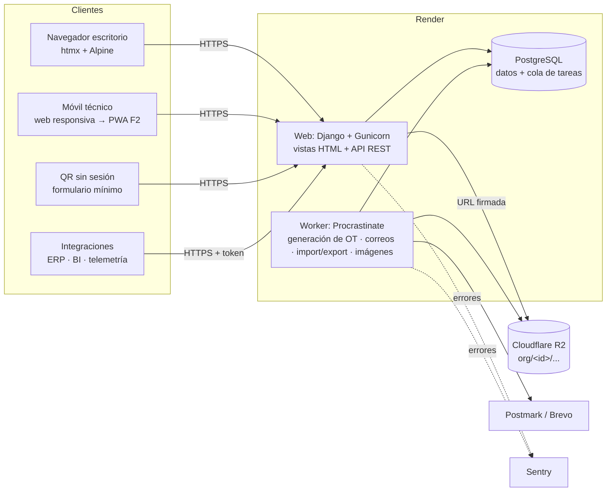

# 04 — Arquitectura

**Estado:** borrador v0.1 (2026-09-24)

## 1. Resumen

**Monolito modular** en Django sobre PostgreSQL, renderizado en servidor con
htmx + Alpine.js, API REST con OpenAPI para integraciones, tareas en segundo
plano con una cola sobre la misma base de datos y archivos en almacenamiento
S3‑compatible. Todo desplegado en un PaaS gestionado. Cero servicios que
operar aparte de Postgres.

| Pieza | Elección |
|---|---|
| Lenguaje / framework | Python 3.13, Django 5.2 LTS (soporte hasta abril de 2028) |
| Base de datos | PostgreSQL 16+ gestionado |
| Frontend | Plantillas Django + htmx 2 + Alpine.js 3, CSS propio con design tokens (sin paso de build en Node) |
| API | Django REST Framework + drf-spectacular (OpenAPI 3) |
| Autenticación | django-allauth (login por correo, verificación, MFA TOTP; SSO OIDC/SAML en F3) |
| Tareas en segundo plano y periódicas | Procrastinate (cola sobre PostgreSQL) |
| Archivos | django-storages → Cloudflare R2 (S3‑compatible) |
| Excel / PDF | openpyxl / WeasyPrint |
| Imágenes | Pillow (compresión y miniaturas en el worker) |
| Correo | Postmark o Brevo vía django-anymail |
| Errores / logs | Sentry + logs JSON a stdout (structlog) |
| Herramientas | uv, ruff (lint + formato), pytest + pytest-django + factory_boy, pre-commit, GitHub Actions |
| Hosting | Render (web + worker + Postgres), región US‑East |

## 2. Diagrama de componentes



## 3. Capas y estructura del código

```
config/                 settings (base, dev, test, prod), urls, wsgi/asgi
apps/
  core/                 TenantModel, contexto de tenant, UUIDv7, permisos base, utilidades
  accounts/             User, Membership, Invitation, roles/permisos, integración allauth
  organizations/        Organization, Plan, feature flags, cupos, Location, marca
  assets/               AssetClass, Asset, AssetStatusPeriod, Meter, MeterReading
  maintenance/          MaintenancePlan, versiones, disparadores, asignaciones, programador
  work/                 WorkOrder, checklist, mano de obra, costos, WorkRequest, FailureEvent, backlog
  catalogs/             FailureCode, plantillas de plataforma (template packs)
  reporting/            KPIs, exportaciones Excel/PDF
  audit/                AuditLog y registro automático
  notifications/        Notification, preferencias, envío de correo
  files/                Attachment, subida, compresión, URLs firmadas, uso por tenant
  api/                  routers DRF, autenticación por token, versión v1
  ui/                   layout base, componentes de plantilla, /design-system/
static/                 css/tokens.css, css/components.css, js/, fonts/
templates/
tests/                  isolation/, permissions/ y tests de cada app
Marca/                  kit de marca original (fuente de verdad, no se edita)
```

Dentro de cada app:

| Archivo | Responsabilidad | Puede importar |
|---|---|---|
| `models.py` | Estructura de datos, restricciones, métodos triviales. Sin lógica de negocio. | `core` |
| `selectors.py` | **Lecturas**: funciones que reciben el contexto (organización, membresía) y devuelven querysets ya filtrados por permisos, con `select_related`/`prefetch_related`. | models de cualquier app |
| `services.py` | **Escrituras y reglas de negocio**: funciones con argumentos por nombre, transaccionales, que validan, escriben, auditan y encolan tareas. | selectors, models, services de otras apps |
| `views.py` | HTTP ↔ servicio/selector. Validan el formulario, llaman a una función, renderizan. Sin lógica. | forms, services, selectors |
| `forms.py` / `api/serializers.py` | Validación de entrada y forma de salida. | models |
| `tasks.py` | Tareas Procrastinate: envoltorios delgados que fijan el tenant y llaman a services. | services |

Reglas: las dependencias van **vista → servicio → selector → modelo**, nunca al
revés; los modelos no llaman servicios; las vistas HTML y la API llaman a
**los mismos** servicios (la API no duplica reglas).

## 4. Multi-tenancy

1. **Resolución** (ADR-003): la organización activa se guarda en la sesión
   (web) o se deduce del token (API). Un middleware carga
   `request.organization` y `request.membership`; si el usuario no tiene
   membresía activa en esa organización, 403.
2. **Contexto**: el middleware fija un `ContextVar` `current_organization`
   durante la petición. Las tareas lo fijan explícitamente con
   `with tenant_context(org):`.
3. **Filtrado que falla cerrado**: el manager por defecto de `TenantModel`
   filtra por la organización del contexto y **lanza `TenantNotSet`** si no
   hay contexto. Para operaciones de plataforma existe un manager explícito
   `all_tenants` que solo se usa en código revisado (comandos de admin,
   migraciones de datos) y se busca con grep en revisiones.
4. **Escritura**: `TenantModel.save()` asigna `organization_id` desde el
   contexto y rechaza guardar si no coincide.
5. **Alcance por sitio**: los selectors aplican además el filtro de
   `membership_location` cuando la membresía está restringida.
6. **Archivos**: claves con prefijo `org/<organization_id>/`; se sirven
   solo mediante URL firmada tras verificar permisos.
7. **Tests de aislamiento** (`tests/isolation/`): para cada modelo, vista y
   endpoint, se crean dos organizaciones y se verifica que A no puede listar,
   ver, editar ni referenciar datos de B (incluido pasar IDs de B en
   formularios y en la API). Un test genérico recorre todos los modelos que
   heredan de `TenantModel` para que ningún modelo nuevo quede fuera.
8. **RLS (segunda defensa)**: antes del primer cliente pagado se activa
   Row‑Level Security en todas las tablas con `organization_id`, con la
   variable de sesión `app.current_organization` fijada con `SET LOCAL` al
   inicio de cada transacción (ver ADR-002).

## 5. Seguridad

| Tema | Medida |
|---|---|
| Autenticación | allauth, Argon2, verificación de correo, MFA TOTP con códigos de recuperación, exigible por organización. |
| Fuerza bruta | Límite de intentos por usuario e IP (django-axes o el rate limit de allauth), bloqueo temporal; límite de tasa en formularios públicos (QR). |
| Sesión | Cookies `Secure`, `HttpOnly`, `SameSite=Lax`; rotación al iniciar sesión y al cambiar de organización; expiración por inactividad configurable. |
| Autorización | Permisos por rol verificados en servicios y selectors (no solo en la UI); objetos siempre obtenidos por selectors con alcance. |
| Transporte | HTTPS obligatorio, HSTS (1 año, preload cuando el dominio sea estable). |
| Cabeceras | CSP estricta (sin scripts en línea; htmx y Alpine servidos localmente; Alpine en su build compatible con CSP), `X-Content-Type-Options`, `Referrer-Policy`, `Permissions-Policy`. |
| API | Tokens por organización con alcances, guardados como hash, con prefijo visible; límite de tasa por token. |
| Archivos | Validación de tipo real (magic bytes) y tamaño; nombres aleatorios; sin ejecución; URLs firmadas de corta duración. |
| Secretos | Variables de entorno de Render; `.env` solo local e ignorado por git; gitleaks en CI. |
| Datos | Cifrado en reposo por el proveedor (Postgres y R2); respaldos cifrados. |
| Dependencias | Dependabot + `pip-audit` en CI. |
| Postura | Documento `docs/07_postura_de_seguridad.md` para clientes (se redacta en MVP‑1). |

## 6. Despliegue y operación

| Ambiente | Infraestructura | Despliegue |
|---|---|---|
| Desarrollo | Local en Windows: Python con uv, PostgreSQL local (instalador oficial o Docker Desktop), almacenamiento en disco. | — |
| Staging | Render: web + worker pequeños, Postgres básico, bucket R2 separado. Datos sintéticos. | Automático al hacer push a `main` con CI en verde. |
| Producción | Render: web + worker, Postgres con respaldos gestionados, bucket R2 de producción. | Manual (promoción del mismo commit) tras validar staging. |

Pipeline (GitHub Actions): ruff → verificación de migraciones faltantes →
pytest (con Postgres de servicio) → `check --deploy` → pip-audit/gitleaks.

Operación:

- `/healthz` (proceso vivo) y `/readyz` (base de datos accesible y cola al día).
- Migraciones en el *pre-deploy command* de Render; migraciones compatibles
  hacia atrás (expand/contract) para no cortar el servicio.
- Respaldos: los del proveedor (recuperación a un punto en el tiempo) más un
  `pg_dump` diario a R2 con retención de 30 días; prueba de restauración en
  staging cada trimestre, registrada en `docs/operacion/`.
- Tareas periódicas (Procrastinate): generación de preventivos cada hora,
  avisos de vencimiento diarios, recálculo de uso de almacenamiento diario,
  respaldo lógico diario.

### Costo estimado de infraestructura

Precios de lista aproximados; verificarlos al contratar.

| Ítem | Staging | Producción |
|---|---|---|
| Render web | ~USD 7 | ~USD 7 → 25 al crecer |
| Render worker | ~USD 7 | ~USD 7 |
| Render Postgres | ~USD 6 | ~USD 19 (1 GB RAM) |
| Cloudflare R2 | gratis (< 10 GB) | ~USD 0–5 |
| Sentry, correo | plan gratuito | plan gratuito → ~USD 15 |
| **Total** | **~USD 20** | **~USD 33–55** |

Alternativas evaluadas: **Railway** (cobro por uso, similar en costo, menos
predecible); **Fly.io** (más barato, pero más operación y Postgres menos
gestionado); **DigitalOcean App Platform** (comparable; opción de respaldo);
**VPS Hetzner + Coolify** (~USD 10, pero respaldos, actualizaciones y seguridad
del servidor quedan a tu cargo: no vale la pena para una sola persona hasta
tener ingresos).

## 7. Zonas horarias e i18n

- `USE_TZ = True`; todo se guarda en UTC.
- Zona de visualización: la del sitio del activo si está definida; si no, la
  de la organización. Un middleware activa la zona de la organización; las
  plantillas que muestran datos de un sitio concreto usan un filtro
  `|site_tz`.
- Fechas "de calendario" (fecha límite de un preventivo por días) se calculan
  en la zona del sitio y se guardan como `timestamptz` al final del día local.
- `LANGUAGE_CODE = "es-cl"`; todo texto con `gettext`/``;
  `LOCALE_PATHS` en el repo; formato numérico y de fecha por locale.

## 8. Decisiones de arquitectura (ADR)

### ADR-001 · Monolito modular con Django y PostgreSQL
- **Contexto:** una sola persona con experiencia en Django; dominio con
  muchas relaciones y reportes.
- **Decisión:** un único proyecto Django organizado en apps por dominio,
  un solo despliegue y una sola base PostgreSQL.
- **Alternativas descartadas:** microservicios (costo operativo imposible
  para una persona); FastAPI + SPA (más código propio para admin, auth,
  formularios y migraciones).
- **Consecuencias:** despliegue y depuración simples; hay que cuidar los
  límites entre apps (reglas de dependencia de la §3) para no crear un
  monolito acoplado.

### ADR-002 · Multi-tenancy con base compartida, columna de tenant y filtrado que falla cerrado; RLS antes de producción paga
- **Contexto:** cientos de organizaciones pequeñas; hay que evitar fugas de
  datos entre ellas; hay que operar barato.
- **Decisión:** una base y un esquema compartidos; `organization_id` en toda
  tabla de negocio (también en las tablas hijas); manager por defecto que
  filtra por el contexto y lanza una excepción si no hay contexto; tests de
  aislamiento obligatorios. RLS de PostgreSQL se activa como segunda defensa
  **antes del primer cliente pagado** (fase MVP‑1), no en el MVP‑0.
- **Por qué RLS no desde el día 1:** requiere un rol de base de datos sin
  `BYPASSRLS`, fijar la variable en cada transacción (interacción con pools
  de conexiones y con las tareas) y ajustar migraciones y tests. Como toda
  tabla ya trae `organization_id`, activarla después es solo agregar policies
  y un middleware, sin migrar datos.
- **Alternativas descartadas:** un esquema por tenant (django-tenants:
  migraciones que crecen con cada cliente y más complejidad); una base por
  tenant (solo como opción del plan Empresa en F3, con el mismo código).
- **Consecuencias:** cada índice empieza por `organization_id`; las consultas
  entre organizaciones (métricas de plataforma) usan el manager explícito.

### ADR-003 · Organización activa en la sesión, un solo dominio
- **Contexto:** los usuarios pueden pertenecer a varias organizaciones.
- **Decisión:** `app.<dominio>` único; la organización activa se guarda en la
  sesión y se cambia con un selector; en la API se deduce del token.
- **Alternativas descartadas:** subdominio por organización (DNS y
  certificados comodín, cookies por subdominio y fricción para usuarios con
  varias organizaciones); prefijo en la URL `/o/<slug>/` (es viable y se
  puede agregar después para enlaces compartibles).
- **Consecuencias:** los enlaces de notificaciones incluyen la organización
  (`?org=`) para cambiar de contexto al abrirlos.

### ADR-004 · Renderizado en servidor con htmx + Alpine; offline acotado en F2
- **Contexto:** perfil Django/HTML/JS; hay que entregar muchas pantallas CRUD
  rápido; el modo offline solo lo necesita el técnico.
- **Decisión:** plantillas Django + htmx para interactividad parcial +
  Alpine.js para estado local de la UI. Sin SPA ni build en Node. El modo
  offline (F2) se implementa como una PWA acotada al flujo del técnico, con
  JS propio sobre la API REST (ADR-011).
- **Alternativas descartadas:** SPA en React/Vue (duplica rutas, validación y
  permisos, y exige un segundo stack); Tailwind (requiere paso de build y es
  redundante con los design tokens).
- **Consecuencias:** una sola fuente de verdad para permisos y validación;
  el offline requerirá una capa JS separada pero pequeña.

### ADR-005 · API REST con DRF y drf-spectacular
- **Decisión:** DRF por su ecosistema (permisos, throttling, filtros,
  paginación) y drf-spectacular para OpenAPI 3 en `/api/schema/` y
  `/api/docs/`. Versionado por URL (`/api/v1/`).
- **Alternativa descartada:** Django Ninja (más liviano, pero menos probado en
  permisos por objeto y throttling).
- **Consecuencias:** los serializers son delgados y llaman a los mismos
  servicios que las vistas.

### ADR-006 · Autenticación con django-allauth
- **Decisión:** allauth para registro, login por correo, verificación, MFA
  (TOTP + códigos de recuperación) y, en F3, SSO OIDC/SAML (Microsoft Entra
  ID), todo con una sola librería.
- **Alternativa descartada:** combinar django-otp, python3-saml y vistas
  propias (más piezas para mantener).
- **Consecuencias:** las invitaciones y las membresías son lógica propia
  sobre el usuario de allauth.

### ADR-007 · Tareas en segundo plano con Procrastinate sobre PostgreSQL
- **Contexto:** hay que generar preventivos, enviar correos, procesar
  importaciones y comprimir imágenes; la meta es no operar Redis.
- **Decisión:** Procrastinate (cola en Postgres con `LISTEN/NOTIFY`, tareas
  periódicas, reintentos) en un proceso worker.
- **Alternativas descartadas:** Celery + Redis (un servicio más que pagar y
  vigilar); cron del PaaS (sin reintentos ni cola).
- **Consecuencias:** el volumen de tareas está acotado por Postgres (de sobra
  para esta escala). Si algún día hace falta, se migra a otro backend sin
  cambiar los servicios, porque las tareas son envoltorios delgados.

### ADR-008 · Ciclo de vida de la OT fijo con pasos opcionales
- **Contexto:** el brief pide un ciclo configurable; el cliente objetivo
  valora la simplicidad; un motor de workflows es caro de construir y probar.
- **Decisión:** estados canónicos fijos en código
  (`requested → planned → scheduled → in_progress ⇄ on_hold → completed →
  closed`, más `cancelled`), con pasos activables por organización
  (aprobación de cierre, paso por *planned*) y nombres visibles editables.
- **Alternativa descartada:** estados y transiciones definidos por el cliente.
- **Consecuencias:** los KPI y reportes se apoyan en estados conocidos; si un
  cliente Empresa lo exige, se evalúa en F3.

### ADR-009 · Claves UUIDv7
- **Decisión:** PK `UUID` versión 7 generada en la aplicación.
- **Por qué:** el offline necesita IDs creados en el cliente; los UUIDv7 no
  son adivinables en URLs y, por ser ordenables en el tiempo, no degradan los
  índices B-tree como UUIDv4.
- **Consecuencias:** los números visibles para humanos (OT, solicitudes) son
  correlativos aparte (`work_order_sequence`).

### ADR-010 · Render + Cloudflare R2 + Sentry
- **Decisión:** ver §6. Región US‑East por latencia a Sudamérica.
- **Alternativas descartadas:** ver §6.
- **Consecuencias:** los datos quedan fuera de Chile; se declara en la
  postura de seguridad. Si un cliente exige residencia local, se evalúa la
  opción de base dedicada del plan Empresa en un proveedor con región
  sudamericana (ej. AWS São Paulo o Santiago).

### ADR-011 · Estrategia offline (se implementa en F2, se diseña ahora)
- **Alcance:** solo el flujo del técnico: ver OT asignadas, ejecutar
  checklist, registrar lecturas, horas y fotos, y crear solicitudes.
- **Diseño:**
  - Un Service Worker cachea la estructura de la aplicación y las OT asignadas
    de los próximos N días.
  - Cada escritura se encola en IndexedDB con un `client_uuid` generado en el
    dispositivo y se envía cuando hay conexión.
  - En el servidor, las escrituras son **idempotentes por `client_uuid`**:
    reintentar un envío nunca duplica datos.
  - Los correlativos (número de OT o de solicitud) los asigna el servidor al
    sincronizar; mientras tanto la UI muestra "pendiente".
  - **Conflictos:** en los ítems de checklist gana la última respuesta por
    `answered_at`, y la anterior queda en auditoría. En el estado de la OT, el
    servidor valida la transición: si la OT fue cancelada o reasignada, la
    sincronización se rechaza para ese elemento y el técnico ve el conflicto.
    Lecturas y fotos se agregan sin conflicto.
- **Consecuencias hoy:** `client_uuid` en las tablas del técnico, servicios
  idempotentes y una API que cubre el flujo del técnico desde el MVP.

### ADR-012 · Código en inglés, interfaz en español vía i18n
- **Decisión:** identificadores, modelos, tablas y commits en inglés;
  interfaz en español (es-CL) mediante archivos de traducción; documentación
  en español.
- **Por qué:** el ecosistema y las librerías están en inglés; evita mezclas
  (`get_activos_by_sitio`) y deja listo el paso a inglés y portugués.
- **Consecuencias:** el glosario de `CLAUDE.md` mapea los términos del
  dominio (activo = asset, OT = work order, etc.).

### ADR-013 · Roles fijos con permisos en código y alcance por sitio
- **Decisión:** seis roles con una matriz de permisos en código
  (`accounts/permissions.py`); cada membresía puede restringirse a sitios.
  Los roles personalizados quedan para F3.
- **Alternativa descartada:** grupos y permisos de Django por organización
  (difíciles de probar y de explicar a una pyme).
- **Consecuencias:** cada permiso sensible tiene un test en
  `tests/permissions/`.

### ADR-014 · Archivos en R2 con prefijo por organización y procesamiento en el worker
- **Decisión:** subida al servidor → validación → almacenamiento del original
  temporal → tarea que comprime y redimensiona las imágenes (WebP/JPEG, lado
  mayor ≤ 2000 px, miniatura de 400 px) → `size_bytes` suma al uso de la
  organización. Descarga por URL firmada (5 minutos).
- **Alternativa descartada por ahora:** subida directa del navegador a R2 con
  URL prefirmada (menos carga en el servidor, pero más complejidad; se
  reevalúa si los archivos grandes afectan el rendimiento).

### ADR-015 · CSS propio con design tokens, sin framework
- **Decisión:** `tokens.css` (variables en `:root` y en `[data-theme=dark]`) +
  `components.css` con clases de componentes. Sin Bootstrap ni Tailwind.
- **Por qué:** control total sobre la marca y el contraste, sin paso de build
  y con un catálogo acotado de componentes.
- **Consecuencias:** mantener el catálogo en `/design-system/` y no escribir
  estilos sueltos en las plantillas.

### ADR-016 · Versiones inmutables de planes preventivos
- **Contexto:** PM-03 exige que editar un plan no altere OT existentes y que
  las OT futuras usen la nueva definición. Los planes cambian (frecuencia,
  checklist, repuestos) mientras hay OT abiertas y asignaciones programadas.
- **Decisión:**
  - El contenido del plan (frecuencia, modo de reprogramación, tolerancia,
    duración, instrucciones, checklist y recursos) vive en `plan_version`.
    `maintenance_plan.current_version` apunta a la publicada vigente.
  - Flujo: *borrador → publicar*. Hay un solo borrador por plan, y se crea
    copiando la versión vigente. Publicar marca la anterior como
    `superseded`.
  - Una versión publicada es **inmutable**: `PlanVersion.save()` rechaza
    cambios de contenido (solo puede cambiar de estado), y los ítems y
    recursos solo se crean, editan o borran en borradores.
  - La OT guarda `plan_version` (PROTECT) y copia el checklist para
    registrar resultados. Los recursos previstos se leen de la versión, que
    no cambia.
  - Las asignaciones apuntan al **plan**, no a la versión. La generación y
    la reprogramación usan la versión vigente en ese momento, así que
    publicar no obliga a reasignar N activos.
  - Si la nueva versión cambia la frecuencia, `publish_version` recalcula en
    la misma transacción el próximo vencimiento de las asignaciones **sin
    OT abierta**. Lo cuenta desde la última ejecución o lectura de cierre;
    si nunca se ejecutó, desde el inicio implícito del ciclo anterior. Así,
    acortar de 30 a 7 días se nota de inmediato. Las asignaciones con OT
    abierta se reprograman al cerrarla.
  - Los disparadores son campos de la versión (uno por calendario y uno por
    medidor, vence lo que ocurra primero), no una tabla `plan_trigger`.
  - Modo fijo: el siguiente objetivo es el anterior + k·intervalo, con el
    menor k que lo deja después de la ejecución. Una OT muy atrasada no
    genera OT en el pasado.
- **Alternativas descartadas:**
  - Editar el plan en sitio y confiar solo en el snapshot del checklist:
    pierde la trazabilidad de frecuencia y recursos.
  - Asignaciones apuntando a una versión: cada publicación tendría que
    migrarlas.
  - Tabla de disparadores: más flexibilidad de la que el dominio necesita.
- **Consecuencias:**
  - La inmutabilidad se aplica en `save()`/`delete()`; `QuerySet.update()`
    y `bulk_*` la saltan. Los servicios no los usan sobre versiones, ítems
    ni recursos de versiones publicadas, salvo `bulk_create` al crear un
    borrador.
  - Las propiedades de frecuencia del plan (`interval_days`,
    `frequency_label`, `uses_meter`…) delegan en la versión vigente y
    devuelven vacío si no la hay.
  - Las versiones usadas por OT no se pueden borrar.
