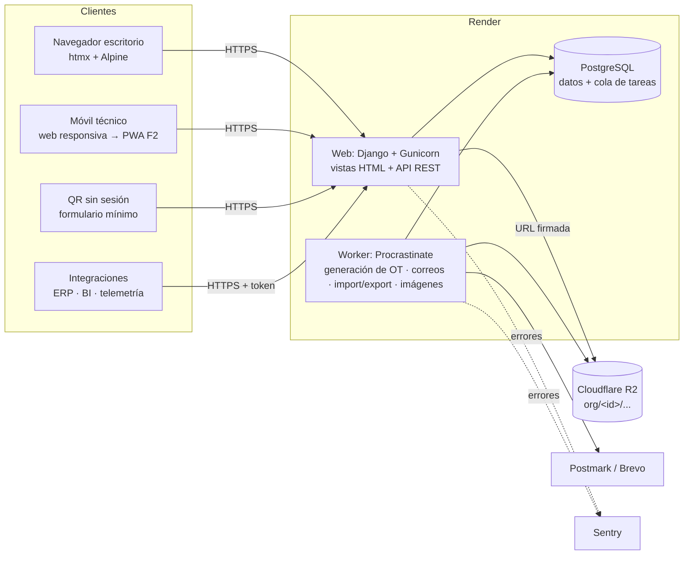

# 04 — Arquitectura

**Estado:** borrador v0.1 (2026-09-24)

## 1. Resumen

**Monolito modular** en Django sobre PostgreSQL, renderizado en servidor con
htmx + Alpine.js, API REST con OpenAPI para integraciones, tareas en segundo
plano con una cola sobre la misma base de datos y archivos en almacenamiento
S3‑compatible. Todo desplegado en un PaaS gestionado. Cero servicios que
operar aparte de Postgres.

| Pieza | Elección |
|---|---|
| Lenguaje / framework | Python 3.13, Django 5.2 LTS (soporte hasta abril de 2028) |
| Base de datos | PostgreSQL 16+ gestionado |
| Frontend | Plantillas Django + htmx 2 + Alpine.js 3, CSS propio con design tokens (sin paso de build en Node) |
| API | Django REST Framework + drf-spectacular (OpenAPI 3) |
| Autenticación | django-allauth (login por correo, verificación, MFA TOTP; SSO OIDC/SAML en F3) |
| Tareas en segundo plano y periódicas | Procrastinate (cola sobre PostgreSQL) |
| Archivos | django-storages → Cloudflare R2 (S3‑compatible) |
| Excel / PDF | openpyxl / reportlab (ADR-019) |
| Imágenes | Pillow (compresión y miniaturas en el worker) |
| Correo | Postmark o Brevo vía django-anymail |
| Asistente IA (F2) | API de Anthropic con el SDK oficial `anthropic`; búsqueda con texto completo de PostgreSQL (ADR-018) |
| Errores / logs | Sentry + logs JSON a stdout (formateador propio sobre `logging`, ADR-020) |
| Herramientas | uv, ruff (lint + formato), pytest + pytest-django + factory_boy, pre-commit, GitHub Actions |
| Hosting | Render (web + worker + Postgres), región US‑East |

## 2. Diagrama de componentes



## 3. Capas y estructura del código

```
config/                 settings (base, dev, test, prod), urls, wsgi/asgi
apps/
  core/                 TenantModel, contexto de tenant, UUIDv7, permisos base, utilidades
  accounts/             User, Membership, Invitation, roles/permisos, integración allauth
  organizations/        Organization, Plan, feature flags, cupos, Location, marca
  assets/               AssetClass, Asset, AssetStatusPeriod, Meter, MeterReading
  maintenance/          MaintenancePlan, versiones, disparadores, asignaciones, programador
  work/                 WorkOrder, checklist, mano de obra, costos, WorkRequest, FailureEvent, backlog
  catalogs/             FailureCode, plantillas de plataforma (template packs)
  reporting/            KPIs, exportaciones Excel/PDF
  audit/                AuditLog y registro automático
  notifications/        Notification, preferencias, envío de correo
  files/                Attachment, subida, compresión, URLs firmadas, uso por tenant
  api/                  routers DRF, autenticación por token, versión v1
  ui/                   layout base, componentes de plantilla, /design-system/
static/                 css/tokens.css, css/components.css, js/, fonts/
templates/
tests/                  isolation/, permissions/ y tests de cada app
Marca/                  kit de marca original (fuente de verdad, no se edita)
```

Dentro de cada app:

| Archivo | Responsabilidad | Puede importar |
|---|---|---|
| `models.py` | Estructura de datos, restricciones, métodos triviales. Sin lógica de negocio. | `core` |
| `selectors.py` | **Lecturas**: funciones que reciben el contexto (organización, membresía) y devuelven querysets ya filtrados por permisos, con `select_related`/`prefetch_related`. | models de cualquier app |
| `services.py` | **Escrituras y reglas de negocio**: funciones con argumentos por nombre, transaccionales, que validan, escriben, auditan y encolan tareas. | selectors, models, services de otras apps |
| `views.py` | HTTP ↔ servicio/selector. Validan el formulario, llaman a una función, renderizan. Sin lógica. | forms, services, selectors |
| `forms.py` / `api/serializers.py` | Validación de entrada y forma de salida. | models |
| `tasks.py` | Tareas Procrastinate: envoltorios delgados que fijan el tenant y llaman a services. | services |

Reglas: las dependencias van **vista → servicio → selector → modelo**, nunca al
revés; los modelos no llaman servicios; las vistas HTML y la API llaman a
**los mismos** servicios (la API no duplica reglas).

## 4. Multi-tenancy

1. **Resolución** (ADR-003): la organización activa se guarda en la sesión
   (web) o se deduce del token (API). Un middleware carga
   `request.organization` y `request.membership`; si el usuario no tiene
   membresía activa en esa organización, 403.
2. **Contexto**: el middleware fija un `ContextVar` `current_organization`
   durante la petición. Las tareas lo fijan explícitamente con
   `with tenant_context(org):`.
3. **Filtrado que falla cerrado**: el manager por defecto de `TenantModel`
   filtra por la organización del contexto y **lanza `TenantNotSet`** si no
   hay contexto. Para operaciones de plataforma existe un manager explícito
   `all_tenants` que solo se usa en código revisado (comandos de admin,
   migraciones de datos) y se busca con grep en revisiones. Excepción
   acotada: el QR sin sesión (REQ-02) busca el activo por su token no
   adivinable y fija `tenant_context` con la organización de ese activo
   (`assets.selectors.asset_for_anonymous_report`).
4. **Escritura**: `TenantModel.save()` asigna `organization_id` desde el
   contexto y rechaza guardar si no coincide.
5. **Alcance por sitio**: los selectors aplican además el filtro de
   `membership_location` cuando la membresía está restringida.
6. **Archivos**: claves con prefijo `org/<organization_id>/`; se sirven
   solo mediante URL firmada tras verificar permisos.
7. **Tests de aislamiento** (`tests/isolation/`): para cada modelo, vista y
   endpoint, se crean dos organizaciones y se verifica que A no puede listar,
   ver, editar ni referenciar datos de B (incluido pasar IDs de B en
   formularios y en la API). Un test genérico recorre todos los modelos que
   heredan de `TenantModel` para que ningún modelo nuevo quede fuera.
8. **RLS (segunda defensa, ADR-026)**: en PostgreSQL toda tabla de un
   `TenantModel` tiene `FORCE ROW LEVEL SECURITY` y la política
   `tenant_isolation`, que compara `organization_id` con la variable de sesión
   `app.current_organization`. `tenant_context()` la fija al entrar y la
   restaura al salir; `request_finished` la limpia. Activa antes del piloto
   con datos reales.

## 5. Seguridad

| Tema | Medida |
|---|---|
| Autenticación | allauth, Argon2, verificación de correo, MFA TOTP con códigos de recuperación, exigible por organización. |
| Fuerza bruta | Límite de intentos por usuario e IP (django-axes o el rate limit de allauth), bloqueo temporal; límite de tasa en formularios públicos: registro (rate limit de allauth) y aviso por QR sin cuenta (por IP y por activo, `apps.accounts.antibot.consume_rate`), ambos con campo trampa, tiempo mínimo y suma firmada. |
| Sesión | Cookies `Secure`, `HttpOnly`, `SameSite=Lax`; rotación al iniciar sesión y al cambiar de organización; expiración por inactividad configurable. |
| Autorización | Permisos por rol verificados en servicios y selectors (no solo en la UI); objetos siempre obtenidos por selectors con alcance. |
| Transporte | HTTPS obligatorio, HSTS (1 año, preload cuando el dominio sea estable). |
| Cabeceras | CSP estricta en toda respuesta (ADR-023: sin scripts ni estilos en línea; htmx y Alpine servidos localmente; Alpine en su build compatible con CSP), `X-Content-Type-Options`, `Referrer-Policy`, `Permissions-Policy`. |
| API | Tokens por organización con alcances, guardados como hash, con prefijo visible; límite de tasa por token. |
| Archivos | Validación de tipo real (magic bytes) y tamaño; nombres aleatorios; sin ejecución; URLs firmadas de corta duración. |
| Secretos | Variables de entorno de Render; `.env` solo local e ignorado por git; gitleaks en CI. |
| Datos | Cifrado en reposo por el proveedor (Postgres y R2); respaldos cifrados. |
| Dependencias | Dependabot + `pip-audit` en CI. |
| Postura | Documento `docs/07_postura_de_seguridad.md` para clientes (se redacta en MVP‑1). |

## 6. Despliegue y operación

| Ambiente | Infraestructura | Despliegue |
|---|---|---|
| Desarrollo | Local en Windows: Python con uv, PostgreSQL local (instalador oficial o Docker Desktop), almacenamiento en disco. | — |
| Staging | Render: web + worker pequeños, Postgres básico, bucket R2 separado. Datos sintéticos. | Automático al hacer push a `main` con CI en verde. |
| Producción | Render: web + worker, Postgres con respaldos gestionados, bucket R2 de producción. | Manual (promoción del mismo commit) tras validar staging. |

Pipeline (GitHub Actions): ruff → verificación de migraciones faltantes →
pytest (con Postgres de servicio) → `check --deploy` → pip-audit/gitleaks.

Operación:

- `/healthz` (proceso vivo) y `/readyz` (base de datos accesible y cola al día).
- Migraciones en el *pre-deploy command* de Render; migraciones compatibles
  hacia atrás (expand/contract) para no cortar el servicio.
- Respaldos: los del proveedor (recuperación a un punto en el tiempo) más un
  `pg_dump` diario a R2 con retención de 30 días; prueba de restauración en
  staging cada trimestre, registrada en `docs/operacion/`.
- Tareas periódicas (Procrastinate): generación de preventivos cada hora,
  avisos de vencimiento diarios, recálculo de uso de almacenamiento diario,
  respaldo lógico diario.

### Costo estimado de infraestructura

Precios de lista aproximados; verificarlos al contratar.

| Ítem | Staging | Producción |
|---|---|---|
| Render web | ~USD 7 | ~USD 7 → 25 al crecer |
| Render worker | ~USD 7 | ~USD 7 |
| Render Postgres | ~USD 6 | ~USD 19 (1 GB RAM) |
| Cloudflare R2 | gratis (< 10 GB) | ~USD 0–5 |
| Sentry, correo | plan gratuito | plan gratuito → ~USD 15 |
| **Total** | **~USD 20** | **~USD 33–55** |

Alternativas evaluadas: **Railway** (cobro por uso, similar en costo, menos
predecible); **Fly.io** (más barato, pero más operación y Postgres menos
gestionado); **DigitalOcean App Platform** (comparable; opción de respaldo);
**VPS Hetzner + Coolify** (~USD 10, pero respaldos, actualizaciones y seguridad
del servidor quedan a tu cargo: no vale la pena para una sola persona hasta
tener ingresos).

## 7. Zonas horarias e i18n

- `USE_TZ = True`; todo se guarda en UTC.
- Zona de visualización: la del sitio del activo si está definida; si no, la
  de la organización. Un middleware activa la zona de la organización; las
  plantillas que muestran datos de un sitio concreto usan un filtro
  `|site_tz`.
- Fechas "de calendario" (fecha límite de un preventivo por días) se calculan
  en la zona del sitio y se guardan como `timestamptz` al final del día local.
- `LANGUAGE_CODE = "es-cl"`; todo texto con `gettext`/``;
  `LOCALE_PATHS` en el repo; formato numérico y de fecha por locale.

## 8. Decisiones de arquitectura (ADR)

### ADR-001 · Monolito modular con Django y PostgreSQL
- **Contexto:** una sola persona con experiencia en Django; dominio con
  muchas relaciones y reportes.
- **Decisión:** un único proyecto Django organizado en apps por dominio,
  un solo despliegue y una sola base PostgreSQL.
- **Alternativas descartadas:** microservicios (costo operativo imposible
  para una persona); FastAPI + SPA (más código propio para admin, auth,
  formularios y migraciones).
- **Consecuencias:** despliegue y depuración simples; hay que cuidar los
  límites entre apps (reglas de dependencia de la §3) para no crear un
  monolito acoplado.

### ADR-002 · Multi-tenancy con base compartida, columna de tenant y filtrado que falla cerrado; RLS antes de producción paga
- **Contexto:** cientos de organizaciones pequeñas; hay que evitar fugas de
  datos entre ellas; hay que operar barato.
- **Decisión:** una base y un esquema compartidos; `organization_id` en toda
  tabla de negocio (también en las tablas hijas); manager por defecto que
  filtra por el contexto y lanza una excepción si no hay contexto; tests de
  aislamiento obligatorios. RLS de PostgreSQL se activa como segunda defensa
  **antes del primer cliente pagado** (fase MVP‑1), no en el MVP‑0.
  *Actualización:* se adelantó a antes del piloto con datos reales; el
  diseño está en ADR-026.
- **Por qué RLS no desde el día 1:** requiere un rol de base de datos sin
  `BYPASSRLS`, fijar la variable en cada transacción (interacción con pools
  de conexiones y con las tareas) y ajustar migraciones y tests. Como toda
  tabla ya trae `organization_id`, activarla después es solo agregar policies
  y un middleware, sin migrar datos.
- **Alternativas descartadas:** un esquema por tenant (django-tenants:
  migraciones que crecen con cada cliente y más complejidad); una base por
  tenant (solo como opción del plan Empresa en F3, con el mismo código).
- **Consecuencias:** cada índice empieza por `organization_id`; las consultas
  entre organizaciones (métricas de plataforma) usan el manager explícito.

### ADR-003 · Organización activa en la sesión, un solo dominio
- **Contexto:** los usuarios pueden pertenecer a varias organizaciones.
- **Decisión:** `app.<dominio>` único; la organización activa se guarda en la
  sesión y se cambia con un selector; en la API se deduce del token.
- **Alternativas descartadas:** subdominio por organización (DNS y
  certificados comodín, cookies por subdominio y fricción para usuarios con
  varias organizaciones); prefijo en la URL `/o/<slug>/` (es viable y se
  puede agregar después para enlaces compartibles).
- **Consecuencias:** los enlaces de notificaciones deberían incluir la
  organización (`?org=`) para cambiar de contexto al abrirlos. Pendiente: hoy
  los correos enlazan a la OT sin `?org=`; quien tiene varias organizaciones
  debe cambiar la activa antes (la bandeja muestra solo la organización activa).

### ADR-004 · Renderizado en servidor con htmx + Alpine; offline acotado en F2
- **Contexto:** perfil Django/HTML/JS; hay que entregar muchas pantallas CRUD
  rápido; el modo offline solo lo necesita el técnico.
- **Decisión:** plantillas Django + htmx para interactividad parcial +
  Alpine.js para estado local de la UI. Sin SPA ni build en Node. El modo
  offline (F2) se implementa como una PWA acotada al flujo del técnico, con
  JS propio sobre la API REST (ADR-011).
- **Alternativas descartadas:** SPA en React/Vue (duplica rutas, validación y
  permisos, y exige un segundo stack); Tailwind (requiere paso de build y es
  redundante con los design tokens).
- **Consecuencias:** una sola fuente de verdad para permisos y validación;
  el offline requerirá una capa JS separada pero pequeña.

### ADR-005 · API REST con DRF y drf-spectacular
- **Decisión:** DRF por su ecosistema (permisos, throttling, filtros,
  paginación) y drf-spectacular para OpenAPI 3 en `/api/schema/` y
  `/api/docs/`. Versionado por URL (`/api/v1/`).
- **Alternativa descartada:** Django Ninja (más liviano, pero menos probado en
  permisos por objeto y throttling).
- **Consecuencias:** los serializers son delgados y llaman a los mismos
  servicios que las vistas.
- **Implementación (X-05, `apps/api`):**
  - **Autenticación:** solo `Authorization: Bearer gbt_…` (sin sesión, así no
    hay CSRF). El token fija el contexto de tenant y la zona horaria de su
    organización (`TenantAPIMixin`); revocado, vencido, inexistente o de una
    organización inactiva → 401.
  - **Principal de servicio:** el token actúa como una membresía en memoria con
    rol planificador sobre toda la organización (sin alcance por sitio) y un
    usuario técnico propio; nunca administra equipo, auditoría, configuración ni
    tokens. Alcance `read`: solo métodos GET; `write`: además escribe.
  - **Límite de tasa:** `TokenRateThrottle`, por token, `API_RATE_LIMIT`
    (por defecto `600/min`), sobre el caché en la base de datos.
  - **Endpoints:** `/api/v1/assets/` (lista, detalle, alta, PATCH),
    `/meters/`, `/readings/` (lista, alta, `bulk/`), `/work-orders/` (lista,
    detalle, alta, `{id}/transition/`), `/requests/` (lista, detalle, alta).
    Paginación por página (`page`, `page_size` ≤ 200). Altas de lecturas, OT y
    solicitudes idempotentes por `client_uuid`; la carga masiva, por
    (medidor, fecha, valor); repetir una transición al mismo estado no hace nada.
  - **Errores:** `{"error": {"code", "message", "details"}}` con textos en español.
  - **Documentación:** esquema en `/api/schema/` y Swagger UI en `/api/docs/`
    servido desde estáticos locales (`drf-spectacular-sidecar`) con el script de
    inicio en un archivo aparte, compatible con la CSP estricta (sin CDN ni JS en
    línea). Un test genera el esquema con `--fail-on-warn`.
  - **Pantalla:** `/settings/api-tokens/` (solo administradores, permiso
    `api_token.manage`), enlazada desde "Más".

### ADR-006 · Autenticación con django-allauth
- **Decisión:** allauth para registro, login por correo, verificación, MFA
  (TOTP + códigos de recuperación) y, en F3, SSO OIDC/SAML (Microsoft Entra
  ID), todo con una sola librería.
- **Alternativa descartada:** combinar django-otp, python3-saml y vistas
  propias (más piezas para mantener).
- **Consecuencias:** las invitaciones y las membresías son lógica propia
  sobre el usuario de allauth.

### ADR-007 · Tareas en segundo plano con Procrastinate sobre PostgreSQL
- **Contexto:** hay que generar preventivos, enviar correos, procesar
  importaciones y comprimir imágenes; la meta es no operar Redis.
- **Decisión:** Procrastinate (cola en Postgres con `LISTEN/NOTIFY`, tareas
  periódicas, reintentos) en un proceso worker.
- **Alternativas descartadas:** Celery + Redis (un servicio más que pagar y
  vigilar); cron del PaaS (sin reintentos ni cola).
- **Consecuencias:** el volumen de tareas está acotado por Postgres (de sobra
  para esta escala). Si algún día hace falta, se migra a otro backend sin
  cambiar los servicios, porque las tareas son envoltorios delgados.

### ADR-008 · Ciclo de vida de la OT fijo con pasos opcionales
- **Contexto:** el brief pide un ciclo configurable; el cliente objetivo
  valora la simplicidad; un motor de workflows es caro de construir y probar.
- **Decisión:** estados canónicos fijos en código
  (`requested → planned → scheduled → in_progress ⇄ on_hold → completed →
  closed`, más `cancelled`), con pasos activables por organización
  (aprobación de cierre, paso por *planned*) y nombres visibles editables.
- **Alternativa descartada:** estados y transiciones definidos por el cliente.
- **Consecuencias:** los KPI y reportes se apoyan en estados conocidos; si un
  cliente Empresa lo exige, se evalúa en F3.

### ADR-009 · Claves UUIDv7
- **Decisión:** PK `UUID` versión 7 generada en la aplicación.
- **Por qué:** el offline necesita IDs creados en el cliente; los UUIDv7 no
  son adivinables en URLs y, por ser ordenables en el tiempo, no degradan los
  índices B-tree como UUIDv4.
- **Consecuencias:** los números visibles para humanos (OT, solicitudes) son
  correlativos aparte (`work_order_sequence`).

### ADR-010 · Render + Cloudflare R2 + Sentry
- **Decisión:** ver §6. Región US‑East por latencia a Sudamérica.
- **Alternativas descartadas:** ver §6.
- **Consecuencias:** los datos quedan fuera de Chile; se declara en la
  postura de seguridad. Si un cliente exige residencia local, se evalúa la
  opción de base dedicada del plan Empresa en un proveedor con región
  sudamericana (ej. AWS São Paulo o Santiago).

### ADR-011 · Estrategia offline (se implementa en F2, se diseña ahora)
- **Alcance:** solo el flujo del técnico: ver OT asignadas, ejecutar
  checklist, registrar lecturas, horas y fotos, y crear solicitudes.
- **Diseño:**
  - Un Service Worker cachea la estructura de la aplicación y las OT asignadas
    de los próximos N días.
  - Cada escritura se encola en IndexedDB con un `client_uuid` generado en el
    dispositivo y se envía cuando hay conexión.
  - En el servidor, las escrituras son **idempotentes por `client_uuid`**:
    reintentar un envío nunca duplica datos.
  - Los correlativos (número de OT o de solicitud) los asigna el servidor al
    sincronizar; mientras tanto la UI muestra "pendiente".
  - **Conflictos:** en los ítems de checklist gana la última respuesta por
    `answered_at`, y la anterior queda en auditoría. En el estado de la OT, el
    servidor valida la transición: si la OT fue cancelada o reasignada, la
    sincronización se rechaza para ese elemento y el técnico ve el conflicto.
    Lecturas y fotos se agregan sin conflicto.
- **Consecuencias hoy:** `client_uuid` en las tablas del técnico, servicios
  idempotentes y una API que cubre el flujo del técnico desde el MVP.

### ADR-012 · Código en inglés, interfaz en español vía i18n
- **Decisión:** identificadores, modelos, tablas y commits en inglés;
  interfaz en español (es-CL) mediante archivos de traducción; documentación
  en español.
- **Por qué:** el ecosistema y las librerías están en inglés; evita mezclas
  (`get_activos_by_sitio`) y deja listo el paso a inglés y portugués.
- **Consecuencias:** el glosario de `CLAUDE.md` mapea los términos del
  dominio (activo = asset, OT = work order, etc.).

### ADR-013 · Roles fijos con permisos en código y alcance por sitio
- **Decisión:** seis roles con una matriz de permisos en código
  (`accounts/permissions.py`); cada membresía puede restringirse a sitios.
  Los roles personalizados quedan para F3.
- **Alternativa descartada:** grupos y permisos de Django por organización
  (difíciles de probar y de explicar a una pyme).
- **Consecuencias:** cada permiso sensible tiene un test en
  `tests/permissions/`.

### ADR-014 · Archivos en R2 con prefijo por organización y procesamiento en el worker
- **Decisión:** subida al servidor → validación → almacenamiento del original
  temporal → tarea que comprime y redimensiona las imágenes (WebP/JPEG, lado
  mayor ≤ 2000 px, miniatura de 400 px) → `size_bytes` suma al uso de la
  organización. Descarga por URL firmada (5 minutos).
- **Alternativa descartada por ahora:** subida directa del navegador a R2 con
  URL prefirmada (menos carga en el servidor, pero más complejidad; se
  reevalúa si los archivos grandes afectan el rendimiento).

### ADR-015 · CSS propio con design tokens, sin framework
- **Decisión:** `tokens.css` (variables en `:root` y en `[data-theme=dark]`) +
  `components.css` con clases de componentes. Sin Bootstrap ni Tailwind.
- **Por qué:** control total sobre la marca y el contraste, sin paso de build
  y con un catálogo acotado de componentes.
- **Consecuencias:** mantener el catálogo en `/design-system/` y no escribir
  estilos sueltos en las plantillas.

### ADR-016 · Versiones inmutables de planes preventivos
- **Contexto:** PM-03 exige que editar un plan no altere OT existentes y que
  las OT futuras usen la nueva definición. Los planes cambian (frecuencia,
  checklist, repuestos) mientras hay OT abiertas y asignaciones programadas.
- **Decisión:**
  - El contenido del plan (frecuencia, modo de reprogramación, tolerancia,
    duración, instrucciones, checklist y recursos) vive en `plan_version`.
    `maintenance_plan.current_version` apunta a la publicada vigente.
  - Flujo: *borrador → publicar*. Hay un solo borrador por plan, y se crea
    copiando la versión vigente. Publicar marca la anterior como
    `superseded`.
  - Una versión publicada es **inmutable**: `PlanVersion.save()` rechaza
    cambios de contenido (solo puede cambiar de estado), y los ítems y
    recursos solo se crean, editan o borran en borradores.
  - La OT guarda `plan_version` (PROTECT) y copia el checklist para
    registrar resultados. Los recursos previstos se leen de la versión, que
    no cambia.
  - Las asignaciones apuntan al **plan**, no a la versión. La generación y
    la reprogramación usan la versión vigente en ese momento, así que
    publicar no obliga a reasignar N activos.
  - Si la nueva versión cambia la frecuencia, `publish_version` recalcula en
    la misma transacción el próximo vencimiento de las asignaciones **sin
    OT abierta**. Lo cuenta desde la última ejecución o lectura de cierre;
    si nunca se ejecutó, desde el inicio implícito del ciclo anterior. Así,
    acortar de 30 a 7 días se nota de inmediato. Las asignaciones con OT
    abierta se reprograman al cerrarla.
  - Los disparadores son campos de la versión (uno por calendario y uno por
    medidor, vence lo que ocurra primero), no una tabla `plan_trigger`.
  - Modo fijo: el siguiente objetivo es el anterior + k·intervalo, con el
    menor k que lo deja después de la ejecución. Una OT muy atrasada no
    genera OT en el pasado.
  - La frecuencia por calendario es `calendar_interval` + `calendar_unit`
    (días, semanas = 7 días, meses de calendario). Un mes suma el mismo día
    del mes ajustado al último día si no existe (31‑ene + 1 mes = 28/29‑feb);
    en modo fijo se suman k meses desde el objetivo anterior de una vez.
    Cambiar la unidad cuenta como cambio de frecuencia al publicar.
  - Absorción (PM‑05 CA3): `plan_absorption` es un dato del plan (rige sin
    publicar). La OT del plan mayor copia el checklist de su versión y el de
    la versión vigente de cada menor absorbido, en secciones rotuladas;
    `work_order_absorption` guarda la asignación y la versión del menor.
  - El horizonte de generación vive en `maintenance_settings` (por
    organización, 14 días por defecto).
- **Alternativas descartadas:**
  - Editar el plan en sitio y confiar solo en el snapshot del checklist:
    pierde la trazabilidad de frecuencia y recursos.
  - Asignaciones apuntando a una versión: cada publicación tendría que
    migrarlas.
  - Tabla de disparadores: más flexibilidad de la que el dominio necesita.
- **Consecuencias:**
  - La inmutabilidad se aplica en `save()`/`delete()`; `QuerySet.update()`
    y `bulk_*` la saltan. Los servicios no los usan sobre versiones, ítems
    ni recursos de versiones publicadas, salvo `bulk_create` al crear un
    borrador.
  - Las propiedades de frecuencia del plan (`interval_days`,
    `frequency_label`, `uses_meter`…) delegan en la versión vigente y
    devuelven vacío si no la hay.
  - Las versiones usadas por OT no se pueden borrar.

### ADR-017 · Toda la aplicación es usable completa desde un smartphone
- **Contexto:** los clientes son pymes donde el administrador, el
  planificador y el técnico suelen ser la misma persona y trabajan en planta,
  no en un escritorio. NF-17 decía "mobile first", pero solo las vistas de
  técnico tenían reglas concretas y la verificación era manual.
- **Decisión:**
  - **Toda** funcionalidad web (técnico, planificador, administrador,
    reportes, importación, configuración) se puede **completar** desde un
    teléfono de 360 px de ancho, en vertical, sin scroll horizontal de la
    página. "Consultable pero no editable en móvil" no es aceptable.
  - Se diseña primero para 360 px y se amplía hacia escritorio; el
    escritorio puede ser más denso, pero no tener funciones exclusivas.
  - Cortes de pantalla únicos, definidos en `docs/06_sistema_de_diseno.md`
    §5: **720 px** (una columna, tablas a tarjetas) y **1100 px**
    (navegación compacta). Ningún componente inventa otro corte.
  - Toda `<td>` de una `.table` lleva `data-label`, porque bajo 720 px la
    fila se apila como tarjeta y la etiqueta reemplaza al encabezado.
  - Todo destino de la navegación de escritorio tiene un acceso en la
    navegación móvil.
  - Una vista no se da por terminada sin probarla a 360 px (DevTools basta
    en desarrollo; teléfono real en cada release).
- **Por qué:** cubre el uso real del cliente objetivo sin mantener dos
  aplicaciones, y es coherente con ADR-004 (renderizado en servidor) y con la
  PWA de F2 (ADR-011).
- **Alternativas descartadas:**
  - Móvil solo para técnicos y escritorio para administración: obliga al
    dueño de la pyme a ir a un computador para tareas cortas.
  - App nativa: segundo código que mantener; se reevalúa solo si la PWA no
    alcanza (cámara, offline).
- **Consecuencias:**
  - `tests/ui/test_mobile.py` falla si una `.table` tiene celdas sin
    `data-label`.
  - Tareas de escritorio intensivas (importación de Excel, edición de
    checklists largos) necesitan un diseño móvil propio: pasos cortos,
    tarjetas en vez de grillas, subida de archivo desde el teléfono.
  - La navegación móvil actual (Inicio, Mis OT, Activos) no expone Equipo
    ni Configuración: requiere un destino "Más" con el resto del menú.
  - Configuración vive hoy en el admin de Django, cuyo uso en móvil es
    limitado; las pantallas de configuración que use el cliente se mueven
    a vistas propias a medida que se construyen.

### ADR-018 · Asistente de diagnóstico con IA sobre el historial propio
- **Contexto:** en las pymes el conocimiento de cada máquina vive en uno o
  dos técnicos expertos. Cuando se van, se pierde. Un chat de IA genérico no
  resuelve esto (cualquier técnico ya lo tiene gratis en su teléfono); lo que
  vale es responder con **el historial y los manuales de ese equipo en esa
  empresa**. El asistente es tan bueno como los datos que el sistema capturó,
  así que la decisión tiene dos mitades: capturar desde el MVP y consultar
  después (requisitos `AI-*` en 02).
- **Decisión:**
  - **Captura (MVP):** al cerrar una OT correctiva se registra síntoma
    observado, causa (catálogo ISO 14224) y acción realizada en texto libre
    (REQ-03). El técnico puede dictar con el micrófono del teclado del
    teléfono; no se construye reconocimiento de voz propio. Los manuales se
    adjuntan al activo o a su clase (AST-06).
  - **Consulta (F2):** un botón "Pedir ayuda" en la ficha del activo y en la
    OT abre una conversación que ya conoce el activo (clase, modelo,
    medidores, fallas recientes, OT abierta).
  - **Recuperación por herramientas, no por volcado de datos:** el modelo
    recibe herramientas que ejecuta el backend (`search_work_orders`,
    `asset_failure_history`, `search_manuals`…). Cada herramienta llama a un
    selector con la `membership` del usuario, dentro de `tenant_context`: el
    aislamiento y el alcance por sitio los garantiza nuestro código, no el
    modelo, y se prueban en `tests/isolation/` como cualquier vista.
  - **Búsqueda con PostgreSQL:** texto completo en español (`tsvector`) sobre
    OT, fallas y páginas de manuales. `pgvector`, en la misma base, solo si
    las pruebas muestran que la búsqueda por palabras no alcanza.
  - **Manuales:** al subir un PDF, el worker extrae el texto por página a
    `document_page` (con número de página) y lo indexa. Así cada respuesta
    cita "Manual X, p. 45". *Implementado en M1 (AST-06 CA3):* `pypdf`
    extrae hasta 500 páginas; los PDF escaneados quedan `no_text` (sin OCR).
    El selector `search_manual_pages(membership, query)` ya aplica
    aislamiento y alcance por sitio y es la base de la futura herramienta
    `search_manuals`.
  - **Citas obligatorias:** cada afirmación indica su origen: manual
    (documento y página), historial (código de OT) o conocimiento general,
    este último marcado como de menor confianza. La interfaz enlaza cada
    fuente.
  - **Ejecución en el worker:** cada turno corre como tarea de Procrastinate
    (un turno con herramientas puede tardar decenas de segundos) y la
    página consulta el resultado con htmx. No se bloquean procesos web.
  - **Proveedor y modelo:** API de Anthropic con el SDK oficial. El modelo
    se configura por ajuste (`AI_ASSISTANT_MODEL`). Se parte con Claude
    Opus 5 y se compara con Claude Sonnet 5 sobre un conjunto de casos reales
    del piloto antes de fijar el de producción. Prompt caching en las
    instrucciones y el contexto del activo.
  - **Reglas de seguridad en las instrucciones del sistema:** recordar
    bloqueo y etiquetado (LOTO) antes de intervenir; nunca sugerir anular
    protecciones o enclavamientos; decir "no lo sé" si no hay fuente; la
    decisión y la responsabilidad son del técnico, y así se muestra en
    pantalla.
  - **Cierre del ciclo:** al completar la OT se propone un resumen de la
    conversación como nota de cierre (el técnico la edita o descarta), y el
    técnico marca si la ayuda sirvió. Esas marcas forman el conjunto de
    evaluación para cambiar de modelo o de instrucciones.
  - **Costo acotado:** módulo por plan con cupo mensual de conversaciones por
    organización (ORG-10). Cada turno guarda los tokens usados para medir el
    costo real por cliente.
- **Por qué:** convierte el historial del CMMS en el diferenciador: el valor
  crece con cada mes de uso y retiene al cliente. Reutiliza Postgres,
  Procrastinate, R2 y los selectors existentes, sin servicios nuevos que
  operar.
- **Alternativas descartadas:**
  - Chat genérico sin datos propios: no diferencia.
  - Base vectorial externa (Pinecone u otra): un servicio más que operar y
    otro lugar donde aislar tenants.
  - Enviar al modelo todo el historial del activo en cada turno: caro y
    arriesga mezclar datos fuera del alcance del usuario.
  - Ajuste fino (fine-tuning) por cliente: caro, lento de actualizar y sin
    citas verificables.
- **Consecuencias:**
  - Datos del cliente (manuales, historial, conversaciones) se envían a un
    proveedor en EE. UU.: se declara en la postura de seguridad y en el
    contrato (Ley 21.719); en el contexto no se envían datos personales
    innecesarios (nombres de técnicos se reemplazan por su rol). Se verifican
    los términos de retención y uso de datos del proveedor antes de producción.
  - Requiere conexión: el asistente no está disponible offline (ADR-011); es
    ayuda, nunca un paso obligatorio del flujo.
  - Cliente nuevo sin historial: el asistente se apoya en los manuales y en
    la biblioteca de clases de activo de GALBUST hasta acumular OT propias.
  - Conversaciones y mensajes son modelos con tenant, en la auditoría y en
    la exportación completa (X-03).

### ADR-019 · PDF con reportlab (Python puro), no WeasyPrint
- **Contexto:** AST-05 CA2 pide etiquetas QR en lote, en PDF y varias por
  hoja. El resumen de arquitectura proponía WeasyPrint, que depende de
  Pango/Cairo del sistema: en Render exige un build con paquetes nativos o
  Docker, y cada actualización de la imagen puede romperlo.
- **Decisión:** los PDF se generan con **reportlab** (dibujo directo sobre un
  lienzo A4, sin librerías del sistema; solo depende de Pillow, que ya está).
  El QR se dibuja como vectores a partir de la matriz de `segno`, el mismo
  generador de la ficha del activo. Las etiquetas usan fuentes TTF
  incrustadas (DejaVu Sans, Sans Bold y Sans Mono Bold, licencia libre, en
  `apps/assets/fonts/` junto a su licencia), que cubren Latin extendido,
  griego, cirílico y símbolos comunes (–, Nº, ø, ✓); reportlab incrusta solo
  los glifos usados.
- **Por qué:** se instala con `uv` como cualquier paquete, funciona igual en
  Windows, en el CI y en Render, y genera 500 etiquetas en menos de un
  segundo sin un proceso aparte. Es una librería madura y mantenida.
- **Alternativas descartadas:**
  - WeasyPrint (HTML → PDF): reutiliza plantillas, pero agrega dependencias
    nativas que operar.
  - Imprimir la página HTML desde el navegador (lo anterior): el tamaño y la
    grilla dependen del navegador y de la impresora; no hay "varias por hoja"
    confiable ni un archivo que guardar.
- **Consecuencias:**
  - Los reportes PDF futuros (OT, informes) se dibujan con reportlab
    (`platypus` para documentos con flujo de texto) o se reevalúa este ADR
    si un reporte necesita maquetación HTML compleja.
  - Las fuentes estándar del PDF (Helvetica, Courier) solo cubren Latin-1, por
    eso no se usan. Alfabetos fuera de DejaVu (CJK, árabe con ligaduras) no
    se ven bien; si un cliente los necesita se registra otra TTF.
  - El PDF de etiquetas tiene un tope de 500 por archivo (21 hojas de 24)
    para acotar memoria y tiempo de la petición web; sobre eso se filtra.

### ADR-020 · Infraestructura de producción en el código, activada por variables de entorno
- **Contexto:** la demo corre en el plan gratis de Render sin worker, R2,
  Sentry ni proveedor de correo; las cuentas pagadas se crean más adelante.
  El código de producción debe existir y probarse ya, sin cambiar la demo.
- **Decisión:** cada pieza se enciende sola al definir sus variables
  (lista completa y checklist en `docs/07_operacion.md`):
  - **Cola (ADR-007):** `procrastinate.contrib.django` se instala solo con
    PostgreSQL (no soporta SQLite); el esquema llega con `migrate`. Tareas en
    `apps/<app>/tasks.py`: preventivos cada hora, una tarea por organización
    con `tenant_context` (PM-05 CA1); limpieza diaria de la cola; respaldo
    diario si `BACKUPS_ENABLED=1`; avisos de OT por vencer y vencidas cada
    día a las 11:00 UTC, una tarea por organización (X-02,
    `apps/notifications/tasks.py`). Nada corre sin el proceso
    `manage.py procrastinate worker`; mientras tanto, un cron puede llamar a
    `manage.py send_due_notifications` (idempotente por OT, persona y día).
  - **Notificaciones (X-02):** los servicios de OT y solicitudes llaman a
    `apps.notifications.services` dentro de su transacción; el aviso en la
    app se crea en `transaction.on_commit` (sin worker, en la misma
    petición) y el correo sale por `send_mail`, que pasa por la cola si
    `EMAIL_USE_QUEUE=1`. Los enlaces de los correos usan `SITE_URL` (por
    defecto el dominio de Render). La campana del encabezado pide su
    contador por htmx al cargar y cada 60 s (sin JS en línea).
  - **Archivos (ADR-014):** con `R2_BUCKET`, `R2_ENDPOINT_URL`,
    `R2_ACCESS_KEY_ID` y `R2_SECRET_ACCESS_KEY` el almacenamiento pasa a R2
    (bucket privado); las vistas con permisos siguen siendo la entrada y
    redirigen a una URL firmada de 5 minutos (`apps.core.files`). Sin ellas,
    disco local.
  - **Errores y logs (NF-15):** Sentry solo con `SENTRY_DSN`,
    `send_default_pii=False`; `LOG_FORMAT=json` emite JSON con `request_id`
    (stdlib, sin structlog: una dependencia menos). `/readyz` verifica la
    base y las tablas de la cola; `/healthz` no cambia.
  - **Correo:** SMTP de Postmark o Brevo por `EMAIL_*`; consola si no hay
    `EMAIL_HOST`. `EMAIL_USE_QUEUE=1` envía desde el worker sin cambiar a
    quienes llaman.
  - **Texto de manuales (AST-06 CA3):** con `DOCUMENT_TEXT_USE_QUEUE=1` (y
    PostgreSQL) la extracción corre en el worker (`attachments.extract_document_text`,
    cola `documents`, recibe `organization_id`). Sin el flag (demo sin
    worker, SQLite) se extrae en la misma petición al confirmar la
    transacción. `manage.py extract_document_text [--retry-failed]` procesa
    los pendientes (p. ej. si se activó la cola sin worker).
  - **Respaldos (NF-09):** `manage.py backup_database` (`pg_dump` formato
    custom) a `backups/` en R2 o a `BACKUP_DIR`, con retención.
- **Consecuencias:** la demo solo gana `/readyz` y las tablas vacías de la
  cola. `render.production.example.yaml` describe web + worker + Postgres
  pagados, pero Render solo lee `render.yaml`. Mientras la demo no tenga
  worker, los preventivos siguen generándose al arrancar el servidor.

### ADR-021 · Plantillas de rubro como archivos versionados que se copian
- **Contexto:** la puesta en marcha (ORG-03) y la biblioteca de planes (PM-07)
  necesitan clases de activo, atributos, catálogo de fallas y planes típicos
  por rubro. Una sola persona los mantiene y el dueño debe poder revisarlos.
- **Decisión:** cada rubro es un JSON en
  `apps/maintenance/templates_library/<rubro>.json` (flota, planta
  industrial, alimentos, edificios), revisado como código y validado por un
  test (tipos, unidades, medidores, rangos, códigos únicos). JSON y no YAML:
  sin dependencias nuevas. El contenido es un dato en español, no pasa por
  gettext. `industry_templates.apply_industry_template(*, organization,
  industry, by, parts, plan_codes)` copia a la organización lo que aún no
  tiene (por código), sin sobrescribir nada, por lotes (consultas acotadas);
  `preview_industry_template` muestra lo mismo sin escribir. Los planes se
  crean con su v1 publicada (`services.bulk_create_published_plans`). La
  web ofrece «Cargar plantilla de rubro» (vista previa y confirmación) y
  `manage.py apply_industry_template` sirve a la plataforma. El asistente
  ORG-03 reutiliza el servicio con `parts` y `plan_codes`.
- **Consecuencias:** las organizaciones reciben copias editables; cambiar la
  plantilla no toca a quien ya la aplicó (la auditoría registra rubro y
  versión). Cada archivo lleva `review_status` y `review_note`; mientras sea
  `draft` («Borrador — revisar antes del piloto») los administradores de la
  plataforma lo ven marcado en la interfaz.

### ADR-022 · MFA de allauth con política por organización
- **Decisión:** `allauth.mfa` con app de autenticación (TOTP) y códigos de
  recuperación (sin llaves WebAuthn por ahora: exigen JS propio). Cada
  organización elige `mfa_policy`: `admins_only` (por defecto: obligatoria para
  administradores), `everyone` u `optional`. `MFARequiredMiddleware` (después de
  `TenantMiddleware`) manda a `/accounts/2fa/totp/activate/` a quien debe tener
  segundo factor y no lo tiene, con la política de la **organización activa**:
  un usuario en dos organizaciones cumple la de la que tiene abierta. Quedan
  abiertas las rutas de `/accounts/` (configurar, salir, correo), estáticos,
  salud, `/org/switch/` y la API, que usa tokens de organización sin sesión y
  no se ve afectada. Con htmx la redirección va en `HX-Redirect`.
- **Consecuencias:** `MFA_ENFORCE=0` apaga la obligación (los tests que no
  tratan de MFA la apagan en `conftest.py`). La demo pública (`seed_demo`)
  usa `optional` porque sus usuarios son compartidos. El ingreso con código de
  recuperación usa la misma pantalla que el código TOTP.

### ADR-023 · Content-Security-Policy propia, estricta y sin excepciones en línea
- **Decisión:** un middleware pequeño (`apps.core.middleware.ContentSecurityPolicyMiddleware`,
  sin django-csp) agrega a toda respuesta la política armada en
  `config.infra.content_security_policy`: `default-src 'self'; script-src 'self';
  style-src 'self'; img-src 'self' data: blob:` (+ host de R2 y subdominios si
  hay R2, + `CSP_EXTRA_IMG_SRC`); `font-src`, `connect-src` y `base-uri 'self'`;
  `object-src 'none'; form-action 'self'; frame-ancestors 'none'`. Sin nonces
  ni `unsafe-inline`: las fuentes son locales, htmx y el JS propio se sirven
  como archivos. `data:` cubre el QR de la verificación en dos pasos; `blob:`,
  las vistas previas de fotos.
- **Ajustes:** htmx no inyecta su `<style>` de indicadores
  (`<meta name="htmx-config">` con `includeIndicatorStyles: false`); Swagger UI
  (`/api/docs/`) usa una plantilla propia sin el `<style>` de drf-spectacular
  (`static/css/swagger.css`) y su script de inicio ya era un archivo aparte; el
  color de cada organización se sirve como hoja `/org-theme.css` (ORG-09).
  `tests/test_csp.py` verifica la cabecera y que ninguna plantilla tenga
  `<script>` sin `src`, `<style>`, atributos `style=` ni manejadores `on*=`.
- **Consecuencias:** nada de JS o CSS en línea, tampoco en plantillas de
  terceros que se sobrescriban. Alpine, cuando entre, debe ser su build
  compatible con CSP.

### ADR-024 · Asistente de puesta en marcha como app propia que solo orquesta servicios
- **Decisión:** ORG-03 vive en `apps/onboarding`: un modelo de avance por
  organización (`OnboardingState`) y seis pantallas server-rendered, sin JS.
  Cada paso llama al servicio que ya existe (`apply_industry_template` con
  `parts`/`plan_codes`, `create_location`, `create_asset`, la importación Excel,
  `assign_plan_to_class`, `record_meter_reading`, `plan_calendar`); el asistente
  no escribe reglas propias salvo generar códigos (sitio, área, activo), crear
  el medidor que exige un plan por uso y recalcular el vencimiento por uso tras
  la primera lectura. Cada paso es idempotente (repetirlo no duplica) y se
  puede saltar y retomar.
- **Entrada:** la confirmación del autoregistro crea el avance y redirige a
  `/onboarding/`; si la política exige segundo factor, `MFARequiredMiddleware`
  lo pide antes y, al volver al inicio, el tablero lleva al asistente mientras
  `started_at` esté vacío. Las organizaciones existentes no son forzadas: su
  administrador lo abre desde Configuración y ve un aviso en el inicio hasta
  terminar o descartarlo. Solo administradores (`organization.manage`).

### ADR-025 · Tablero semanal con arrastrar y soltar como mejora progresiva
- **Decisión:** REQ-05 se programa con un formulario por tarjeta («Programar»: día y
  responsable) que funciona sin JS y en el teléfono; `static/js/board.js` agrega
  arrastrar y soltar (HTML5 drag-and-drop) en escritorio y envía el mismo formulario
  con `fetch` y el encabezado `X-CSRFToken`. La vista responde 204/400 con el mensaje
  cuando llega `X-Board-Drop` y redirige en el resto de los casos. Sin librerías ni JS
  en línea (ADR-023).
- **Capacidad:** `membership.weekly_capacity_hours` (la edita el administrador en
  Equipo); no se crea un modelo de turnos hasta que un cliente lo pida.
- **Puntaje del backlog:** expresión `CASE` en SQL (criticidad × prioridad) para
  ordenar y paginar en la base, sin columnas guardadas que haya que mantener.

### ADR-026 · Row-Level Security en PostgreSQL como segunda defensa del aislamiento
- **Contexto:** NF-07 y ADR-002. El manager que falla cerrado protege el ORM,
  pero no el SQL crudo, `all_tenants` mal usado, el `_base_manager` de Django
  (FK hacia adelante, `refresh_from_db`) ni un filtro olvidado. Decisión del
  dueño: RLS activo **antes del piloto con datos reales**.
- **Decisión:**
  - Toda tabla de un `TenantModel` concreto (descubierta en tiempo de
    ejecución, no listada) queda con `ENABLE` + `FORCE ROW LEVEL SECURITY` y
    la política `tenant_isolation`: `USING` y `WITH CHECK`
    `current_setting('app.bypass_rls', true) = 'on' OR organization_id =
    NULLIF(current_setting('app.current_organization', true), '')::uuid`.
    Sin variable no se ve ni escribe ninguna fila (falla cerrado).
  - **Instalación:** un receptor de `post_migrate` (`apps/core/rls.py`) las
    (re)aplica de forma idempotente tras cada `migrate`, así que una tabla
    nueva queda cubierta en el mismo despliegue sin migración a mano.
    `pre_migrate` activa el bypass para que las migraciones de datos vean
    todas las filas; al terminar vuelve al contexto. `tests/isolation/test_rls.py`
    y `manage.py rls_status` fallan si una tabla de TenantModel no tiene la
    política.
  - **Variables de sesión:** `tenant_context()` (que usan el middleware, el
    token de la API, las tareas y el reporte anónimo por QR) ejecuta
    `set_config(..., false)` en la conexión al entrar y restaura el valor
    anterior al salir; `platform_context()` hace lo mismo con
    `app.bypass_rls`. Se ejecuta en el cursor nativo de psycopg (no cuenta en
    los tests de cantidad de consultas). `request_finished` vuelve a
    sincronizar la conexión con el contexto (vacío tras la petición), así que
    nada se filtra entre peticiones con `CONN_MAX_AGE` ni entre tareas de
    Procrastinate. `connection_created` aplica el contexto a una conexión
    nueva o reconectada. Dentro de una transacción abortada no se ejecuta: el
    `ROLLBACK` devuelve la variable al valor previo a la transacción.
  - **`all_tenants`** usa `PlatformQuerySet`, que evalúa cada consulta
    (iteración, `count`, `exists`, `aggregate`, `update`, `delete`,
    `bulk_*`, `iterator`) dentro de `platform_context()`. Usado como
    subconsulta dentro de otra consulta rige el contexto externo: ahí se
    envuelve la consulta externa en `platform_context()` (ej.
    `attachments.selectors.storage_usage`). Código de plataforma explícito
    (`seed_demo`, comandos) usa `platform_context()`.
  - **Cobertura:** solo tablas de `TenantModel`. `organizations_organization`,
    planes, `accounts_user`, `Membership`, invitaciones, tablas de allauth,
    sesiones y Procrastinate no tienen RLS: se consultan antes de conocer la
    organización (login, selección de organización) y siguen protegidas por
    los selectores y los tests de aislamiento.
- **Modelo de amenaza:** RLS protege contra **errores de la aplicación** que
  olvidan el filtro por organización (SQL crudo, managers sin filtro, FK
  cruzadas). **No** protege contra un rol de aplicación comprometido: el mismo
  rol puede fijar `app.bypass_rls` o cualquier organización. El rol de la
  aplicación no debe ser superusuario ni tener `BYPASSRLS` (lo ignorarían);
  el dueño de las tablas sí queda sujeto gracias a `FORCE`.
- **Rendimiento:** `current_setting` es estable y se evalúa una vez por
  consulta; la condición sobre `organization_id` usa los índices compuestos
  que ya empiezan por esa columna. Costo extra: un `SELECT set_config` al
  entrar y salir de cada contexto (dos por petición autenticada) y por cada
  evaluación de `all_tenants`.
- **Alternativas descartadas:** `SET LOCAL` por transacción (Django corre en
  autocommit y habría que abrir transacción en cada consulta); roles de base
  por organización (inmanejable con cientos de organizaciones).
